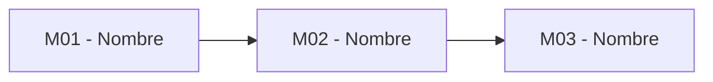
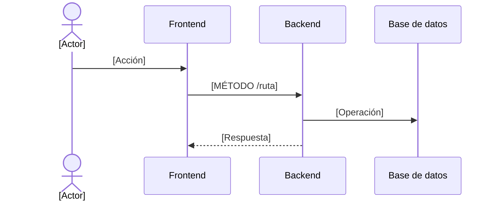

# Plantillas de Entregables Markdown

> Regla común a las cuatro plantillas: toda afirmación debe citar su evidencia (`ruta/archivo:línea`, endpoint o componente). Si no hay evidencia, escribir `Sin evidencia en código` en lugar de inferir.

## Plantilla para `00-CORAZON-DEL-PROYECTO.md`

````markdown
# Corazón del Proyecto: [Nombre del Sistema]

**Fecha de auditoría:** [YYYY-MM-DD] · **Commit auditado:** `[hash corto]` · **Rama:** `[rama]`

## 1. Propósito del Sistema
[Qué problema de negocio resuelve, para quién y con qué alcance, según la evidencia del código.]

## 2. Stack Tecnológico Detectado
| Capa | Tecnología / Versión | Evidencia |
|---|---|---|
| Frontend | [Framework x.y] | `frontend/package.json` |
| Backend | [Runtime / Framework x.y] | `backend/package.json` |
| Base de datos | [Motor x.y] | `docker-compose.yml` / migraciones |
| Infraestructura | [Contenedores, hosting, CI] | `[archivo]` |

## 3. Mapa de Módulos
| ID | Módulo | Tipo | Submódulos | Nº RF | Estado global |
|---|---|---|---|---|---|
| M01 | [Nombre] | Core / Soporte / Satélite | SM01.1, SM01.2 | [n] | Implementado / Parcial |



## 4. Flujo Principal de Negocio (Core Domain)
1. [Paso 1 — módulo y endpoint/pantalla que lo ejecuta]
2. [Paso 2]
3. [Paso N]



## 5. Entidades Centrales
| Entidad / Tabla | Propósito | Relaciones clave | Evidencia |
|---|---|---|---|
| [tabla] | [Descripción] | [FK → tabla] | `[migración:línea]` |

## 6. Actores y Roles
| Rol | Permisos / Módulos accesibles | Evidencia (guardia / middleware) |
|---|---|---|
| [Rol] | [Módulos] | `[archivo]` |

## 7. Módulos Indispensables vs. Satélites
- **Indispensables:** [Módulos sin los cuales el flujo core no funciona y por qué.]
- **Satélites:** [Módulos complementarios.]
````

## Plantilla para `01-CATALOGO-RF-CU.md`

```markdown
# Catálogo de Requerimientos Funcionales y Casos de Uso

## Módulo M01: [Nombre del Módulo]
**Descripción:** [Propósito del módulo dentro del sistema]

### Submódulo SM01.1: [Nombre del Submódulo]

#### Requerimientos Funcionales
| ID | Nombre | Descripción / Regla de Negocio | Estado | Evidencia (Back / Front) |
|---|---|---|---|---|
| RF-001 | [Título] | [Descripción detallada] | Implementado / Indicio | `views.py` / `comp.ts` |

#### Casos de Uso
- **CU-001: [Nombre del Caso de Uso]** (Asociado a `RF-001`)
  - **Actor:** [Rol]
  - **Precondición:** [Estado previo]
  - **Flujo Principal:**
    1. [Paso 1]
    2. [Paso 2]
  - **Flujos Alternativos / Errores:** [Validaciones detectadas en código]
  - **Postcondición:** [Resultado en base de datos / UI]
```

## Plantilla para `02-INDICIOS-Y-FUNCIONALIDADES-OCULTAS.md`

```markdown
# Indicios de Funcionalidades y Desarrollo Incompleto

| ID Indicio | Capa | Ubicación en Código | Qué se encontró | Funcionalidad Inferida | Acción Sugerida |
|---|---|---|---|---|---|
| IND-001 | Backend | `models.py` (línea X) | Campo/tabla sin endpoint | [Funcionalidad] | [Completar API / Limpiar] |
```

## Plantilla para `03-LIMITACIONES-Y-DEUDA-TECNICA.md`

```markdown
# Limitaciones y Deuda Técnica

**Escala de severidad:** Crítica (bloquea el flujo core o expone datos) · Alta (afecta a un módulo completo) · Media (degrada calidad o mantenibilidad) · Baja (cosmética o de higiene).

## 1. Brechas Frontend ↔ Backend
| ID | Tipo de brecha | Frontend | Backend | Impacto | Severidad |
|---|---|---|---|---|---|
| BRE-001 | Endpoint sin consumidor / Pantalla sin API / Contrato distinto | `[componente]` | `[MÉTODO /ruta]` | [Efecto] | Alta |

## 2. Limitaciones Funcionales
| ID | Limitación | Módulo / RF afectado | Evidencia | Severidad |
|---|---|---|---|---|
| LIM-001 | [Qué no puede hacer hoy el sistema] | M01 / RF-001 | `[archivo:línea]` | Media |

## 3. Deuda Técnica
| ID | Categoría | Descripción | Evidencia | Severidad | Recomendación |
|---|---|---|---|---|---|
| DT-001 | Validación / Pruebas / Acoplamiento / Duplicación / Configuración | [Detalle] | `[archivo:línea]` | Media | [Acción concreta] |

## 4. Riesgos de Seguridad
| ID | Riesgo | Evidencia | Severidad | Mitigación sugerida |
|---|---|---|---|---|
| SEG-001 | [Ej. endpoint sin autenticación, secreto en código, falta de control de rol] | `[archivo:línea]` | Crítica | [Acción] |

## 5. Riesgos de Rendimiento y Escalabilidad
| ID | Cuello de botella | Evidencia | Severidad | Mitigación sugerida |
|---|---|---|---|---|
| REN-001 | [Ej. consulta N+1, ausencia de índices, carga sin paginar] | `[archivo:línea]` | Alta | [Acción] |

## 6. Cobertura de Pruebas
| Capa | Pruebas encontradas | Comando | Resultado observado |
|---|---|---|---|
| Backend | [n archivos / ninguna] | `[npm test]` | [Resultado real o "No ejecutado"] |
| Frontend | [n archivos / ninguna] | `[npm test]` | [Resultado real o "No ejecutado"] |

## 7. Priorización Recomendada
1. [ID] — [Motivo: impacto en flujo core / seguridad]
2. [ID] — [Motivo]
```
