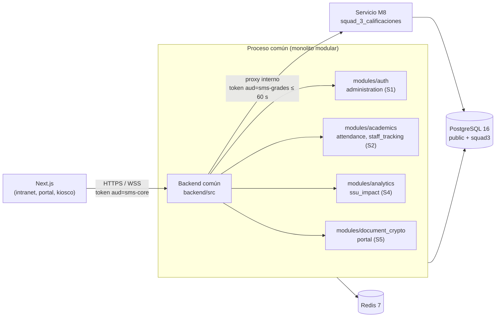

# ADR-001: Topología del backend — monolito modular con M8 detrás de un gateway

- **Estado:** Aceptado por el líder del proyecto el 2026-10-30 para el cierre de S1/S2; implementación del gateway pendiente.
- **Fecha:** 2026-10-22
- **Decisores:** Líder de proyecto (Squad 2), Squad 1 (Brandon Montero), Squad 3 (Steve Ovalle)
- **Squads afectados:** S1, S2, S3, S4, S5
- **Formaliza:** decisión D-05 de [`F0_DECISIONES_ARQUITECTURA_PENDIENTES.md`](../../../../docs/F0_DECISIONES_ARQUITECTURA_PENDIENTES.md) y §4.1 de [`F0_PLAN_MIGRACION_TYPESCRIPT.md`](../../../../docs/F0_PLAN_MIGRACION_TYPESCRIPT.md)
- **Requisitos relacionados:** RNF-10, RNF-12, RNF-16; RF-36 a RF-46 y RF-79 a RF-82 (M8)

## Contexto

El repositorio conserva dos procesos backend. La tabla resume su estado al 2026-10-30; todavía no existe el gateway que permite integrarlos:

| Aspecto | Backend común (`backend/src/`) | Servicio M8 (`backend/squad_3_calificaciones/`) |
|---|---|---|
| Servidor HTTP | Express 4 (`server.ts`) | `node:http` nativo (`app.ts`) |
| Sistema de módulos | CommonJS (`backend/tsconfig.json`) | ESM `NodeNext` |
| JWT | `jsonwebtoken`, claim `tenantId` y `iss=sms-core`, `aud=sms-web`/`sms-refresh` | `jose`, claims `tenant_id` y `role`, exige `iss`, `aud` y `maxTokenAge 30m` |
| Tiempo real | `ws` en `/api/v1/notifications/ws`; gateway M8 pendiente | `ws` en `/api/v1/grades/live` |
| Datos | Esquema consolidado `public` | Esquema `squad3` con agregado JSONB y RLS |
| Pruebas | `node:test` sobre `dist/`: 9 pruebas locales de cifrado, importación y errores HTTP; falta integración con PostgreSQL/Redis reales | 4 archivos de prueba (dominio, HTTP, PostgreSQL, proveedores) |

Un token emitido por el backend común es **rechazado** por M8 (claims y `aud` distintos).

`arquitectura_sistema.md` §4 describe un único `src/` con `modules/` por subdominio. El plan de la Fase 3 necesita fijar cómo se llega ahí sin romper M8, que es la parte más madura del sistema.

## Opciones consideradas

1. **Microservicios por squad.** Cada squad despliega su propio servicio.
   - A favor: independencia de despliegue.
   - En contra: 5 despliegues, 5 configuraciones de JWT y CORS, y transacciones distribuidas entre matrícula, notas y documentos (RNF-12). Es desproporcionado para un equipo de 5 personas y un único plantel.
2. **Monolito modular inmediato.** Reescribir o montar M8 dentro de Express ya.
   - A favor: un solo proceso desde el inicio.
   - En contra: exige unificar ESM/CommonJS y adaptar el servidor nativo de M8 a un router. Pone en riesgo un dominio probado (D-05 rechaza la reescritura).
3. **Monolito modular como destino, con M8 detrás de un gateway durante la transición.**
   - A favor: los Squads 1, 2, 4 y 5 construyen en `backend/src/modules/*` desde el día 1; M8 no cambia.
   - En contra: dos procesos temporalmente y un salto de red interno para `/grades`.

## Decisión

Se adopta la **opción 3**.

1. **Destino:** un único proceso Node.js/TypeScript en `backend/src/`, organizado por módulos de dominio como indica `arquitectura_sistema.md` §4 (`modules/auth`, `academics`, `attendance`, `grades`, `analytics`, `document_crypto`, `portal`, etc.). Cada módulo expone rutas, servicios y repositorios propios. **Ningún módulo lee las tablas de otro directamente**: consume los servicios internos definidos en el kernel compartido (`AccessControlService`, `EnrollmentQueryService`, `GradingScaleService`, `AuditService`).
2. **Transición (Fase 4):** M8 sigue siendo un proceso independiente. El backend común actúa como **gateway** de `/api/v1/grades/*` y del WebSocket `/api/v1/grades/live`. El gateway:
   - valida la sesión core;
   - acuña un token interno de audiencia `sms-grades`, de 60 s o menos, con el rol M8 mapeado desde el rol activo (C1.3 de [`F0_CIERRE_OBSERVACIONES.md`](../../../../docs/F0_CIERRE_OBSERVACIONES.md));
   - reenvía la solicitud.

   El cliente nunca recibe ese token. M8 no es accesible desde fuera de la red interna.
3. **Paso posterior (opcional):** montar `createGradesApp()` como módulo dentro del proceso común. Se hace solo cuando se cumplan los criterios de la sección "Criterios para pasar a módulo".
4. **Se descarta** la reescritura de M8 en Express.

## Criterios para pasar a módulo

Los criterios para integrar M8 en el proceso común (opción 3, paso 3) son:

- El backend común migró a ESM o existe un adaptador probado entre ambos sistemas de módulos.
- Las 4 suites de prueba de M8 pasan sin cambios dentro del proceso común.
- Las pruebas de seguridad SEC-01 a SEC-14 de `F0_CIERRE_OBSERVACIONES.md` §C1.5 pasan a través del gateway.
- La latencia P95 de `PATCH /api/v1/grades/batch` a través del gateway mide menos de 1,5 s (RNF-01). Si el salto de red no afecta ese umbral, no hay urgencia en integrar.

## Consecuencias

- **Backend común:** se reorganiza gradualmente de `controllers/`, `routes/` y `services/` planos hacia `core/` + `modules/`. Ya hay rutas de auth, usuarios, escuela, apoderados, notificaciones y auditoría; la reorganización exige preservar esos consumidores. El gateway a M8 sigue pendiente.
- **M8:** sin cambios de código. Se configuran `JWT_ISSUER`, `JWT_AUDIENCE=sms-grades` y un secreto propio, distinto del core.
- **Despliegue:** dos contenedores (común y M8) en la misma red privada, detrás de Nginx. Solo el común se publica. Coherente con ADR-012 (despliegue).
- **Tiempo real:** el gateway WebSocket del común (ADR-007) reenvía el canal de M8. Los clientes se conectan a un solo origen.
- **SDD:** `sdd_squad_1.md` documenta el gateway y los servicios internos. `sdd_squad_3.md` documenta que M8 se expone solo a través del gateway. Los SDD de S2, S4 y S5 ubican su código en `backend/src/modules/*`.
- **Plan de la Fase 3:** la fila ADR-001 de [`plan_fase_3_diseno.md`](../plan_fase_3_diseno.md) queda precisada por este ADR. La reubicación de M8 en `modules/grades/` es condicional, no automática en la Fase 4.

## Preguntas abiertas para la revisión

1. ¿El esqueleto andante (Etapa 3.5, paso 4) ya pasa por el gateway, o llama a M8 directamente solo en desarrollo?
2. ¿El backend común se migra a ESM en la Fase 4 (lo que facilita el paso 3) o se mantiene CommonJS?
