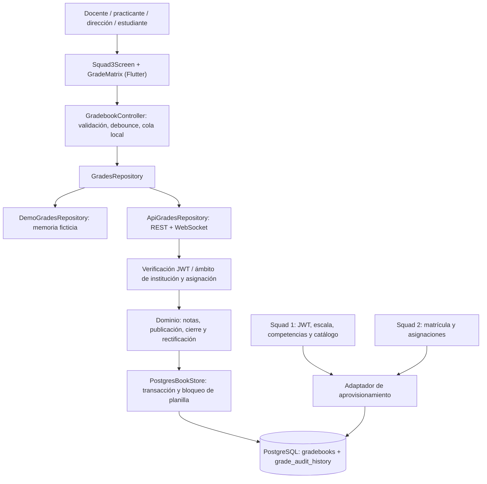
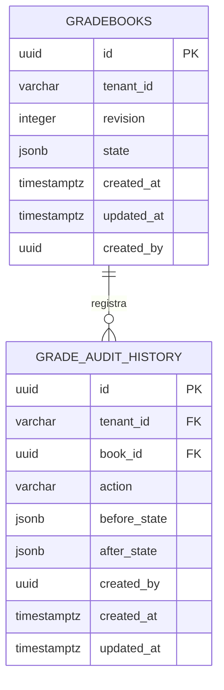

# Documento de Diseño de Software (SDD) — Squad 3

Planteles de Aplicación «Guamán Poma de Ayala» — UNSCH. Servicio Social IS-480, 2026-II.
Estructura basada en IEEE 1016-2009 / ISO/IEC/IEEE 42010 y en la plantilla canónica del repositorio.

## Metadatos del documento

| Campo | Valor |
|---|---|
| Responsable | Steve Smith Ovalle Luyo (`@steveovalle27-lgtm`) |
| Squad / módulo | Squad 3 — Calificaciones y Modo Excel / M8 |
| Rama | `feature/squad-3-calificaciones-m8` |
| Requisitos / casos de uso | RF-36–RF-46 / CU-NOT-01–CU-NOT-11 |
| Versión / fecha | 1.0.0 / 16 de octubre de 2026 |
| Estado | En revisión; integración con servicios de Squads 1 y 2 pendiente de disponibilidad |

## 1. Introducción y alcance del módulo

### 1.1 Propósito

Definir la implementación de la evaluación docente, la planilla por teclado, el autoguardado, las conclusiones descriptivas, la supervisión de practicantes, la publicación estudiantil, los promedios y las rectificaciones posteriores al cierre. Los [RF del Squad 3](../../Requisitos%20Funcionales/Squad%203%20-%20Calificaciones%20y%20Modo%20Excel/README.md) y los [casos de uso](../../Casos%20de%20uso/Squad%203%20-%20Calificaciones%20y%20Modo%20Excel/README.md) son las fuentes funcionales.

### 1.2 Alcance funcional

Docente titular: define evaluaciones, competencias y criterios; registra notas; revisa borradores; redacta conclusiones y publica. Practicante asignado: registra borradores, sin capacidad de publicación. Coordinación o dirección: cierre del periodo. Dirección: decisión sobre rectificaciones. Estudiante: consulta exclusivamente sus notas publicadas. El portal de padres permanece fuera del piloto según el documento de límites, pese a su mención en RF-44.

### 1.3 Supuestos y restricciones

- Flutter/Dart Material 3, Node.js/TypeScript, PostgreSQL y JWT. Los patrones Table, Dialog y estados visuales de PrimeNG se adaptan a Flutter; no se incorpora Angular.
- No existían un backend ejecutable, autenticación real ni proveedores de matrícula en este checkout. Se implementa un servicio autónomo del Squad 3 con puntos de integración explícitos, sin fingir que los otros squads ya están conectados.
- La pantalla predeterminada es una demostración con datos ficticios y almacenamiento volátil identificado. Producción exige inyectar sesión autenticada y repositorio REST.
- El contrato canónico de escritura es `PATCH /api/v1/grades/batch`. Los nombres anteriores `batch-save`, `auto-save` y `batch-upsert` se aceptan como alias con **el nuevo cuerpo uniforme**; no se reinterpretan silenciosamente los payloads históricos incompatibles.
- La especificación técnica define cortes continuos 17,50 / 13,50 / 10,50 y representantes AD=19, A=15, B=12, C=8. CU-NOT-11 muestra intervalos enteros 18–20 / 14–17 / 11–13 / 0–10, compatibles al redondear el promedio final. El proveedor curricular debe suministrar la escala efectiva; no se presentan los cortes como norma universal de MINEDU.
- CU-NOT-02 menciona un decimal, mientras el contrato SQL usa NUMERIC(4,2). Esta versión admite dos decimales de manera consistente en cliente y servidor; requiere ratificación académica en revisión.

## 2. Vista arquitectural del módulo (C4)

### 2.1 Contenedores y componentes



### 2.2 Responsabilidades

| Componente | Responsabilidad |
|---|---|
| `GradeMatrix` / `GradeCell` | Filas virtualizadas, desplazamiento, foco y edición por teclado |
| `GradebookController` | Lote pendiente, validación, temporizador, reintentos limitados y conflictos |
| `GradingScaleService` | Conversión local de vista previa usando escala de la planilla |
| `ApiGradesRepository` | HTTP autenticado, timeout, notificaciones WebSocket y reconexión |
| `domain.ts` | Reglas autoritativas de acceso, notas, promedios y estados |
| `PostgresBookStore` | Serialización por planilla, versión optimista, persistencia y auditoría atómicas |
| `provision.ts` | Importación validada desde proveedores de los Squads 1 y 2 |

### 2.3 Secuencia crítica de autoguardado

```mermaid
sequenceDiagram
    participant D as Docente
    participant C as GradebookController
    participant A as API
    participant P as PostgreSQL
    D->>C: Digita o pega TSV
    C->>C: Valida; espera 400 ms desde la última edición
    C->>A: PATCH batch (bookId, revision, items)
    A->>A: JWT, institución y asignación docente
    A->>P: BEGIN; SELECT FOR UPDATE
    A->>A: Revalida versión, plazo y lote completo
    A->>P: UPDATE planilla + INSERT historial; COMMIT
    P-->>A: Transacción confirmada
    A-->>C: 200, nueva revisión y estado autoritativo
    C->>C: Retira solo las ediciones confirmadas
    A-->>C: GRADE_UPDATED a suscriptores autorizados
    Note over C: Una edición nueva durante la petición se conserva para otro lote
```

### 2.4 Secuencia de rectificación

```mermaid
sequenceDiagram
    participant T as Docente titular
    participant A as API
    participant D as Dirección
    participant P as PostgreSQL
    T->>A: Solicita rectificación, motivo y referencia probatoria
    A->>P: Guarda solicitud pendiente y nota original
    D->>A: Decide con sesión JWT y confirmación electrónica
    A->>A: Comprueba rol, separación de funciones y nota original
    alt Aprobada
      A->>P: Actualiza nota y publicación existente; registra historial
    else Rechazada
      A->>P: Conserva nota; registra motivo del rechazo
    end
    Note over P: El periodo permanece cerrado en ambos casos
```

## 3. Diseño detallado de persistencia (PostgreSQL)

### 3.1 Modelo entidad-relación



### 3.2 Diccionario y DDL

DDL ejecutable: [`backend/squad_3_calificaciones/migrations/001_grades.sql`](../../../../backend/squad_3_calificaciones/migrations/001_grades.sql). `esquema_datos.sql` remite a esa migración para evitar dos definiciones divergentes.

**Decisión de diseño:** una planilla por institución/sección/curso/periodo constituye el agregado transaccional. `state` conserva evaluaciones, matrícula importada, notas duales, conclusiones, publicación y solicitudes. La matrícula es una instantánea referenciada por su ID externo; no se crean usuarios ni matrículas ficticias en las tablas de otros squads. La aplicación normaliza esos datos a entidades en TypeScript. Este diseño permite desarrollar M8 sin acoplarse a tablas transversales aún inexistentes. No equivale al antiguo borrador SQL normalizado del directorio.

`gradebooks`: UUID, `tenant_id VARCHAR(50)`, revisión positiva, estado JSONB, autor y fechas. Restricciones verifican que ID, institución y revisión del JSON correspondan a sus columnas. Índice B-tree por institución. `grade_audit_history`: UUID, institución y planilla mediante FK compuesta `ON DELETE RESTRICT`, actor, operación y estados anterior/posterior. Triggers impiden UPDATE, DELETE y TRUNCATE del historial. Políticas RLS usan `app.tenant_id`; las consultas además filtran la institución del JWT.

Las notas tienen `{numeric, literal, status, authorId}`. Los borradores pueden conservar `previous` para permitir rechazo sin destruir la nota anterior. Los valores publicados se guardan como una instantánea separada. Un fallo de validación, revisión o auditoría revierte toda la transacción. El rol de aplicación en producción debe ser diferente al propietario de las tablas y carecer de permisos DDL, para que no pueda desactivar las protecciones.

## 4. Contratos de comunicación (REST y WebSockets)

Ver [contratos_api.md](contratos_api.md) para cuerpos, códigos y configuración completos. Todas las rutas funcionales exigen `Authorization: Bearer <JWT>` con firma HS256 verificada, emisor, audiencia, expiración, `sub`, `iat`, `tenant_id` y rol. El tenant nunca se toma del cuerpo enviado por el cliente.

| Método y ruta | Operación |
|---|---|
| GET `/api/v1/grades/matrix?bookId=UUID` | Carga planilla filtrada por actor |
| PATCH `/api/v1/grades/batch` | Escritura atómica de hasta 2000 celdas |
| POST `/api/v1/grades/actions` | `evaluation`, `approve`, `reject`, `publish`, `conclusion`, `close`, `rectification`, `decide` |
| GET `/api/v1/grades/annual?bookId=UUID` | Consolidado de los periodos configurados del año |
| WS `/api/v1/grades/live` | Autenticación en primer mensaje; evento `GRADE_UPDATED` sin datos personales |

La respuesta REST es `{success:true,data:{...},timestamp:"ISO-8601"}`. Los errores usan `{success:false,error:{code,message},timestamp:"ISO-8601"}` y HTTP 400, 401, 403, 404, 409, 413, 422 o 500. No se exponen detalles SQL. `/health` es una comprobación de proceso, no una prueba de conexión a BD.

## 5. Diseño de interfaz de usuario en Flutter

### 5.1 Estructura Feature-First

```text
lib/features/squad_3_calificaciones/
  domain/models/gradebook.dart
  data/repositories/grades_repository.dart
  data/repositories/demo_grades_repository.dart
  data/repositories/api_grades_repository.dart
  presentation/controllers/gradebook_controller.dart
  presentation/screens/squad_3_screen.dart
  presentation/widgets/grade_matrix.dart
  squad_3_grades.dart
```

### 5.2 Ergonomía y estados

Tabla desplazable horizontalmente, encabezado fijo y `ListView.builder` con extensión de fila fija. Solo se construyen las filas cercanas al viewport. Flechas mueven entre celdas, Enter baja, Tab/Shift+Tab recorren la matriz, Esc restaura el valor al entrar en edición, Ctrl/Cmd+V admite TSV y CRLF. Se valida todo el bloque antes de aplicar cambios y se rechaza el desbordamiento. El pegado masivo se deshabilita con filtro de búsqueda para evitar reasignar notas a filas ocultas.

Cada entrada inválida tiene mensaje local y detiene el lote. No se transforma una celda vacía o inválida en cero. La UI distingue pendiente, guardando, guardado confirmado, error y conflicto. Una respuesta antigua no borra una edición posterior. Los conflictos requieren recarga explícita con confirmación del descarte; no se reenvían ciegamente. Ante fallos no conflictivos hay hasta tres reintentos con esperas de 1, 2 y 4 segundos, más reintento manual.

Se muestran los pesos y rúbricas en las cabeceras, promedios calculados, asistente editable de conclusiones y bandeja de rectificaciones. Los controles se restringen por rol, estado y cambios pendientes. Las sugerencias de la demostración son ejemplos pedagógicos, no un banco MINEDU certificado. Colores tomados exclusivamente de `AppTheme`.

## 6. Seguridad, resiliencia y atributos de calidad

- **RBAC y privacidad:** titular o practicante deben estar asignados a la planilla; dirección/coordinación se limitan a su institución. El estudiante solo recibe su matrícula, sus notas publicadas y sus conclusiones publicadas. El backend realiza estas verificaciones independientemente de la UI.
- **Publicación:** un borrador no se publica. El docente lo aprueba o rechaza con observaciones. Una nota publicada permanece estable hasta una publicación posterior o rectificación autorizada.
- **Cierre:** se verifica la fecha límite en cada escritura, aunque no se haya ejecutado un trabajo programado. El cierre explícito requiere notas completas y aprobadas. Conclusiones B/C son obligatorias y limitadas a 500 caracteres.
- **Promedios:** secundaria usa pesos de evaluación y redondeo half-up únicamente al consolidar el bimestre. Primaria utiliza nivel predominante y, en empate, el último logro evaluado; esta política debe ratificarse por coordinación. El anual aplica `annualMode` y `periodWeight` de configuración y permanece incompleto hasta que existan y estén cerrados todos los `expectedPeriods`.
- **Concurrencia:** bloqueo SQL de la planilla y versión optimista a nivel de agregado, no por celda. Dos clientes no pueden sobrescribirse silenciosamente. La contrapartida es que cambios de celdas distintas también pueden generar conflicto.
- **Evidencia y confirmación electrónica:** la solicitud conserva referencia al documento institucional y el director confirma con texto identificatorio asociado a su JWT y fecha. No se implementa firma digital PKI ni almacenamiento de archivos; la referencia debe corresponder a un expediente custodiado por la institución.
- **Sincronización:** WebSocket autenticado avisa cambios; REST devuelve la vista autorizada. Refresco de respaldo cada 10 segundos si no hay cambios locales. La instancia actual difunde eventos en un solo proceso; un despliegue con varias réplicas requiere conectar el bus Redis institucional. No se declara esa integración como realizada.
- **Resiliencia:** las ediciones fallidas se conservan mientras vive el controlador. No hay cola duradera offline en este módulo ni garantía frente al cierre de la pestaña; el modo demo lo informa. El kiosco offline de Squad 2 no forma parte de M8.
- **Rendimiento:** virtualización comprobable con 5000 estudiantes; objetivo de cuadro inferior a 16,67 ms a validar en modo profile. Las pruebas de widgets no demuestran 60 FPS. Se incluye procedimiento de medición y no se inventan resultados de hardware.
- **Persistencia:** almacenar estados completos simplifica la integración inicial y la auditoría, pero aumenta tamaño de respuesta e historial para planillas grandes. La granularidad del agregado debe reevaluarse con las mediciones de producción.

## 7. Matriz de trazabilidad bidireccional

Los endpoints que escriben modifican `squad3.gradebooks` y registran `squad3.grade_audit_history` en la misma transacción.

| RF | CU | Tablas / datos del agregado | Endpoint / acción | UI / componente | Verificación |
|---|---|---|---|---|---|
| RF-36 | CU-NOT-01 | `gradebooks.evaluations`, competencias importadas | POST actions: evaluation | Formulario de evaluación / rúbrica | Competencia oficial y peso válido |
| RF-37 | CU-NOT-02 | `grades`, `publishedGrades` | PATCH batch; POST actions: publish | GradeMatrix / Publicar | Lote atómico y snapshot publicado |
| RF-38 | CU-NOT-03 | `grades` | PATCH batch | GradeCell / GradeMatrix | Foco, TSV y virtualización |
| RF-39 | CU-NOT-04 | `conclusionBank`, `conclusions` | GET matrix; POST actions: conclusion | Asistente editable | Longitud y obligatoriedad B/C |
| RF-40 | CU-NOT-05 | Notas draft/approved, `draftFeedback` | POST actions: approve/reject | Insignia borrador / revisión | Sin publicación de borradores |
| RF-41 | CU-NOT-06 | Evaluaciones y notas de los periodos | GET matrix / annual | Columnas calculadas / consolidado | Pesos, redondeo, primaria y anual |
| RF-42 | CU-NOT-07 | `closed`, `deadline` | POST actions: close | Cerrar periodo | Bloqueo por rol y plazo |
| RF-43 | CU-NOT-08 | `requests`, historial inmutable | POST actions: rectification/decide | Solicitud y bandeja directiva | Sustento, decisión, nota original e historial |
| RF-44 | CU-NOT-09 | Instantánea publicada del estudiante | GET matrix / annual | Planilla de solo lectura | Sin acceso a compañeros ni borradores |
| RF-45 | CU-NOT-10 | `revision`, `grades` | PATCH batch | GradebookController / estados | 400 ms, reintentos, edición en vuelo |
| RF-46 | CU-NOT-11 | `scale`, notas numeric/literal | PATCH batch | GradingScaleService / insignias | Límites de escala y entradas literales |

Pruebas: `test/squad_3/` y `backend/squad_3_calificaciones/test/`. La validación y las instrucciones de integración se documentan en [validacion_integracion.md](validacion_integracion.md).
