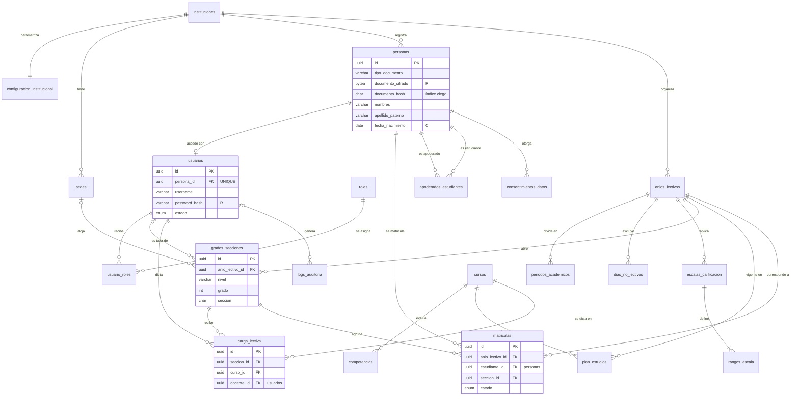

# Modelo de Datos Canónico — Núcleo Compartido

### Sistema de Gestión Escolar — Planteles de Aplicación "Guamán Poma de Ayala" (UNSCH)
**Etapa 3.1 de [`plan_fase_3_diseno.md`](plan_fase_3_diseno.md)**

| Campo | Valor |
|---|---|
| Versión | 0.1 (borrador para revisión de los 5 squads) |
| Fecha | 2026-10-22 |
| Dueño | Squad 1 (Brandon Montero), con el Squad 2 para las tablas académicas |
| Revisores | Squads 3, 4 y 5 |
| Depende de | [ADR-002](ADR/ADR-002-tipo-tenant-id.md) (tenant), [ADR-003](ADR/ADR-003-aislamiento-rls.md) (RLS), [ADR-004](ADR/ADR-004-migraciones.md) (migraciones) |
| Fuente actual | `database/init/01_esquema_consolidado.sql` (815 líneas) y los 5 `esquema_datos.sql` |

> **Qué es este documento:** la especificación del **núcleo** de la base de datos, es decir, las tablas maestras que consumen los 5 squads. Las tablas propias de cada dominio (notas, documentos, analítica, etc.) se diseñan en el SDD de su squad, **siguiendo las convenciones de §3**.
>
> **Qué no es:** todavía no es una migración ejecutable. El DDL de §5 es la especificación; las migraciones se escriben con la herramienta que fije ADR-004, una vez aceptado.

---

## 1. Inventario de la situación actual

Comparé automáticamente las 6 fuentes de esquema (el consolidado y los 5 `esquema_datos.sql`).

### 1.1 Resumen

| Indicador | Valor | Regla incumplida |
|---|---:|---|
| Tablas distintas en las 6 fuentes | 44 | — |
| Tablas que existen solo en un archivo de squad | 2 (`asistencias_docentes_contratados`, `cuadros_merito`) | El consolidado debe ser completo |
| Vistas materializadas fuera del consolidado | 1 (`vm_asistencia_mensual`, solo en Squad 4) | Ídem |
| Tablas **transaccionales** sin `tenant_id` | 17 de 41 | `sdd_rules.md` §2.1 |
| Tablas con `created_by` | **0** de 44 | `sdd_rules.md` §2.3 |
| Tablas con `updated_at` | 8 de 44 | `sdd_rules.md` §2.3 |
| Tablas sin `created_at` | 24 de 44 | `sdd_rules.md` §2.3 |
| `created_at` declarado `NOT NULL` | 0 (todas las columnas aceptan nulos) | `sdd_rules.md` §2.3 |
| Usos de `uuid_generate_v4()` en lugar de `gen_random_uuid()` | 34 | `sdd_rules.md` §2.2 |
| Columnas `curso_id` sin tabla de cursos | 5 tablas | Integridad referencial |

Las 3 tablas sin `tenant_id` que no cuentan como transaccionales son `instituciones` (es el tenant), `roles` y `banco_conclusiones_cneb` (catálogos globales).

**Tablas transaccionales sin `tenant_id`:** `periodos_academicos`, `usuario_roles`, `preferencias_notificacion`, `envios_correo`, `carnes_escolares`, `asistencias_alumnos`, `asistencias_practicantes`, `asistencias_docentes_contratados`, `avisos_inasistencia`, `evaluaciones`, `calificaciones`, `conclusiones_descriptivas`, `cuadros_merito`, `noticias_galeria`, `expedientes_movimientos`, `expedientes_adjuntos`, `metricas_impacto_ssu`.

Sin `tenant_id`, el aislamiento de esas tablas depende de un JOIN con la tabla padre. Con RLS (ADR-003) eso no basta: cada tabla necesita su propia columna para tener política propia.

### 1.2 Divergencias entre archivos

| Archivo | Tabla | Divergencia con el consolidado |
|---|---|---|
| Squad 1 | `instituciones` | Le faltan `escudo_url` y `membrete_texto` |
| Squad 1 | `usuarios` | Le falta `foto_url` |
| Squad 1 | `logs_auditoria` | Le faltan `hash_previo` y `hash_registro` (la cadena de integridad, RF-65) |
| Squad 2 | `asistencias_practicantes` | Nombres distintos: `hora_entrada` / `hora_ingreso`, `tutor_guia_id` / `tutor_docente_id`, `validado_tutor` / `validado_por_tutor`. Además, su índice `idx_practicantes_pendientes` usa `tutor_docente_id`, que **no existe** en su propia tabla: el archivo del Squad 2 falla al ejecutarse |
| Squad 2 | `asistencias_docentes_contratados` | No existe en el consolidado (RF-32 a RF-35 sin tabla en la fuente oficial) |
| Squad 4 | `vm_asistencia_mensual` | No existe en el consolidado y **no tiene `tenant_id`**: mezclaría la asistencia de todos los tenants |
| Squad 5 | `cuadros_merito` | No existe en el consolidado y no tiene `tenant_id` |

### 1.3 Huecos funcionales del núcleo

Hay RF de configuración y de gestión académica cuyo dato maestro **no tiene tabla**. Son justamente lo que los demás squads consumen:

| RF | Necesita | Situación actual | Consumidores |
|---|---|---|---|
| RF-07 | Sedes del plantel | No existe | S2, S5 |
| RF-10 | Calendario escolar (días no lectivos) | Solo `anios_lectivos` con fechas de inicio y fin | S2 (asistencia), S3 (plazos), S4 (ausentismo) |
| RF-13 | Escalas de calificación (Dual CNEB) | No existe. M8 la recibe por API de un "proveedor curricular" que nadie implementa (`provision.ts`) | S3, S4, S5 |
| RF-14 | Parámetros institucionales | Solo `membrete_texto` y `escudo_url` en `instituciones` | Todos |
| RF-15 | Padrón de estudiantes (filiación) | `usuarios` no tiene fecha de nacimiento, sexo ni apellidos separados (SIAGIE los exige, RF-88) | S2, S5 |
| RF-17 | Catálogo curricular CNEB | No existe. `curso_id UUID` aparece en 5 tablas sin FK | S3, S4, S5 |
| RF-18 | Carga lectiva docente | No existe. M8 la recibe por API de un "proveedor de matrículas" | S2, S3, S4 |

---

## 2. Decisiones de modelado

Cada decisión indica la recomendación y si necesita confirmación del consejo de diseño.

### DM-01 — Separar `personas` de `usuarios` *(aprobada por el líder de proyecto, 2026-10-22)*

**Problema:** hoy `usuarios` mezcla dos cosas: la **persona** (identidad, DNI, nombres) y la **cuenta** (usuario, clave, estado de acceso). Consecuencias:
- Todo estudiante de Inicial o Primaria necesita `password_hash NOT NULL` aunque nunca inicie sesión.
- Un apoderado no puede registrarse como persona hasta que active su cuenta, pero RF-75 necesita vincularlo antes, para enviarle la invitación.
- Los datos sensibles de menores (RNF-08) quedan en la misma tabla que consulta el login.

**Decisión recomendada:**
- `personas`: identidad y filiación de todos (estudiantes, apoderados, personal).
- `usuarios`: solo cuentas de acceso, con `persona_id` 1:1 opcional desde la persona.
- Las columnas que identifican a un **estudiante** (`estudiante_id`) apuntan a `personas`. Las que identifican a un **actor del sistema** (`docente_id`, `emitido_por`, `created_by`) apuntan a `usuarios`.

**Por qué ahora:** el único código que lee `usuarios` es `auth.service.ts` (login). Ninguna tabla de dominio tiene datos reales. Hacerlo después de la Fase 4 obligaría a migrar datos de 5 squads.

### DM-02 — Documento de identidad cifrado con índice ciego

**Problema:** RNF-08 exige AES-256 para el DNI de menores, pero el consolidado tiene `dni CHAR(8)` en texto plano con `UNIQUE (tenant_id, dni)` y un índice de búsqueda. Una columna cifrada no se puede indexar ni comparar.

**Decisión:** tres columnas por documento:

| Columna | Contenido | Uso |
|---|---|---|
| `documento_cifrado BYTEA` | AES-256-GCM, clave fuera de la BD (ADR-009) | Mostrar el número completo solo a quien tenga permiso |
| `documento_hash CHAR(64)` | HMAC-SHA256 del número normalizado, con una clave distinta | Unicidad y búsqueda exacta |
| `documento_ultimos4 CHAR(4)` | Últimos 4 dígitos | Mostrar enmascarado (`****5678`) |

Además, `tipo_documento` admite `DNI`, `CE`, `PASAPORTE`, `PTP` y `SIN_DOCUMENTO`: hay estudiantes extranjeros y menores que todavía no tienen DNI.

**Fuera del núcleo:** `expedientes_mesa_partes.solicitante_dni` y `solicitudes_certificado.solicitante_dni` (Squad 5) guardan DNI en texto plano. El SDD del Squad 5 debe aplicar el mismo patrón.

### DM-03 — Las secciones pertenecen a un año lectivo

**Problema:** `grados_secciones` no tiene `anio_lectivo_id`. Una sección "3.° B" de 2026 y otra de 2027 serían la misma fila, con el mismo tutor y el mismo aforo, y el historial de matrículas perdería contexto.

**Decisión:** `grados_secciones.anio_lectivo_id NOT NULL`, con unicidad `(tenant_id, anio_lectivo_id, nivel, grado, seccion)`. Se conserva el nombre de la tabla porque los documentos de los 5 squads ya lo usan.

### DM-04 — Catálogo curricular y carga lectiva como tablas del núcleo

**Decisión:** se crean `cursos`, `competencias`, `plan_estudios` y `carga_lectiva` (§5.4).
- Todas las columnas `curso_id` existentes pasan a tener FK a `cursos`.
- En el CNEB la unidad es el **área curricular** (Matemática, Comunicación…). La tabla se llama `cursos` para coincidir con el `curso_id` que ya usan los squads y M8 (`courseId`); `es_taller` distingue los talleres propios del plantel.
- Las competencias se guardan por tenant, sembradas desde el CNEB, porque el plantel puede agregar talleres.

### DM-05 — Escala de calificación versionada por año y nivel

**Decisión:** `escalas_calificacion` + `rangos_escala` (§5.3). Una escala pertenece a un año lectivo y a un nivel educativo, y una vez `VIGENTE` no se modifica: un cambio crea una escala nueva.

**Bloqueo conocido:** los **valores** de la escala (fronteras decimales de AD/A/B/C) dependen de D-16, que está bloqueada por la coordinación académica. El modelo funciona con cualquier valor; la semilla queda pendiente.

### DM-06 — `tenant_id` en todas las tablas y FK compuestas

**Decisión:**
1. Toda tabla transaccional lleva su propio `tenant_id`, incluso si lo podría deducir de su padre (corrige las 17 tablas de §1.1).
2. Toda tabla que es referenciada declara `UNIQUE (tenant_id, id)`.
3. Toda FK entre tablas con tenant es **compuesta**: `FOREIGN KEY (tenant_id, padre_id) REFERENCES padre (tenant_id, id)`.

El punto 3 hace que la base de datos **rechace** que una matrícula del tenant A apunte a una sección del tenant B, aunque la aplicación tenga un error. M8 ya usa este patrón (`squad3.grade_audit_history`).

### DM-07 — Roles: catálogo global, asignación por tenant

**Decisión:**
- `roles` sigue siendo un catálogo global sin `tenant_id` (son los mismos para todos los planteles).
- `usuario_roles` gana `tenant_id`, `asignado_por`, `activo` y fechas, para cumplir RF-73 (reasignación con historial).
- `SUPERADMIN` significa **administrador TI del plantel**, no un administrador nacional (fuera de alcance, límite O9). Se recomienda renombrar su descripción en la semilla.

**Abierto (D-06):** si `TUTOR_AULA` es un rol o una asignación. El modelo ya tiene `grados_secciones.tutor_id`; se recomienda tratarlo como asignación y dejar el valor del enum sin uso.

### DM-08 — Auditoría particionada y protegida

**Decisión:**
- `logs_auditoria` conserva su clave numérica (`BIGINT GENERATED ALWAYS AS IDENTITY`). Es la excepción a la regla UUID: la cadena de hash necesita un orden total.
- Se particiona por mes según `timestamp_utc`, por volumen (§7). En una tabla particionada la clave primaria debe incluir la columna de partición: `PRIMARY KEY (id, timestamp_utc)`.
- Se agrega un trigger que bloquea `TRUNCATE`, como ya hace M8. El trigger actual solo bloquea `UPDATE` y `DELETE`.
- La cadena de hash es **por tenant** y se serializa con `pg_advisory_xact_lock` por tenant. Sin ese bloqueo, dos inserciones concurrentes leerían el mismo `hash_previo`.
- El rol de aplicación solo tiene `INSERT` y `SELECT` sobre esta tabla.
- **Minimización:** `payload_anterior` y `payload_nuevo` nunca guardan el documento en claro ni la clave; solo `documento_ultimos4`.

### DM-09 — Calendario escolar, sedes y parámetros

**Decisión:** se crean `dias_no_lectivos` (RF-10), `sedes` (RF-07) y `configuracion_institucional` (RF-14, 1:1 con `instituciones`). Así, los umbrales que hoy aparecen como constantes en los RF (tolerancia de tardanza, ausentismo crónico) se vuelven configurables por plantel.

### DM-10 — Tipos enumerados: solo para conjuntos normativos

**Problema:** el consolidado necesita `ALTER TYPE ... ADD VALUE` en dos lugares (líneas 36, 80 y 81). En PostgreSQL ese valor nuevo no puede usarse en la misma transacción, y un valor de enum no se puede eliminar.

**Decisión:**
- Los `ENUM` existentes se conservan (cambiarlos no aporta nada).
- Los nuevos `ENUM` solo se usan para conjuntos fijados por norma, como `nivel_logro_cneb_enum`.
- Para todo lo demás se usa `VARCHAR` + `CHECK` (cambiar un `CHECK` es una migración normal) o una tabla catálogo si el plantel debe poder editarlo.

---

## 3. Convenciones obligatorias

Aplican a todas las tablas nuevas o modificadas de los 5 squads, y reemplazan a `sdd_rules.md` §2 cuando se acepte este documento.

| # | Convención | Regla |
|---|---|---|
| C-01 | Clave primaria | `id UUID PRIMARY KEY DEFAULT gen_random_uuid()`. Excepciones: catálogos globales (`roles`, `banco_conclusiones_cneb`) y tablas de solo inserción con orden total (`logs_auditoria`, `expedientes_movimientos`), que usan `BIGINT GENERATED ALWAYS AS IDENTITY` |
| C-02 | Tenant | `tenant_id UUID NOT NULL REFERENCES instituciones(id) ON DELETE RESTRICT` como segunda columna, con índice `idx_<tabla>_tenant` (ADR-002) |
| C-03 | Unicidad para FK compuestas | Toda tabla referenciada declara `CONSTRAINT uq_<tabla>_tenant_id UNIQUE (tenant_id, id)` |
| C-04 | FK entre tablas con tenant | Compuesta: `(tenant_id, <padre>_id) REFERENCES <padre>(tenant_id, id)` (DM-06) |
| C-05 | Columnas de auditoría | `created_at TIMESTAMPTZ NOT NULL DEFAULT now()`, `updated_at TIMESTAMPTZ NOT NULL DEFAULT now()`, `created_by UUID NOT NULL DEFAULT app_user_id() REFERENCES usuarios(id) DEFERRABLE INITIALLY DEFERRED`. La FK es diferible porque la persona y el usuario `sistema` de un tenant nuevo se crean en la misma transacción y se referencian entre sí |
| C-06 | Mantenimiento de `updated_at` | Trigger `BEFORE UPDATE ... EXECUTE FUNCTION fn_set_updated_at()` en toda tabla con `updated_at` |
| C-07 | Tablas inmutables | Las de solo inserción (auditoría, historiales, movimientos) no llevan `updated_at` y tienen trigger que bloquea `UPDATE`, `DELETE` y `TRUNCATE` |
| C-08 | Fechas y horas | Instantes en `TIMESTAMPTZ` (se guardan en UTC). Fechas civiles en `DATE`, calculadas en `America/Lima` por la aplicación. Nunca `TIMESTAMP` sin zona |
| C-09 | Booleanos | `NOT NULL` con `DEFAULT` explícito |
| C-10 | Baja lógica | Las tablas maestras no se borran: `activo BOOLEAN NOT NULL DEFAULT TRUE` o una columna `estado`. Las FK usan `ON DELETE RESTRICT`; `CASCADE` solo para hijos que no existen sin su padre (p. ej. `rangos_escala`) |
| C-11 | Enumerados | Según DM-10 |
| C-12 | Nombres | `snake_case` en español; tablas en plural; FK `<entidad>_id`; restricciones con prefijo `pk_`, `uq_`, `fk_`, `ck_`; índices `idx_<tabla>_<columnas>` |
| C-13 | Datos personales | Toda columna se clasifica en el diccionario (§4). Las de clase **R** (restringida) se cifran a nivel de aplicación (DM-02) |
| C-14 | Funciones de contexto | `app_tenant_id()` y `app_user_id()` leen `app.tenant_id` y `app.user_id` de la transacción (ADR-003). Devuelven `NULL` si no están definidas, así que una inserción sin contexto falla por `NOT NULL` |

**Usuario del sistema:** los procesos automáticos (semillas, monitores, importaciones) actúan con un usuario `sistema` por tenant, en estado `INACTIVO` y sin clave utilizable. Así `created_by` siempre identifica a alguien.

---

## 4. Tablas del núcleo

### 4.1 Lista

| Tabla | Estado | Dueño | RF | Consumen |
|---|---|---|---|---|
| `instituciones` | Modificada | S1 | RF-07 | Todos |
| `configuracion_institucional` | **Nueva** | S1 | RF-14 | Todos |
| `sedes` | **Nueva** | S1 | RF-07 | S2, S5 |
| `personas` | **Nueva** (DM-01) | S1 | RF-05, RF-15 | Todos |
| `usuarios` | Modificada (DM-01) | S1 | RF-01, RF-05, RF-72 | Todos |
| `roles` | Sin cambios de estructura | S1 | RF-04 | S1 |
| `usuario_roles` | Modificada | S1 | RF-04, RF-73 | S1 |
| `anios_lectivos` | Modificada | S1 | RF-10 | Todos |
| `periodos_academicos` | Modificada | S1 | RF-11 | S3, S4, S5 |
| `dias_no_lectivos` | **Nueva** | S1 | RF-10 | S2, S3, S4 |
| `escalas_calificacion`, `rangos_escala` | **Nuevas** | S1 | RF-13 | S3, S4, S5 |
| `logs_auditoria` | Modificada (DM-08) | S1 | RF-65 a RF-67 | Todos (escriben) |
| `apoderados_estudiantes` | Modificada (DM-01) | S1 | RF-75 | S2, S3, S4 |
| `consentimientos_datos` | Modificada | S1 | RF-68, RF-75 | S1 |
| `grados_secciones` | Modificada (DM-03) | S2 | RF-12 | S3, S4, S5 |
| `cursos`, `competencias`, `plan_estudios` | **Nuevas** (DM-04) | S2 | RF-17 | S3, S4, S5 |
| `carga_lectiva` | **Nueva** (DM-04) | S2 | RF-18 | S3, S4 |
| `matriculas` | Modificada | S2 | RF-16 | S3, S4, S5 |

`invitaciones_apoderado`, `notificaciones`, `preferencias_notificacion` y `envios_correo` son del Squad 1, pero no forman parte del núcleo congelado: se cierran en el SDD del Squad 1 aplicando §3.

### 4.2 Diagrama entidad-relación

Para que el diagrama sea legible no muestra `tenant_id` ni las columnas de auditoría: todas las tablas las tienen (C-02, C-05), excepto `instituciones` y `roles`.



### 4.3 Clasificación de datos personales

Base: Ley N.° 29733 y su reglamento. Toda columna de las tablas del núcleo se clasifica así en el diccionario:

| Clase | Significado | Control mínimo |
|---|---|---|
| **P** — Pública | Puede aparecer en el portal | Ninguno |
| **I** — Interna | Visible para el personal del plantel | RBAC |
| **C** — Confidencial | Dato personal (nombre de un menor, fecha de nacimiento, contacto) | RBAC + registro en auditoría al exportar |
| **R** — Restringida | Identificador o secreto (documento, hash de clave) o dato sensible (salud) | Cifrado o hash, nunca en logs ni en respuestas por defecto |

---

## 5. Especificación DDL del núcleo

El DDL usa las funciones de contexto de C-14 y omite, por brevedad, la repetición de `created_at`, `updated_at` y `created_by` (marcada como `-- auditoría C-05`) y los triggers de C-06.

> **Verificación (2026-10-22):** este DDL, con las columnas C-05 expandidas y una política RLS de muestra, se ejecutó en PGlite 0.3.16 (PostgreSQL embebido, la misma herramienta de pruebas de M8). Pasaron las 16 comprobaciones:
> - creación del tenant con su persona y usuario `sistema`;
> - inserción sin contexto rechazada por `created_by` nulo;
> - matrícula rechazada si la sección es de otro año o si el estudiante es de otro tenant;
> - retiro sin fecha rechazado;
> - un solo año activo por tenant;
> - documento sin hash y documento duplicado rechazados;
> - `UPDATE` y `TRUNCATE` bloqueados en `logs_auditoria`;
> - RLS: cada tenant ve solo sus filas, sin contexto no ve ninguna, y no puede insertar en otro tenant.
>
> La prueba detectó y corrigió dos longitudes de `VARCHAR` y la necesidad de que la FK `created_by` sea diferible. Estas comprobaciones pasan a ser pruebas obligatorias de las migraciones (ADR-004).

### 5.1 Identidad

```sql
CREATE TABLE personas (
    id                  UUID PRIMARY KEY DEFAULT gen_random_uuid(),
    tenant_id           UUID NOT NULL REFERENCES instituciones(id) ON DELETE RESTRICT,
    tipo_documento      VARCHAR(13) NOT NULL
                        CHECK (tipo_documento IN ('DNI', 'CE', 'PASAPORTE', 'PTP', 'SIN_DOCUMENTO')),
    documento_cifrado   BYTEA,          -- R: AES-256-GCM (ADR-009)
    documento_hash      CHAR(64),       -- R: HMAC-SHA256 del número normalizado
    documento_ultimos4  CHAR(4),        -- I: para mostrar enmascarado
    nombres             VARCHAR(100) NOT NULL,   -- C
    apellido_paterno    VARCHAR(60)  NOT NULL,   -- C
    apellido_materno    VARCHAR(60),             -- C
    fecha_nacimiento    DATE,                    -- C
    sexo                CHAR(1) CHECK (sexo IN ('M', 'F')),   -- C (SIAGIE)
    email               VARCHAR(254),            -- C
    telefono            VARCHAR(20),             -- C
    foto_url            TEXT,                    -- C
    codigo_siagie       VARCHAR(20),             -- I (RF-78, RF-88)
    activo              BOOLEAN NOT NULL DEFAULT TRUE,
    -- auditoría C-05
    CONSTRAINT uq_personas_tenant_id UNIQUE (tenant_id, id),
    CONSTRAINT uq_personas_documento UNIQUE (tenant_id, tipo_documento, documento_hash),
    CONSTRAINT ck_personas_documento CHECK (
        (tipo_documento = 'SIN_DOCUMENTO') = (documento_hash IS NULL)
        AND (documento_hash IS NULL) = (documento_cifrado IS NULL)
    )
);
CREATE INDEX idx_personas_tenant ON personas (tenant_id);
CREATE UNIQUE INDEX uq_personas_siagie ON personas (tenant_id, codigo_siagie) WHERE codigo_siagie IS NOT NULL;
CREATE INDEX idx_personas_nombre_trgm ON personas
    USING gin ((nombres || ' ' || apellido_paterno || ' ' || coalesce(apellido_materno, '')) gin_trgm_ops);

-- usuarios: cuenta de acceso. Se retiran dni, nombres, apellidos, email, telefono,
-- foto_url y codigo_siagie (pasan a personas).
CREATE TABLE usuarios (
    id                  UUID PRIMARY KEY DEFAULT gen_random_uuid(),
    tenant_id           UUID NOT NULL REFERENCES instituciones(id) ON DELETE RESTRICT,
    persona_id          UUID NOT NULL,
    username            VARCHAR(50) NOT NULL,
    password_hash       VARCHAR(255) NOT NULL,   -- R: bcrypt coste >= 12 (RNF-07)
    estado              estado_usuario_enum NOT NULL DEFAULT 'ACTIVO',
    intentos_fallidos   SMALLINT NOT NULL DEFAULT 0,
    bloqueado_hasta     TIMESTAMPTZ,
    ultimo_login        TIMESTAMPTZ,
    fecha_baja          TIMESTAMPTZ,             -- RF-72
    motivo_baja         TEXT,
    baja_por            UUID,
    -- auditoría C-05
    CONSTRAINT uq_usuarios_tenant_id UNIQUE (tenant_id, id),
    CONSTRAINT uq_usuarios_username UNIQUE (tenant_id, username),
    CONSTRAINT uq_usuarios_persona UNIQUE (persona_id),
    CONSTRAINT fk_usuarios_persona FOREIGN KEY (tenant_id, persona_id) REFERENCES personas (tenant_id, id),
    CONSTRAINT fk_usuarios_baja_por FOREIGN KEY (tenant_id, baja_por) REFERENCES usuarios (tenant_id, id),
    CONSTRAINT ck_usuarios_baja CHECK ((fecha_baja IS NULL) = (motivo_baja IS NULL))
);
CREATE INDEX idx_usuarios_tenant ON usuarios (tenant_id);

CREATE TABLE usuario_roles (
    id              UUID PRIMARY KEY DEFAULT gen_random_uuid(),
    tenant_id       UUID NOT NULL REFERENCES instituciones(id) ON DELETE RESTRICT,
    usuario_id      UUID NOT NULL,
    rol_id          INT  NOT NULL REFERENCES roles(id) ON DELETE RESTRICT,
    activo          BOOLEAN NOT NULL DEFAULT TRUE,
    revocado_en     TIMESTAMPTZ,
    -- auditoría C-05 (created_by = quien asignó, RF-73)
    CONSTRAINT fk_usuario_roles_usuario FOREIGN KEY (tenant_id, usuario_id) REFERENCES usuarios (tenant_id, id),
    CONSTRAINT ck_usuario_roles_revocacion CHECK (activo = (revocado_en IS NULL))
);
-- Un rol vigente por usuario; las revocaciones quedan como historial.
CREATE UNIQUE INDEX uq_usuario_roles_vigente ON usuario_roles (usuario_id, rol_id) WHERE activo;
CREATE INDEX idx_usuario_roles_tenant ON usuario_roles (tenant_id);
```

### 5.2 Institución y calendario

```sql
ALTER TABLE instituciones ADD COLUMN created_by UUID;   -- única tabla sin created_by obligatorio:
                                                        -- se crea antes que cualquier usuario.

CREATE TABLE configuracion_institucional (
    tenant_id                    UUID PRIMARY KEY REFERENCES instituciones(id) ON DELETE RESTRICT,
    zona_horaria                 VARCHAR(40) NOT NULL DEFAULT 'America/Lima',
    escudo_url                   TEXT,          -- P (RF-14)
    membrete_texto               TEXT,          -- P
    tolerancia_tardanza_min      SMALLINT NOT NULL DEFAULT 10 CHECK (tolerancia_tardanza_min BETWEEN 0 AND 60),
    umbral_ausentismo_pct        NUMERIC(5,2) NOT NULL DEFAULT 20.00 CHECK (umbral_ausentismo_pct BETWEEN 0 AND 100),
    minutos_inactividad_sesion   SMALLINT NOT NULL DEFAULT 15 CHECK (minutos_inactividad_sesion BETWEEN 5 AND 120),
    -- auditoría C-05
);

CREATE TABLE sedes (
    id          UUID PRIMARY KEY DEFAULT gen_random_uuid(),
    tenant_id   UUID NOT NULL REFERENCES instituciones(id) ON DELETE RESTRICT,
    nombre      VARCHAR(120) NOT NULL,
    direccion   TEXT,
    activo      BOOLEAN NOT NULL DEFAULT TRUE,
    -- auditoría C-05
    CONSTRAINT uq_sedes_tenant_id UNIQUE (tenant_id, id),
    CONSTRAINT uq_sedes_nombre UNIQUE (tenant_id, nombre)
);

-- anios_lectivos: se agregan auditoría, CHECK de fechas y un único año activo por tenant.
ALTER TABLE anios_lectivos
    ADD CONSTRAINT uq_anios_lectivos_tenant_id UNIQUE (tenant_id, id),
    ADD CONSTRAINT ck_anios_lectivos_fechas CHECK (fecha_fin > fecha_inicio);
CREATE UNIQUE INDEX uq_anios_lectivos_activo ON anios_lectivos (tenant_id) WHERE activo;

-- periodos_academicos: gana tenant_id y FK compuesta hacia su año.
--   tenant_id UUID NOT NULL, FK (tenant_id, anio_lectivo_id) -> anios_lectivos (tenant_id, id),
--   CHECK (fecha_fin > fecha_inicio), CHECK (fecha_limite_notas::date >= fecha_fin),
--   UNIQUE (tenant_id, id) y FK compuesta para cerrado_por.

CREATE TABLE dias_no_lectivos (
    id               UUID PRIMARY KEY DEFAULT gen_random_uuid(),
    tenant_id        UUID NOT NULL REFERENCES instituciones(id) ON DELETE RESTRICT,
    anio_lectivo_id  UUID NOT NULL,
    fecha            DATE NOT NULL,
    tipo             VARCHAR(13) NOT NULL CHECK (tipo IN ('FERIADO', 'VACACIONES', 'SUSPENSION', 'INSTITUCIONAL')),
    motivo           VARCHAR(150) NOT NULL,
    -- auditoría C-05
    CONSTRAINT fk_dias_no_lectivos_anio FOREIGN KEY (tenant_id, anio_lectivo_id) REFERENCES anios_lectivos (tenant_id, id),
    CONSTRAINT uq_dias_no_lectivos UNIQUE (anio_lectivo_id, fecha)
);
```

### 5.3 Escala de calificación (RF-13)

```sql
CREATE TABLE escalas_calificacion (
    id               UUID PRIMARY KEY DEFAULT gen_random_uuid(),
    tenant_id        UUID NOT NULL REFERENCES instituciones(id) ON DELETE RESTRICT,
    anio_lectivo_id  UUID NOT NULL,
    nivel            VARCHAR(10) NOT NULL CHECK (nivel IN ('INICIAL', 'PRIMARIA', 'SECUNDARIA')),
    modalidad        VARCHAR(16) NOT NULL CHECK (modalidad IN ('LITERAL', 'DUAL_VIGESIMAL')),
    estado           VARCHAR(11) NOT NULL DEFAULT 'BORRADOR' CHECK (estado IN ('BORRADOR', 'VIGENTE', 'REEMPLAZADA')),
    aprobada_por     UUID,
    aprobada_en      TIMESTAMPTZ,
    -- auditoría C-05
    CONSTRAINT uq_escalas_tenant_id UNIQUE (tenant_id, id),
    CONSTRAINT fk_escalas_anio FOREIGN KEY (tenant_id, anio_lectivo_id) REFERENCES anios_lectivos (tenant_id, id),
    CONSTRAINT fk_escalas_aprobada_por FOREIGN KEY (tenant_id, aprobada_por) REFERENCES usuarios (tenant_id, id),
    CONSTRAINT ck_escalas_aprobacion CHECK ((estado = 'BORRADOR') = (aprobada_en IS NULL))
);
-- Una sola escala vigente por año y nivel.
CREATE UNIQUE INDEX uq_escalas_vigente ON escalas_calificacion (tenant_id, anio_lectivo_id, nivel) WHERE estado = 'VIGENTE';

CREATE TABLE rangos_escala (
    id           UUID PRIMARY KEY DEFAULT gen_random_uuid(),
    tenant_id    UUID NOT NULL REFERENCES instituciones(id) ON DELETE RESTRICT,
    escala_id    UUID NOT NULL,
    nivel_logro  nivel_logro_cneb_enum NOT NULL,
    nota_minima  NUMERIC(4,2),     -- NULL en modalidad LITERAL
    nota_maxima  NUMERIC(4,2),
    descripcion  VARCHAR(150) NOT NULL,
    -- auditoría C-05
    CONSTRAINT fk_rangos_escala FOREIGN KEY (tenant_id, escala_id)
        REFERENCES escalas_calificacion (tenant_id, id) ON DELETE CASCADE,
    CONSTRAINT uq_rangos_nivel UNIQUE (escala_id, nivel_logro),
    CONSTRAINT ck_rangos_valores CHECK (
        (nota_minima IS NULL AND nota_maxima IS NULL)
        OR (nota_minima >= 0 AND nota_maxima <= 20 AND nota_minima <= nota_maxima)
    )
);
-- Que los rangos no se solapen y cubran 0-20 sin huecos se valida al pasar a VIGENTE
-- (función fn_validar_escala, prueba obligatoria). Los valores dependen de D-16.
```

### 5.4 Estructura académica (Squad 2)

```sql
-- grados_secciones (DM-03): gana anio_lectivo_id y sede_id.
--   anio_lectivo_id UUID NOT NULL, FK (tenant_id, anio_lectivo_id) -> anios_lectivos
--   sede_id UUID NULL, FK (tenant_id, sede_id) -> sedes
--   CHECK (nivel IN ('INICIAL', 'PRIMARIA', 'SECUNDARIA')), CHECK (grado BETWEEN 1 AND 6),
--   CHECK (aforo_maximo > 0)
--   UNIQUE (tenant_id, anio_lectivo_id, nivel, grado, seccion)   -- reemplaza uq_grado_seccion
--   UNIQUE (tenant_id, id) y UNIQUE (tenant_id, anio_lectivo_id, id)   -- para matriculas
--   FK (tenant_id, tutor_id) -> usuarios

CREATE TABLE cursos (
    id           UUID PRIMARY KEY DEFAULT gen_random_uuid(),
    tenant_id    UUID NOT NULL REFERENCES instituciones(id) ON DELETE RESTRICT,
    nivel        VARCHAR(10) NOT NULL CHECK (nivel IN ('INICIAL', 'PRIMARIA', 'SECUNDARIA')),
    nombre       VARCHAR(100) NOT NULL,     -- P: "Matemática", "Taller de Robótica"
    codigo_cneb  VARCHAR(20),               -- NULL en talleres propios
    es_taller    BOOLEAN NOT NULL DEFAULT FALSE,
    activo       BOOLEAN NOT NULL DEFAULT TRUE,
    -- auditoría C-05
    CONSTRAINT uq_cursos_tenant_id UNIQUE (tenant_id, id),
    CONSTRAINT uq_cursos_nombre UNIQUE (tenant_id, nivel, nombre),
    CONSTRAINT ck_cursos_cneb CHECK (es_taller OR codigo_cneb IS NOT NULL)
);

CREATE TABLE competencias (
    id         UUID PRIMARY KEY DEFAULT gen_random_uuid(),
    tenant_id  UUID NOT NULL REFERENCES instituciones(id) ON DELETE RESTRICT,
    curso_id   UUID NOT NULL,
    nombre     VARCHAR(200) NOT NULL,
    orden      SMALLINT NOT NULL,
    activo     BOOLEAN NOT NULL DEFAULT TRUE,
    -- auditoría C-05
    CONSTRAINT uq_competencias_tenant_id UNIQUE (tenant_id, id),
    CONSTRAINT fk_competencias_curso FOREIGN KEY (tenant_id, curso_id) REFERENCES cursos (tenant_id, id),
    CONSTRAINT uq_competencias_orden UNIQUE (curso_id, orden)
);

CREATE TABLE plan_estudios (
    id               UUID PRIMARY KEY DEFAULT gen_random_uuid(),
    tenant_id        UUID NOT NULL REFERENCES instituciones(id) ON DELETE RESTRICT,
    anio_lectivo_id  UUID NOT NULL,
    nivel            VARCHAR(10) NOT NULL CHECK (nivel IN ('INICIAL', 'PRIMARIA', 'SECUNDARIA')),
    grado            SMALLINT NOT NULL CHECK (grado BETWEEN 1 AND 6),
    curso_id         UUID NOT NULL,
    horas_semanales  SMALLINT NOT NULL CHECK (horas_semanales BETWEEN 1 AND 20),
    -- auditoría C-05
    CONSTRAINT fk_plan_anio FOREIGN KEY (tenant_id, anio_lectivo_id) REFERENCES anios_lectivos (tenant_id, id),
    CONSTRAINT fk_plan_curso FOREIGN KEY (tenant_id, curso_id) REFERENCES cursos (tenant_id, id),
    CONSTRAINT uq_plan_estudios UNIQUE (anio_lectivo_id, nivel, grado, curso_id)
);

CREATE TABLE carga_lectiva (
    id               UUID PRIMARY KEY DEFAULT gen_random_uuid(),
    tenant_id        UUID NOT NULL REFERENCES instituciones(id) ON DELETE RESTRICT,
    seccion_id       UUID NOT NULL,
    curso_id         UUID NOT NULL,
    docente_id       UUID NOT NULL,
    horas_semanales  SMALLINT NOT NULL CHECK (horas_semanales BETWEEN 1 AND 20),
    activo           BOOLEAN NOT NULL DEFAULT TRUE,
    -- auditoría C-05
    CONSTRAINT uq_carga_tenant_id UNIQUE (tenant_id, id),
    CONSTRAINT fk_carga_seccion FOREIGN KEY (tenant_id, seccion_id) REFERENCES grados_secciones (tenant_id, id),
    CONSTRAINT fk_carga_curso   FOREIGN KEY (tenant_id, curso_id)   REFERENCES cursos (tenant_id, id),
    CONSTRAINT fk_carga_docente FOREIGN KEY (tenant_id, docente_id) REFERENCES usuarios (tenant_id, id)
);
-- Un docente vigente por curso y sección; los reemplazos dejan historial.
CREATE UNIQUE INDEX uq_carga_vigente ON carga_lectiva (seccion_id, curso_id) WHERE activo;
CREATE INDEX idx_carga_docente ON carga_lectiva (tenant_id, docente_id) WHERE activo;

-- matriculas: estudiante_id pasa a personas y la sección debe ser del mismo año.
--   FK (tenant_id, estudiante_id) -> personas (tenant_id, id)
--   FK (tenant_id, anio_lectivo_id, seccion_id) -> grados_secciones (tenant_id, anio_lectivo_id, id)
--   + fecha_retiro DATE, motivo_retiro TEXT, CHECK ((estado IN ('RETIRADO','TRASLADADO')) = (fecha_retiro IS NOT NULL))
--   UNIQUE (tenant_id, id); se conserva uq_estudiante_anio.
```

La FK de `matriculas` hacia `grados_secciones` incluye `anio_lectivo_id`. Así la base de datos impide matricular en 2027 a un estudiante en una sección abierta en 2026.

### 5.5 Auditoría (DM-08)

```sql
CREATE TABLE logs_auditoria (
    id                BIGINT GENERATED ALWAYS AS IDENTITY,
    tenant_id         UUID NOT NULL REFERENCES instituciones(id),
    usuario_id        UUID,            -- NULL en eventos sin sesión (login fallido)
    modulo            VARCHAR(50) NOT NULL,
    accion            VARCHAR(50) NOT NULL,
    tabla_afectada    VARCHAR(63),
    registro_id       VARCHAR(64),
    ip_origen         INET NOT NULL,
    user_agent        TEXT,
    request_id        UUID,            -- correlación con los logs de aplicación (ADR-011)
    payload_anterior  JSONB,           -- sin datos de clase R
    payload_nuevo     JSONB,
    hash_previo       CHAR(64),
    hash_registro     CHAR(64) NOT NULL,
    timestamp_utc     TIMESTAMPTZ NOT NULL DEFAULT now(),
    PRIMARY KEY (id, timestamp_utc)
) PARTITION BY RANGE (timestamp_utc);
-- Particiones mensuales creadas por adelantado (job mensual); retención según §8.
-- Triggers: bloquear UPDATE, DELETE y TRUNCATE. Inserción mediante fn_registrar_auditoria(),
-- que toma pg_advisory_xact_lock por tenant antes de leer hash_previo.
```

`usuario_id` deja de tener FK: en una tabla particionada de solo inserción, una FK hacia `usuarios` impediría dar de baja físicamente una cuenta en el futuro y encarece cada inserción. La integridad la da `fn_registrar_auditoria()`, que recibe el usuario de `app_user_id()`.

---

## 6. Aislamiento multi-tenant

Se rige por [ADR-003](ADR/ADR-003-aislamiento-rls.md). Resumen para el núcleo:

- **Con RLS:** todas las tablas con `tenant_id`. `instituciones` y `configuracion_institucional` filtran por `id` o `tenant_id` igual a `app_tenant_id()`.
- **Sin RLS, solo lectura:** `roles` y `banco_conclusiones_cneb` (catálogos globales).
- **Vistas materializadas:** PostgreSQL no aplica RLS a vistas materializadas. El rol de aplicación no tiene acceso directo a `vm_*`: las lee a través de vistas `security_barrier` filtradas por tenant. Por eso `vm_asistencia_mensual` **debe** incluir `tenant_id`.

---

## 7. Volumetría e índices

Supuestos: hasta 5 000 estudiantes (límite superior de `Fase 1/deliminatacions.md`), unas 190 jornadas lectivas por año, secciones de 35 estudiantes y 4 bimestres.

| Tabla | Cálculo | Filas por año | Estrategia |
|---|---|---:|---|
| `personas` | Estudiantes + 2 apoderados + personal | ~15 000 | Sin partición |
| `matriculas` | 1 por estudiante | 5 000 | Sin partición |
| `asistencias_alumnos` (S2) | 5 000 × 190 | ~950 000 | Partición anual por `fecha` (para retención, no por rendimiento) |
| Eventos del Kiosco (S2) | 5 000 × 190 × 2 (ingreso y salida) | ~1 900 000 | Partición anual; el diseño de la tabla lo decide el SDD del Squad 2 |
| Notas (S3) | 5 000 × 12 cursos × 4 bimestres × 6 evaluaciones | ~1 440 000 | Hoy en `squad3.gradebooks` (JSONB): ~1 900 planillas por año |
| `logs_auditoria` | Escrituras de todos los módulos, incluido el autoguardado de notas | 3–6 millones (estimado) | **Partición mensual** (DM-08) |

**Índices:** cada FK lleva índice que empieza por `tenant_id` (las consultas siempre filtran por tenant). Los índices parciales (`WHERE activo`, `WHERE estado = 'VIGENTE'`) se usan para unicidades "vigentes" que deben dejar historial.

---

## 8. Ciclo de vida del dato

| Dato | Retención | Al vencer |
|---|---|---|
| Matrículas, notas consolidadas, actas | Permanente (documento oficial) | — |
| Asistencia diaria | Año lectivo en curso + 5 años | Se archiva la partición fuera de la BD transaccional |
| `logs_auditoria` | 5 años | Se archiva la partición mensual, firmada |
| Sesiones y tokens | Redis, según su vida útil (ADR-006) | Expiran solos |
| Consentimientos revocados | Se conservan como prueba | — |
| Persona que ejerce su derecho de cancelación (ARCO) | Se anonimiza: nombres y contacto en `NULL` o con un seudónimo, documento eliminado; se conservan las matrículas y notas sin identificación | Procedimiento a definir con la dirección (D-15) |

> Los plazos de retención son una **propuesta técnica**. Debe confirmarlos la dirección del plantel con el responsable de datos personales.

**Respaldos:** volcado completo diario y archivado continuo de WAL. Objetivos: RPO ≤ 24 h y RTO ≤ 4 h (plan §3.4.4). La restauración se prueba en la Fase III.

**Vistas materializadas:** se refrescan con `REFRESH MATERIALIZED VIEW CONCURRENTLY`, mediante una función `SECURITY DEFINER` del dueño del esquema (ADR-003). Por defecto se refrescan cada noche y tras el cierre de un periodo. El SDD del Squad 4 fija la frecuencia final.

---

## 9. Datos semilla

| Semilla | Contenido | Entornos |
|---|---|---|
| Obligatoria | `roles`, `banco_conclusiones_cneb`, cursos y competencias CNEB, usuario `sistema` | Todos |
| Escala de calificación | Valores de AD/A/B/C | Todos, **bloqueada por D-16** |
| Demostración | Institución ficticia, ~200 personas con nombres y documentos generados, un año lectivo con secciones, carga y matrículas | Solo desarrollo y pruebas. **Prohibido** usar datos reales de menores |

`metricas_impacto_ssu` contiene hoy los nombres reales del equipo SSU. No es dato de menores, pero tampoco es un dato del colegio: el SDD del Squad 4 decide si pasa a semilla obligatoria o a configuración.

---

## 10. Impacto en los otros squads

| Squad | Qué cambia en su diseño |
|---|---|
| S1 | Adaptar el login a `usuarios` + `personas`, con el tenant por `codigo_modular` (ADR-002). Corregir el filtro `u.activo` (la columna correcta es `estado`). Diseñar invitaciones y notificaciones con §3 |
| S2 | Rehacer `asistencias_practicantes` (unificar nombres con el consolidado) y crear `asistencias_docentes_contratados` con §3. Replantear `UNIQUE (matricula_id, fecha)` de `asistencias_alumnos`, que impide registrar el ingreso del Kiosco y la asistencia de aula el mismo día (F0, hallazgo N7) |
| S3 | `evaluaciones`, `actividades_evaluativas`, `importaciones_notas` y `alertas_docentes` ganan FK a `cursos`. M8 sigue igual (K1 de D-04); su proveedor de escala y de matrícula pasa a leer `escalas_calificacion`, `carga_lectiva` y `matriculas` |
| S4 | `vm_rendimiento_seccion` y `vm_asistencia_mensual` con `tenant_id` y detrás de vistas `security_barrier`. Las agregaciones por nivel, grado o curso usan las nuevas FK |
| S5 | `estudiante_id` de `documentos_emitidos`, `solicitudes_certificado` y `citas_apoderados` apunta a `personas`. Aplicar DM-02 al DNI del solicitante. Crear `cuadros_merito` con `tenant_id` |

---

## 11. Estado de los entregables de la Etapa 3.1

| # | Entregable del plan | Estado |
|---|---|---|
| 3.1.1 | Migraciones versionadas | Diseño en [ADR-004](ADR/ADR-004-migraciones.md); se escriben tras su aceptación |
| 3.1.2 | `created_by` y `updated_at` en todas las tablas | Especificado (C-05, C-06) |
| 3.1.3 | Tablas faltantes y conciliación de notas | Inventario hecho (§1.2). Conciliación de notas: K1, sin cambios en M8 |
| 3.1.4 | Políticas RLS | Diseño en [ADR-003](ADR/ADR-003-aislamiento-rls.md) |
| 3.1.5 | ER y diccionario | ER hecho (§4.2). Diccionario parcial en el DDL (§5); falta la tabla completa por columna |
| 3.1.6 | Catálogos | Definidos (§9); escala bloqueada por D-16 |
| 3.1.7 | Volumetría | Hecho (§7) |
| 3.1.8 | Ciclo de vida y respaldos | Propuesta (§8), pendiente de la dirección |
| 3.1.9 | Semillas anonimizadas | Definidas (§9); por escribir |

## 12. Preguntas para el consejo de diseño

1. ~~¿Se aprueba DM-01?~~ Aprobada por el líder de proyecto el 2026-10-22.
2. ¿`TUTOR_AULA` deja de ser rol y queda como asignación (`grados_secciones.tutor_id`)?
3. ¿Los plazos de retención de §8 se presentan a la dirección tal como están?
4. ¿Las semillas de cursos y competencias CNEB las prepara el Squad 2 o la coordinación académica?
