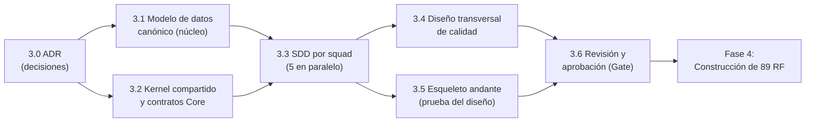
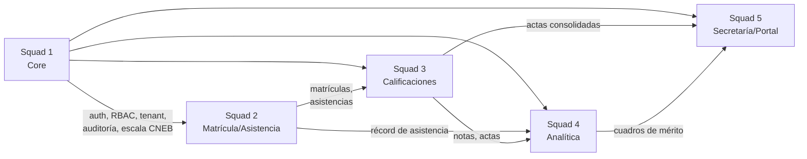
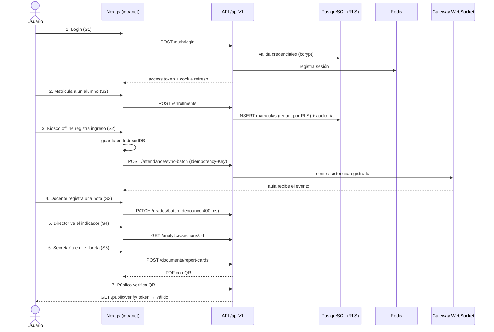
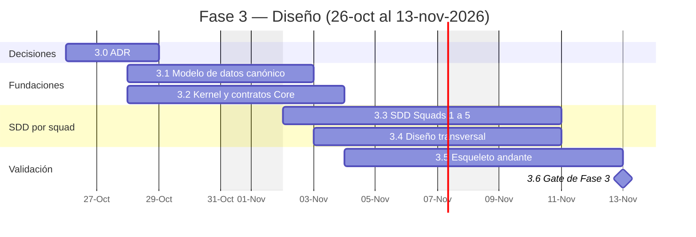

# Plan de Trabajo — Fase 3: Diseño de Software (SDD) y Fundaciones Compartidas

### Sistema de Gestión Escolar — Planteles de Aplicación "Guamán Poma de Ayala" (UNSCH)
**Servicio Social Universitario IS-480 (2026-II)**

| Campo | Valor |
|---|---|
| Versión | 1.0 (borrador para aprobación del líder) |
| Fecha | 2026-10-22 |
| Responsable del plan | Eduardo Sebastian Paipay Vega (Líder de Proyecto) |
| Sub líder | Steve Smith Ovalle Luyo |
| Duración propuesta | 3 semanas: lunes 2026-10-26 a viernes 2026-11-13 |
| Fase de la guía | Fase 3 de [`orden_lectura_obligatorio.md`](../../../.agents/rules/orden_lectura_obligatorio.md) |
| Fase del plan SSU | Fase II, Semanas 6-8 de [`plan_trabajo.md`](../../plan_trabajo.md) |
| Estándares | IEEE 1016-2009, ISO/IEC/IEEE 42010, ISO/IEC 25010, OWASP ASVS 4.0 nivel 2, WCAG 2.1 AA, Ley N° 29733 |

---

## 0. Respuesta corta: ¿qué es lo primordial?

**No conviene empezar por "todo el esqueleto" ni por "toda la base de datos".** El orden recomendado es:

1. **Decisiones de arquitectura cerradas (ADR).** Hoy existen contradicciones que harían que cada squad diseñe sobre supuestos distintos (ver §1).
2. **Modelo de datos canónico + núcleo compartido (Core del Squad 1).** Son los contratos que los 5 squads consumen: tenant, usuarios, roles, años lectivos, auditoría, formato de errores, sesión. Si el core cambia después, todos rehacen trabajo.
3. **SDD de cada squad, en paralelo.** Se diseñan sobre el modelo y los contratos ya congelados.
4. **Esqueleto andante (*walking skeleton*).** Es una rebanada vertical delgada que atraviesa todas las capas (Next.js → API → PostgreSQL/Redis → WebSocket → PDF) para **probar** que el diseño funciona antes de construir los 89 RF. Es la prueba de salida de la Fase 3, no el punto de partida.

> **Regla de oro:** la base de datos completa es un *resultado* del diseño de los 5 SDD, no un insumo. Lo que se congela primero es solo el **núcleo de la BD** (tablas maestras compartidas y convenciones). Las tablas de cada dominio se cierran dentro del SDD del squad dueño.



---

## 1. Diagnóstico de partida (evidencia del repositorio al 2026-10-22)

| # | Hallazgo | Evidencia | Impacto si no se corrige |
|---|---|---|---|
| H1 | Solo 2 de 5 SDD existen | Existen `sdd_squad_1.md` y `sdd_squad_3.md`; faltan `sdd_squad_2.md`, `sdd_squad_4.md` y `sdd_squad_5.md` | 52 de los 89 RF sin diseño de detalle (S2: 24, S4: 14, S5: 14) |
| H2 | Tipo de `tenant_id` contradictorio | `sdd_rules.md` exige `VARCHAR(50)`; `01_esquema_consolidado.sql` usa `UUID REFERENCES instituciones(id)`; el backend del Squad 3 usa `VARCHAR(50)` | Joins rotos entre módulos y migraciones incompatibles |
| H3 | Falta `created_by` en el esquema consolidado | 0 coincidencias de `created_by` en `01_esquema_consolidado.sql`; la regla §2.3 lo exige | Auditoría incompleta (Ley 29733) |
| H4 | Tablas de squads ausentes del consolidado | `asistencias_docentes_contratados` (S2) y `cuadros_merito` (S5) existen solo en `esquema_datos.sql` del squad | El script de arranque no crea todas las tablas |
| H5 | Dos topologías de backend | `backend/src/` es Express + `jsonwebtoken` + `redis`; `backend/squad_3_calificaciones/` es un servicio aparte con `jose`, `ws`, esquema `squad3` y estado en JSONB | Dos librerías JWT, dos modelos de notas (`calificaciones` vs `squad3.gradebooks`), dos despliegues |
| H6 | Tiempo real sin decidir | `stack_tecnologico_proyecto.md` declara `socket.io-client`; Squad 3 usa `ws` nativo | Clientes incompatibles con el gateway |
| H7 | Metas de latencia distintas para el Kiosco | `AGENTS.md`: < 200 ms; RNF-03: < 300 ms; skill `sdd-authoring`: < 300 ms | Criterio de aceptación ambiguo |
| H8 | Frontend sin capa de servicios | `frontend/lib/` solo tiene `utils.ts`; no hay cliente HTTP con interceptor JWT, ni cliente WebSocket, ni `modules/shared/` de sesión | Cada squad inventaría su propio cliente |
| H9 | Estado auditado | README: 251/1000, 0/89 RF aceptados | Confirma que el diseño todavía no está cerrado |

---

## 2. Principios de diseño de la Fase 3 (calidad de lanzamiento)

"Calidad de lanzamiento mundial" significa **calidad de ingeniería**, no ampliar el alcance. La línea roja de [`limites_y_alcance_proyecto.md`](../limites_y_alcance_proyecto.md) sigue vigente: sin pagos, sin apps nativas, sin IA predictiva y sin superadministrador nacional.

1. **API-first:** ningún endpoint se implementa sin contrato OpenAPI 3.1 aprobado.
2. **Una sola fuente de verdad por artefacto:** un solo esquema de BD (migraciones versionadas), un solo catálogo de errores, una sola matriz RBAC y un solo catálogo de eventos.
3. **Seguridad y privacidad desde el diseño:** cada SDD incluye su modelo de amenazas (STRIDE) y la clasificación de datos de menores.
4. **Multi-tenant desde el día 1:** aislamiento por `tenant_id` en aplicación **y** en base de datos (Row-Level Security).
5. **Offline-first verificable:** idempotencia, UUID generados en el cliente y política explícita de conflictos.
6. **Presupuestos medibles:** cada RNF se traduce en una métrica con umbral y en la prueba que la mide.
7. **Decisiones escritas:** toda decisión que afecte a más de un squad se registra como ADR.
8. **Trazabilidad bidireccional:** RF ↔ CU ↔ tabla ↔ endpoint ↔ componente ↔ prueba.

---

## 3. Etapas detalladas

### Etapa 3.0 — Cierre de decisiones de arquitectura (ADR)

**Fechas:** lun 26-oct a mié 28-oct · **Dueño:** Líder + Sub líder · **Participan:** los 5 líderes de squad

**Ubicación:** [`ADR/`](ADR/README.md) (índice y plantilla en §9). Cada ADR formaliza, cuando existe, la decisión D-xx equivalente del registro F0 (`docs/F0_DECISIONES_ARQUITECTURA_PENDIENTES.md`), para no mantener dos registros paralelos.

| ADR | Decisión a tomar | Recomendación del plan | Resuelve |
|---|---|---|---|
| [ADR-001](ADR/ADR-001-topologia-backend.md) | Topología del backend | **Monolito modular** en `backend/src/modules/*` como destino. M8 (`backend/squad_3_calificaciones/`) sigue como proceso aparte detrás de un **gateway** del backend común, sin cambios de código. Solo se integra como módulo si cumple los criterios del ADR (D-05) | H5 |
| [ADR-002](ADR/ADR-002-tipo-tenant-id.md) | Tipo de `tenant_id` | `UUID NOT NULL REFERENCES instituciones(id)`, como el consolidado; tenant = institución; después del login el tenant sale **solo** del JWT; se actualiza `sdd_rules.md` §2.1 (D-04) | H2 |
| ADR-003 | Aislamiento multi-tenant | Doble barrera: `tenant.middleware.ts` fija el tenant del JWT y PostgreSQL aplica RLS con `SET LOCAL app.tenant_id` por transacción | H2 |
| ADR-004 | Migraciones | SQL versionado (`database/migrations/NNNN_descripcion.sql`) con un ejecutor ligero (p. ej. `node-pg-migrate`), sin ORM. `01_esquema_consolidado.sql` pasa a ser la migración `0001` | H3, H4 |
| [ADR-005](ADR/ADR-005-contratos-api.md) | Contratos API | OpenAPI 3.1 en `packages/contracts/openapi/` como fuente única, tipos generados y `zod` como validación en tiempo de ejecución (D-18) | H8 |
| ADR-006 | Librería JWT | Una sola (`jsonwebtoken` o `jose`). Access token de 15 min, refresh de 7 días en cookie HttpOnly con rotación y lista de revocación en Redis (RNF-05) | H5 |
| ADR-007 | Tiempo real | Socket.IO con adaptador Redis (escala horizontal, RF-27, RF-76) **o** `ws` nativo. Elegir uno; el plan recomienda Socket.IO por coherencia con el stack declarado | H6 |
| ADR-008 | Sincronización offline | UUID v4 generado en el Kiosco, `Idempotency-Key` por lote, política "primer registro gana" para asistencia, cola IndexedDB con mínimo 2 000 registros | RF-25, RNF-11 |
| ADR-009 | Cifrado de datos sensibles | AES-256-GCM a nivel de aplicación para DNI de menores, diagnósticos y observaciones, con clave en variable de entorno separada de la BD y rotación documentada (RNF-08) | RNF-08 |
| ADR-010 | Motor PDF y sello | `pdfkit` en backend, hash SHA-256 con *salt* institucional y token opaco en el QR (RNF-09) | RF-59, RF-60 |
| ADR-011 | Observabilidad | Logs JSON estructurados con `request_id` y `tenant_id`, endpoint `/health` (ya existe), métricas de latencia P95 por ruta | RNF-10 |
| ADR-012 | Despliegue | Frontend en Vercel (`vercel.json` existe); backend + PostgreSQL + Redis en VPS con Docker detrás de Nginx/TLS 1.3 (Semana 10 del plan SSU) | RNF-10 |
| ADR-013 | Meta de latencia del Kiosco | Unificar en **< 300 ms P95** (RNF-03) y corregir `AGENTS.md`, o justificar 200 ms | H7 |

**Criterio de salida 3.0:** 13 ADR en estado `Aceptado`, firmados por los 5 líderes, y `sdd_rules.md` actualizado.

---

### Etapa 3.1 — Modelo de datos canónico (núcleo de la BD)

**Fechas:** mié 28-oct a lun 02-nov · **Dueño:** Squad 1 (Brandon Montero) · **Revisores:** los 4 squads restantes

**Qué se congela en esta etapa (núcleo compartido):** `instituciones`, `usuarios`, `roles`, `usuario_roles`, `anios_lectivos`, `periodos_academicos`, `logs_auditoria`, `apoderados_estudiantes`, `consentimientos_datos`, `grados_secciones` y `matriculas`. Estas últimas dos son del Squad 2, pero las consumen los Squads 3, 4 y 5.

**Qué NO se congela aquí:** las tablas propias de cada dominio. Se cierran en el SDD del squad (Etapa 3.3).

| # | Tarea | Entregable |
|---|---|---|
| 3.1.1 | Aplicar ADR-002/004: convertir el consolidado en migraciones `0001_core.sql`, `0002_academico.sql`, etc. | `database/migrations/` |
| 3.1.2 | Agregar `created_by UUID NOT NULL` y `updated_at` en todas las tablas; trigger genérico `set_updated_at()` | Migración `0003_auditoria_columnas.sql` |
| 3.1.3 | Incorporar `asistencias_docentes_contratados` y `cuadros_merito` (H4) y conciliar `calificaciones`/`evaluaciones` con el modelo del Squad 3 (H5) | Esquema único sin divergencias |
| 3.1.4 | Políticas RLS por tabla con `tenant_id` | `0004_rls.sql` + prueba que demuestre que el tenant A no lee al tenant B |
| 3.1.5 | Diagrama ER global (`erDiagram`) del núcleo y diccionario de datos (tabla, columna, tipo, nulidad, clasificación de privacidad) | `modelo_datos_canonico.md` |
| 3.1.6 | Catálogos normalizados: roles, escala CNEB (AD, A, B, C), estados de matrícula, tipos de documento | Seeds en `database/seeds/` |
| 3.1.7 | Volumetría y estrategia de índices: estimar filas/año de `asistencias_alumnos` (alumnos × días lectivos) y decidir particionamiento por año lectivo | Sección "Volumetría" del modelo |
| 3.1.8 | Política de retención y borrado lógico (`is_active`), respaldos (RPO ≤ 24 h, RTO ≤ 4 h) y refresco de vistas materializadas (`vm_rendimiento_seccion`, `vm_asistencia_mensual`) | Sección "Ciclo de vida del dato" |
| 3.1.9 | Datos semilla anonimizados (sin datos reales de menores) para desarrollo y pruebas | `database/seeds/demo_*.sql` |

**Criterio de salida 3.1:** `docker compose up` crea la BD desde cero sin errores; las migraciones son reproducibles; la prueba de RLS pasa; los 5 líderes aprueban el ER del núcleo.

---

### Etapa 3.2 — Kernel compartido y contratos del Core

**Fechas:** mié 28-oct a mar 03-nov (en paralelo con 3.1) · **Dueño:** Squad 1 · **Apoyo:** Líder

| # | Contrato compartido | Contenido mínimo | Ubicación |
|---|---|---|---|
| 3.2.1 | Envoltorio de respuesta y catálogo de errores | `{success, data, timestamp}` / `{success, error:{code, message}, timestamp}`; catálogo sembrado con los códigos de M8 (`UNAUTHENTICATED`, `ACCESS_DENIED`, `VERSION_CONFLICT`, `PERIOD_CLOSED`, etc.; ver ADR-005) | `packages/contracts/openapi/components/` |
| 3.2.2 | Convenciones REST | Prefijo `/api/v1`, paginación `page`/`limit`, filtros, orden, fechas ISO-8601 en `America/Lima`, baja lógica | `packages/contracts/README.md` |
| 3.2.3 | Flujo de autenticación | Diagrama de secuencia de login, refresh, logout, expiración por inactividad y bloqueo por intentos | `sdd_squad_1.md` actualizado |
| 3.2.4 | Matriz RBAC única | Roles (Admin, Director, Docente, Auxiliar, Secretaría, Apoderado, Practicante) × permisos (`recurso:acción`) para los 89 RF | `docs/seguridad/matriz_rbac.md` |
| 3.2.5 | Contrato de auditoría | Qué eventos se auditan, formato del diff, quién puede consultar (RF de auditoría del Squad 1) | `sdd_squad_1.md` §auditoría |
| 3.2.6 | Catálogo de eventos de tiempo real | Nombre, emisor, consumidores, carga útil, sala (`tenant:{id}:seccion:{id}`) | `packages/contracts/events/` |
| 3.2.7 | Servicios internos entre módulos | Interfaces TypeScript de `AccessControlService`, `GradingScaleService`, `EnrollmentQueryService`, `AuditService` (proveedor → consumidores según `AGENTS.md`) | `packages/contracts/src/` (interfaces) |
| 3.2.8 | Frontend compartido (solo diseño) | Cliente HTTP con interceptor JWT y reintento de refresh, cliente WebSocket, `SessionProvider`, guardas de ruta por rol, manejo estándar de estados (inactivo, cargando, éxito, error) | `docs/frontend/kernel_compartido.md` |
| 3.2.9 | OpenAPI del Core | `auth`, `users`, `audit`, `institutions`, `academic-years` | `packages/contracts/openapi/paths/` |

**Mapa de dependencias entre squads (proveedor → consumidor):**



**Criterio de salida 3.2:** OpenAPI del Core válido (lint sin errores), matriz RBAC cubre los 89 RF y cada consumidor firmó el contrato que usa.

---

### Etapa 3.3 — SDD por squad (5 en paralelo)

**Fechas:** lun 02-nov a mar 10-nov · **Herramienta:** skill [`sdd-authoring`](../../../.agents/skills/sdd-authoring/SKILL.md) y [plantilla IEEE 1016](../../../.agents/skills/sdd-authoring/resources/plantilla_sdd.md)

**Contenido obligatorio de todo SDD (además de la plantilla):**

1. Alcance con lista exacta de RF y CU.
2. Diagrama de componentes (`flowchart`), ER del dominio (`erDiagram`) y secuencias de flujos críticos (`sequenceDiagram`).
3. DDL del dominio como migración propuesta, conforme a ADR-002/003/004.
4. Contratos OpenAPI de sus endpoints con 200/201, 400, 401, 403, 422 y 500.
5. Estructura Feature-First: `components/`, `hooks/`, `services/`, `types.ts`, `index.ts`.
6. **Modelo de amenazas STRIDE** del módulo.
7. **Presupuesto de RNF** con métrica, umbral y prueba que lo mide.
8. **Estrategia de pruebas:** unitarias, integración, contrato y E2E.
9. Matriz de trazabilidad RF ↔ CU ↔ tabla ↔ endpoint ↔ componente ↔ prueba.
10. Riesgos y decisiones abiertas.

| Squad | Acción | RF | Temas críticos que el SDD debe resolver |
|---|---|---|---|
| **Squad 1** — Core | **Actualizar** `sdd_squad_1.md` a los ADR | RF-01–14, 65–68, 72, 73, 75, 76 (22) | RLS, rotación de refresh, bloqueo por intentos, consentimiento de datos de menores, invitación de apoderados, notificaciones (RF-76) |
| **Squad 2** — Matrícula y Asistencia | **Crear** `sdd_squad_2.md` | RF-15–35, 74, 77, 78 (24) | Secuencia offline → sync por lotes con idempotencia; generación y revocación del carné QR (RF-26); difusión WebSocket (RF-27); cómputo de horas SSU de practicantes; importación masiva de nómina transaccional (RNF-12); latencia del Kiosco (ADR-013) |
| **Squad 3** — Calificaciones | **Actualizar** `sdd_squad_3.md` | RF-36–46, 79–82 (15) | Migrar de `squad3.gradebooks` (JSONB) al modelo canónico o justificarlo en ADR; debounce de 400 ms; cierre de periodo atómico; rectificación auditada; motor CNEB y conversión dual |
| **Squad 4** — Analítica | **Crear** `sdd_squad_4.md` | RF-47–58, 83, 89 (14) | Vistas materializadas y su refresco; drill-down del mapa de calor con 5 000 registros en < 2 s (RNF-04); Ficha 360° (RF-56) con control de acceso a datos de menores; reglas de alerta de deserción sin IA predictiva (límite O4); métricas SSU IS-480 |
| **Squad 5** — Secretaría y Portal | **Crear** `sdd_squad_5.md` | RF-59–64, 69–71, 84–88 (14) | Libreta PDF vectorial; verificador público `GET /api/v1/public/verify/:token` con *rate limit* y sin filtrar datos personales; mesa de partes con adjuntos (almacenamiento, tamaño, antivirus); portal SSR/SEO (RF-71, RF-84); exportación SIAGIE solo por archivo (límite O7) |

**Ritmo interno sugerido para cada squad (7 días hábiles):**

| Día | Actividad |
|---|---|
| 1 | Leer RF/CU del squad y los ADR; listar dudas al líder |
| 2 | Componentes C4 + ER del dominio |
| 3 | DDL del dominio como migración propuesta |
| 4 | OpenAPI de los endpoints + eventos |
| 5 | Diseño frontend Feature-First + secuencias críticas |
| 6 | STRIDE + presupuesto de RNF + estrategia de pruebas |
| 7 | Matriz de trazabilidad + revisión cruzada con el squad consumidor |

**Revisión cruzada obligatoria (pares):** S2 revisa S3 · S3 revisa S4 · S4 revisa S5 · S5 revisa S1 · S1 revisa S2.

**Criterio de salida 3.3:** 5 SDD que cubren el 100% de los 89 RF, con diagramas Mermaid que compilan, OpenAPI válido y revisión de pares aprobada.

---

### Etapa 3.4 — Diseño transversal de calidad

**Fechas:** mar 03-nov a mar 10-nov (en paralelo con 3.3) · **Dueño:** Sub líder · **Apoyo:** un integrante por squad

| # | Área | Entregable | Umbral o criterio |
|---|---|---|---|
| 3.4.1 | Seguridad | Modelo de amenazas global + checklist OWASP ASVS nivel 2 | Sin amenazas altas sin mitigación |
| 3.4.2 | Privacidad (Ley 29733) | Evaluación de impacto: inventario de datos personales, base legal, minimización, plazos de retención y derechos ARCO | Cada campo sensible tiene clasificación y control |
| 3.4.3 | Rendimiento | Tabla única de presupuestos: CRUD < 1,5 s (RNF-01), Kiosco < 300 ms (RNF-03), dashboards < 2 s (RNF-04), planilla a 60 FPS | Cada umbral tiene herramienta de medición |
| 3.4.4 | Disponibilidad | 99,5 % en horario lectivo (RNF-10), RPO ≤ 24 h, RTO ≤ 4 h, procedimiento de restauración | Restauración probada en la Fase III |
| 3.4.5 | Accesibilidad | WCAG 2.1 AA (RNF-15): contraste, foco visible, navegación por teclado, etiquetas ARIA en PrimeReact | Checklist por pantalla |
| 3.4.6 | Compatibilidad | Chrome/Edge/Firefox ≥ 100, Safari ≥ 15, de 360 px a 1920 px (RNF-13, RNF-20) | Matriz de dispositivos de prueba |
| 3.4.7 | Estrategia de pruebas | Pirámide: unitarias (dominio) → integración (API + BD real) → contrato (OpenAPI) → E2E (flujos críticos) | Cobertura mínima del dominio: 80 % |
| 3.4.8 | Puertas de CI | `npm run lint`, `npm run build`, `npm test`, validación OpenAPI, migraciones desde cero, auditor PrimeReact | Ningún merge a `dev` con una puerta en rojo |
| 3.4.9 | Observabilidad | Formato de log, `request_id`, métricas P95, alertas mínimas | Definido en ADR-011 |

---

### Etapa 3.5 — Esqueleto andante (validación del diseño)

**Fechas:** mié 04-nov a jue 12-nov · **Dueño:** Líder · **Participan:** un desarrollador por squad

Es la única construcción de código de la Fase 3. Su objetivo es **probar el diseño**, no entregar funcionalidad. Cada paso se implementa con la profundidad mínima para atravesar todas las capas.



| Paso | Squad | Qué demuestra |
|---|---|---|
| 1 | S1 | JWT + refresh + RBAC + tenant de punta a punta |
| 2 | S2 | Escritura transaccional con RLS y auditoría |
| 3 | S2 | Offline-first, idempotencia y WebSocket |
| 4 | S3 | Contrato de notas en el monolito modular (ADR-001) |
| 5 | S4 | Lectura agregada desde vista materializada |
| 6–7 | S5 | Generación de PDF, sello SHA-256 y endpoint público |

**Criterio de salida 3.5:** el flujo de 7 pasos corre en `docker compose` local con prueba E2E automatizada; latencias medidas y registradas frente a los presupuestos de 3.4.3. Todo hallazgo que contradiga un SDD actualiza ese SDD o abre un ADR.

---

### Etapa 3.6 — Revisión de diseño y aprobación (Gate de Fase 3)

**Fecha:** vie 13-nov · **Dueño:** Líder · **Asisten:** los 5 squads (y el docente asesor, si corresponde)

Lista de verificación del Gate (todas deben cumplirse):

- [ ] 13 ADR aceptados y `sdd_rules.md` actualizado.
- [ ] BD creada desde migraciones con RLS probada; ER del núcleo aprobado.
- [ ] Catálogo de errores, convenciones REST, matriz RBAC, catálogo de eventos y servicios internos publicados.
- [ ] 5 SDD completos; los 89 RF trazados hasta tabla, endpoint, componente y prueba.
- [ ] OpenAPI unificado válido.
- [ ] Modelo de amenazas, evaluación de privacidad y presupuestos de RNF aprobados.
- [ ] Esqueleto andante verde en CI.
- [ ] `npm run lint` y `npm run build` sin errores en `frontend/` y `backend/`.
- [ ] Hallazgos H1–H9 de §1 cerrados o con ADR que los acepte.
- [ ] Commit etiquetado `fase-3-gate` en `dev` y bloque de estado del README actualizado (skill `project-audit-status`).

---

## 4. Cronograma



| Hito | Fecha | Evidencia |
|---|---|---|
| M1 — Decisiones cerradas | mié 28-oct | 13 ADR aceptados |
| M2 — Núcleo congelado | mar 03-nov | Migraciones + RLS + OpenAPI del Core |
| M3 — SDD completos | mar 10-nov | 5 SDD con revisión de pares |
| M4 — Diseño probado | jue 12-nov | Esqueleto andante verde |
| M5 — Gate aprobado | vie 13-nov | Lista de §3.6 completa |

> **Impacto en el cronograma SSU:** según [`plan_trabajo.md`](../../plan_trabajo.md), la versión Alpha correspondía a la Semana 8 (alrededor del 26-oct). Este plan la desplaza unas 3 semanas, hasta la entrega de la Alpha sobre el esqueleto andante. Se recomienda compensar acortando la Fase IV (capacitación) y reflejar el ajuste en el plan oficial con el visto bueno del docente.

---

## 5. Matriz RACI

R = Responsable · A = Aprueba · C = Consultado · I = Informado

| Entregable | Líder (S2) | Sub líder (S3) | S1 | S2 | S3 | S4 | S5 |
|---|---|---|---|---|---|---|---|
| ADR 001–013 | A | R | C | C | C | C | C |
| Modelo de datos canónico | A | C | R | C | C | C | C |
| Kernel y contratos Core | A | C | R | C | C | C | C |
| SDD Squad 1 | A | C | R | C | I | I | C |
| SDD Squad 2 | A | C | C | R | C | C | I |
| SDD Squad 3 | A | R | C | C | R | C | C |
| SDD Squad 4 | A | C | C | C | C | R | C |
| SDD Squad 5 | A | C | C | I | C | C | R |
| Diseño transversal de calidad | A | R | C | C | C | C | C |
| Esqueleto andante | R/A | C | R | R | R | R | R |
| Gate de Fase 3 | A | R | I | I | I | I | I |

---

## 6. Ceremonias de seguimiento

| Ceremonia | Frecuencia | Duración | Objetivo |
|---|---|---|---|
| Sincronización diaria | Lunes a viernes | 15 min | Avance, bloqueos, dependencias entre squads |
| Consejo de diseño | Martes y jueves | 45 min | Aprobar ADR y resolver conflictos de contrato |
| Revisión de pares de SDD | Lun 09-nov | 60 min por par | Revisión cruzada (§3.3) |
| Demo del esqueleto andante | Jue 12-nov | 30 min | Demostrar el flujo de 7 pasos |
| Gate de Fase 3 | Vie 13-nov | 90 min | Aprobación formal |

---

## 7. Riesgos de la Fase 3

| Riesgo | Probabilidad | Impacto | Mitigación |
|---|---|---|---|
| El Squad 1 se vuelve cuello de botella (todos dependen del Core) | Alta | Alto | El líder y el sub líder apoyan 3.1/3.2; los squads empiezan su SDD con supuestos marcados como "pendiente de Core" |
| El Squad 3 no quiere migrar su modelo JSONB | Media | Alto | ADR específico que evalúe costo y beneficio; adaptador temporal si se mantiene |
| Ampliar el alcance por "nivel mundial" | Media | Alto | Toda idea nueva pasa por `limites_y_alcance_proyecto.md` antes de aceptarse |
| Diseños sin validar ("papel lo aguanta todo") | Alta | Alto | El esqueleto andante es condición del Gate |
| Datos reales de menores en desarrollo | Baja | Crítico | Solo seeds anonimizados; prohibido usar datos reales fuera de producción |
| Retraso frente al cronograma SSU | Alta | Medio | Ajuste formal del plan (§4) y entrega incremental de SDD |

---

## 8. Definición de Terminado (DoD) de un SDD

Un SDD se considera terminado solo si:

1. Cubre el 100 % de los RF asignados al squad, cada uno con su CU.
2. Todos los diagramas Mermaid compilan.
3. El DDL respeta los ADR-002/003/004 (tenant UUID, RLS, migración versionada, `created_by`, `updated_at`).
4. Cada endpoint está en OpenAPI con 200/201, 400, 401, 403, 422 y 500.
5. Incluye STRIDE, presupuesto de RNF y estrategia de pruebas.
6. La matriz de trazabilidad llega hasta la prueba.
7. Está enlazado desde el `README.md` del squad y desde [`GUIA_RAPIDA_SDD.md`](GUIA_RAPIDA_SDD.md).
8. Tiene la aprobación del par revisor y del líder.

---

## 9. Plantilla de ADR

```markdown
# ADR-0XX: <Título de la decisión>

- **Estado:** Propuesto | Aceptado | Reemplazado por ADR-0YY
- **Fecha:** AAAA-MM-DD
- **Decisores:** <nombres>
- **Squads afectados:** <S1..S5>
- **Requisitos relacionados:** RF-XX, RNF-XX

## Contexto
<Problema y evidencia del repositorio.>

## Opciones consideradas
1. <Opción A> — ventajas / desventajas
2. <Opción B> — ventajas / desventajas

## Decisión
<Opción elegida y por qué.>

## Consecuencias
<Qué cambia en BD, API, frontend, pruebas y documentos.>
```

---

## 10. Primeros pasos (lunes 26-oct)

1. El líder publica este plan en `dev` y lo presenta en la sincronización diaria.
2. El sub líder redacta los borradores de ADR-001, ADR-002 y ADR-005 (los que más bloquean).
3. El Squad 1 inventaría las diferencias entre `01_esquema_consolidado.sql` y los 5 `esquema_datos.sql`.
4. Los Squads 2, 4 y 5 copian la plantilla IEEE 1016 en su carpeta y completan metadatos y alcance (RF/CU).
