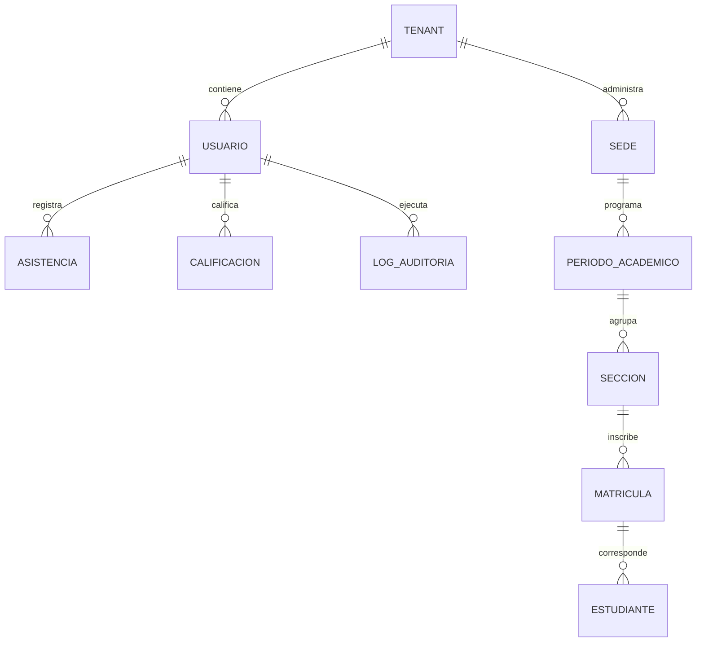

# ESPECIFICACIÓN Y DOCUMENTACIÓN DEL STACK TECNOLÓGICO DEL PROYECTO
## Plataforma Integral de Gestión Académica e Información Institucional

### Planteles de Aplicación "Guamán Poma de Ayala" — UNSCH
**Servicio Social Universitario (SSU IS-480, Semestre 2026-II)**  
**Escuela Profesional de Ingeniería de Sistemas — EPIS UNSCH**  
**Versión:** 1.1 | **Fecha:** Octubre de 2026 (frontend migrado de Flutter a Next.js)  

---

## 1. RESUMEN EJECUTIVO DEL STACK TECNOLÓGICO

El ecosistema tecnológico ha sido seleccionado bajo criterios rigurosos de **rendimiento, mantenibilidad, portabilidad multiplataforma, seguridad criptográfica y resiliencia operativa Offline-First**, garantizando el soporte integral a los **89 Requisitos Funcionales (`RF-01` al `RF-89`)** y **20 Requisitos No Funcionales (RNF)** distribuidos en los 5 squads de desarrollo.

```
┌────────────────────────────────────────────────────────────────────────────────────────┐
│                               CAPA DE CLIENTE / FRONTEND                               │
│     Next.js 15 (App Router) • React 19 • TypeScript 5 • Tailwind CSS • PrimeReact      │
│  [Web Responsive (PWA) │ Kiosco de Portería en navegador │ Vista móvil del apoderado]  │
├────────────────────────────────────────────────────────────────────────────────────────┤
│                          CAPA DE SEGURIDAD, GATEWAY Y RED                              │
│       Nginx Reverse Proxy • TLS 1.3 (HTTPS) • WSS (WebSockets) • JWT Interceptor       │
├────────────────────────────────────────────────────────────────────────────────────────┤
│                             CAPA DE BACKEND Y SERVICIOS                                │
│       API RESTful Modular (Node.js LTS / TypeScript / Clean Architecture)              │
│   [Auth JWT/RBAC │ Kiosco Sync Worker │ Engine Modo Excel │ Motor CNEB │ Validador QR] │
├────────────────────────────────────────────────────────────────────────────────────────┤
│                       CAPA DE DATOS, PERSISTENCIA Y CACHÉ                              │
│   PostgreSQL 16+ (Multi-Tenant `tenant_id`) │ Redis 7+ (Caché & PubSub) │ IndexedDB    │
├────────────────────────────────────────────────────────────────────────────────────────┤
│                           DEVOPS, CALIDAD Y ENTORNOS                                   │
│      Docker & Compose • Git / GitFlow • GitHub Actions CI/CD • ESLint • PR-Agent       │
└────────────────────────────────────────────────────────────────────────────────────────┘
```

---

## 2. FICHA TÉCNICA RESUMIDA POR CAPAS

| Capa del Sistema | Tecnología Principal | Versión Base | Propósito en el Proyecto |
|---|---|:---:|---|
| **Frontend Framework** | **Next.js (App Router)** | `15.x` | Renderizado en servidor y cliente, rutas por grupos `(landing)` e `(intranet)`, PWA. |
| **Biblioteca de UI** | **React** | `19.x` | Componentes declarativos con Server Components y Suspense. |
| **Lenguaje Frontend** | **TypeScript** | `5.x` | Tipado estricto compartido con los contratos JSON del backend. |
| **Arquitectura Frontend** | **Feature-First** | Estándar | Modularización por squad en `frontend/modules/squads/squad_[X]_[modulo]/`. |
| **Componentes y Estilos** | **PrimeReact + Tailwind CSS** | `10.x / 3.x` | Componentes de datos (tablas, calendarios, diálogos) y tokens de diseño en `tailwind.config.ts` y `app/globals.css`. |
| **Persistencia Local (Offline)** | **IndexedDB** | W3C | Búfer local del Kiosco Offline-First (`RF-25`), con sincronización al reconectar. |
| **Protocolo en Tiempo Real** | **WebSockets (`wss://`)** | RFC 6455 | Difusión instantánea de asistencia de aula (`RF-27`) y sincronización. |
| **Backend Runtime** | **Node.js** | `v20+ LTS` | Entorno de ejecución asíncrono y de alta concurrencia para API RESTful. |
| **Lenguaje Backend** | **TypeScript** | `5.x` | Tipado estricto de contratos JSON, DTOs y lógica de negocio. |
| **Base de Datos Principal** | **PostgreSQL** | `16+` | Motor relacional ACID con soporte nativo de JSONB y aislamiento multi-tenant. |
| **Motor de Caché y Sesiones** | **Redis** | `7+` | Almacén en memoria para blacklist de JWT, rate limiting y pub/sub WebSocket. |
| **Criptografía Documental** | **SHA-256 + QR Code** | FIPS 180-4 | Sello inmutable y verificación pública de boletas y carnés oficiales (`RF-60`). |
| **Contenedores y Despliegue** | **Docker & Docker Compose** | Multi-stage | Empaquetado reproducible y despliegue unificado de frontend, backend y BD. |
| **Servidor Web y Proxy** | **Nginx** | `1.24+` | Reverse proxy, terminación SSL TLS 1.3, balanceo y entrega de estáticos. |

---

## 3. CAPA DE PRESENTACIÓN: NEXT.JS & REACT

### 3.1 Justificación Técnica de Next.js
1. **Un solo frontend web para todos los actores:** El portal público, la intranet, el Kiosco de Portería y la vista móvil del apoderado se sirven desde la misma aplicación, con rutas separadas por grupos (`app/(landing)`, `app/(intranet)`).
2. **Rendimiento y SEO:** El renderizado en servidor entrega el portal y las noticias (`RF-71`, `RF-84`) indexables por buscadores, y los Server Components reducen el JavaScript enviado al navegador.
3. **Planilla "Modo Excel" fluida:** La grilla de notas (`RF-38`) se implementa con virtualización de filas y manejo de foco por teclado, manteniendo 60 FPS en secciones de 35 estudiantes y decenas de columnas.
4. **PWA y Offline-First:** Un Service Worker y una cola en IndexedDB permiten que el Kiosco siga registrando ingresos sin conexión (`RF-25`).

### 3.2 Dependencias Clave del Frontend

**Instaladas en `frontend/package.json`:**

| Paquete | Versión | Uso en el Proyecto |
|---|:---:|---|
| **`next`** / **`react`** / **`react-dom`** | `^15.5` / `^19.1` | Framework, App Router y renderizado. |
| **`primereact`** / **`primeicons`** | `^10.9` / `^7.0` | Tablas de datos, calendarios, diálogos y formularios (patrones de la skill `primeng`). |
| **`tailwindcss`** | `^3.4` | Utilidades de estilo y tokens de diseño. |
| **`framer-motion`** | `^14.2` | Microinteracciones y transiciones. |
| **`lucide-react`** | `^0.468` | Iconografía. |
| **`next-themes`** | `^0.4` | Tema claro y oscuro. |
| **`class-variance-authority`** / **`clsx`** / **`tailwind-merge`** | — | Variantes y composición de clases de componentes. |

**Propuestas para los módulos pendientes (a confirmar por cada squad antes de instalarlas):**

| Necesidad | Opción propuesta | RF |
|---|---|---|
| Mapas de calor y radar | `echarts` + `echarts-for-react` | RF-47 a RF-51, RF-56, RF-83 |
| Cola offline del Kiosco | `idb` (envoltorio de IndexedDB) + Service Worker | RF-25 |
| Tiempo real | `socket.io-client` | RF-27, RF-76 |
| Lectura y generación de Excel | `exceljs` (en el backend) | RF-06, RF-78, RF-80, RF-88 |
| QR en pantalla | `qrcode.react` | RF-26, RF-60 |
| PDF oficiales | generación en el backend (`pdfkit` o `@react-pdf/renderer`) | RF-26, RF-59, RF-87 |
| Editor de noticias | `primereact/editor` (Quill) | RF-84 |

### 3.3 Sistema de Diseño e Identidad Visual
Los tokens visuales se definen como variables CSS en [`frontend/app/globals.css`](../../frontend/app/globals.css) y se exponen como clases en [`frontend/tailwind.config.ts`](../../frontend/tailwind.config.ts). La escala normativa CNEB (MINEDU) usa colores fijos en toda la plataforma:
  * `AD` (Logro Destacado): Verde Esmeralda (`#2E7D32`)
  * `A` (Logro Esperado): Azul Cobalto (`#1565C0`)
  * `B` (En Proceso): Amarillo Ámbar (`#F9A825`)
  * `C` (En Inicio): Rojo Carmesí (`#C62828`)

> **Pendiente de decisión:** este documento definía como colores institucionales el Verde Botella (`#1B4D3E`) y el Azul UNSCH (`#0B2F64`), pero el frontend actual usa una paleta granate (`--primary-colors-primary-brand: #500000`). El equipo debe fijar una sola paleta institucional y actualizar `globals.css` o este documento.

---

## 4. CAPA DE BACKEND Y SERVICIOS RESTFUL

### 4.1 Entorno de Ejecución y Lenguaje
* **Runtime:** Node.js (v20+ LTS) o equivalente modular.
* **Lenguaje:** TypeScript 5.x con tipado estricto (`strict: true` en `tsconfig.json`).
* **Paradigma Arquitectónico:** Clean Architecture organizada en 4 capas concéntricas:
  1. **Dominio:** Entidades puras y reglas de negocio del colegio (cálculo de promedios CNEB, ponderaciones, límites de inasistencia).
  2. **Aplicación / Casos de Uso:** Orquestadores de flujo de negocio (ej. `RegistrarAsistenciaUseCase`, `CalcularFicha360UseCase`).
  3. **Adaptadores / Controladores:** Endpoints RESTful JSON y controladores de WebSockets.
  4. **Infraestructura:** Repositorios de acceso a base de datos, clientes Redis, generadores de PDF y servicios de firma hash.

### 4.2 Seguridad, Autenticación y Autorización
* **Protocolo de Autenticación:** JSON Web Tokens (JWT) dual:
  * **Access Token:** Corta duración (15 a 30 minutos), firmado mediante algoritmo HMAC-SHA256 (`HS256`) o RSA (`RS256`). Contiene `sub`, `email`, `role`, `tenant_id` y `permissions[]`.
  * **Refresh Token:** Larga duración (7 días), almacenado de forma segura con revocación inmediata en Redis ante cierre de sesión forzado.
* **Control de Acceso Basado en Roles (RBAC):**
  * Guards / Middlewares que interceptan cada endpoint verificando los roles autorizados (`ADMIN`, `DIRECTIVO`, `DOCENTE`, `PRACTICANTE`, `ESTUDIANTE`).
* **Protección de Contraseñas:** Algoritmo `bcryptjs` con factor de coste de salting igual a 12 (`rounds = 12`).
* **Mitigación de Ataques:**
  * **Rate Limiting:** Máximo 5 intentos fallidos de login por minuto por IP antes de bloqueo temporal en Redis.
  * **CORS:** Lista blanca restringida a dominios institucionales autorizados.
  * **Cabeceras HTTP:** Implementación de `helmet` (HSTS, No-Sniff, XSS-Protection, Frameguard).

---

## 5. CAPA DE PERSISTENCIA Y ALMACENAMIENTO DE DATOS



### 5.1 Base de Datos Relacional: PostgreSQL 16+
* **Transaccionalidad ACID:** Integridad estricta en el guardado en cascada de notas, matrículas y registros de auditoría.
* **Estrategia Multi-Tenant:**
  * Todas las tablas maestras incorporan la clave `tenant_id UUID NOT NULL` indexada en B-Tree.
  * Garantiza el aislamiento lógico total de los Planteles de Aplicación "Guamán Poma de Ayala", dejando el sistema preparado para futuras escuelas sin alterar el código núcleo.
* **Auditoría Inmutable (Ley N.° 29733):**
  * Tabla `logs_auditoria` protegida con Triggers a nivel de base de datos que anulan cualquier intento de instrucción `DELETE` o `UPDATE`.
  * Registro de: `id`, `usuario_id`, `ip_origen`, `user_agent`, `accion`, `entidad`, `datos_anteriores (JSONB)`, `datos_nuevos (JSONB)` y `timestamp_utc`.

### 5.2 Almacén en Memoria y Caché: Redis 7+
* **Caché de Consultas Frecuentes:** Catálogo del CNEB, escalas de notas y periodos académicos con TTL para respuesta ultrarrápida (< 50ms).
* **Pub/Sub para WebSockets:** Permite escalar los eventos en tiempo real entre múltiples instancias del servidor sin perder mensajes.
* **Gestión de Sesiones:** Control activo de listas negras de tokens invalidados (*token revocation blacklist*).

### 5.3 Persistencia de Contingencia Local: IndexedDB
* **Kiosco Offline-First (`RF-25`):** Cuando la portera o vigilante escanea carnés QR en la puerta del colegio y no hay conexión a internet, el evento de ingreso se escribe en una cola local atómica.
* Al recuperar conectividad (eventos `online`/`offline` del navegador y Service Worker), un worker en segundo plano envía las transacciones acumuladas en lote (*batch sync*) con resolución de duplicados mediante clave `idempotency_key`.

---

## 6. CRIPTOGRAFÍA Y VERIFICACIÓN DOCUMENTAL

* **Algoritmo de Digest:** **SHA-256 (Secure Hash Algorithm - 256 bits)**.
* **Flujo de Sellado de Boletas y Carnés (`RF-60`):**
  1. Al generarse el PDF oficial de una boleta de calificaciones o carné escolar, el backend genera una cadena canónica con los datos del documento (ID Estudiante, Periodo, Notas Oficiales, Fecha de Emisión, Clave Secreta Institucional).
  2. Se calcula el digest criptográfico `SHA-256`.
  3. El hash resultante se almacena en la tabla `documentos_verificacion` y se incrusta en el código QR del PDF en formato de URL pública:  
     `https://guamanpoma.unsch.edu.pe/verificar?doc_id=DOC-2026-X&hash=e3b0c44298fc1c149...`
  4. Cualquier tercero o entidad universitaria que escanee el código QR físico accede al portal web de verificación pública institucional para constatar que el documento no ha sido adulterado.

---

## 7. INFRAESTRUCTURA, DEVOPS Y CONTROL DE CALIDAD

### 7.1 Contenedorización con Docker
El despliegue está estandarizado mediante `Docker` y orquestado con `docker-compose.yml`:
* **Frontend:** aplicación Next.js desplegada en **Vercel** (CDN global). En local se ejecuta con `npm run dev`, o en un contenedor `node:20-alpine` con `next start`.
* **Contenedor 2 (Backend API):** Node.js LTS en Alpine Linux ejecutando el servicio REST y WebSocket Gateway.
* **Contenedor 3 (Base de Datos):** `postgres:16-alpine` con volúmenes persistentes y scripts de migración inicial.
* **Contenedor 4 (Caché):** `redis:7-alpine` configurado con persistencia AOF/RDB.

### 7.2 Flujo de Ramas Git (GitFlow Ligero)
* **`main` (Producción):** Código blindado, probado y listo para sustentaciones y demos formales.
* **`dev` (Integración):** Rama central de desarrollo donde confluyen los módulos de los 5 squads.
* **`feature/squad-[X]-[funcionalidad]`:** Ramas de trabajo aisladas por squad:
  * `feature/squad-1-jwt-rbac`
  * `feature/squad-2-kiosco-offline`
  * `feature/squad-3-modo-excel`
  * `feature/squad-4-mapas-calor`
  * `feature/squad-5-verificacion-qr`

### 7.3 Calidad de Código y Pruebas Automatizadas
* **Análisis Estático:** `npm run lint` (ESLint) en `frontend/` y `backend/` con 0 errores, y compilación TypeScript estricta (`npm run build`).
* **Pruebas:** Jest en el backend para promedios CNEB, conversión dual, cómputo de horas y reglas de negocio; pruebas de componentes en el frontend (React Testing Library) para la planilla, el debounce de 400 ms y los formularios.
* **Revisión automática:** PR-Agent revisa cada Pull Request hacia `dev` (`.github/workflows/pr_agent.yml`).

---

## 8. MATRIZ DE ASIGNACIÓN TECNOLÓGICA POR SQUAD

| Squad Técnico | Líder Técnico | Tecnologías y Librerías Principales |
|---|---|---|
| **Squad 1: Core y Seguridad** | Brandon Montero (`@brandonmontero27-g`) | • Next.js (Login, Perfil, Configuración, Matriz RBAC, cuentas de apoderado)<br>• Node.js / TypeScript (AuthService, JWT HS256, bcrypt, NotificationService)<br>• PostgreSQL 16 (RBAC, Multi-Tenant, Auditoría Ley 29733)<br>• Redis 7 (Tokens blacklist, Rate Limiting, Pub/Sub de notificaciones) |
| **Squad 2: Matrícula y Asistencia** | Eduardo Paipay (`@Eduardo-Sebastian-Paipay-Vega`) | • Next.js PWA (Kiosco de Portería en navegador)<br>• IndexedDB + Service Worker (Búfer Offline-First)<br>• Socket.IO (Toma rápida en aula en tiempo real)<br>• Carnés QR en PDF e importación de nóminas SIAGIE (exceljs) |
| **Squad 3: Calificaciones y Modo Excel** | Steve Ovalle (`@steveovalle27-lgtm`) | • Grilla de notas virtualizada con navegación por teclado (Planilla Modo Excel)<br>• Debounce 400 ms con autoguardado (`PATCH /grades/batch`)<br>• Motor de conversión vigesimal a CNEB en TypeScript (compartido backend/frontend)<br>• Plantillas Excel firmadas y calendario de actividades |
| **Squad 4: Analítica y Dashboards** | Grissel Rodríguez (`@Arascely`) | • ECharts (Mapas de calor Drill-Down, radar de la Ficha 360°)<br>• Vistas y vistas materializadas de PostgreSQL (Métricas SSU IS-480, cumplimiento docente)<br>• Algoritmos de semaforización diagnóstica (Verde, Amarillo, Rojo)<br>• Agenda de citas con apoderados |
| **Squad 5: Secretaría y Portal Web** | Cesar Leon (`@cesarleon27-ai`) | • PDF oficiales generados en el backend (boletas, actas, certificados)<br>• Motor Criptográfico SHA-256 y QR (Sello de verificación)<br>• Next.js con renderizado en servidor (Portal, noticias, mesa de partes)<br>• Graph API de Meta (Facebook) y archivos de carga para el SIAGIE |
---

## 9. CONCLUSIÓN

El stack tecnológico seleccionado garantiza un balance óptimo entre **modernidad, rendimiento, simplicidad operativa y rigor académico**. Permite que el equipo de desarrollo cumpla con los 89 Requisitos Funcionales en el tiempo estipulado para el **Servicio Social Universitario IS-480**, entregando a los **Planteles de Aplicación "Guamán Poma de Ayala"** un sistema de alta calidad técnica y operativa.
