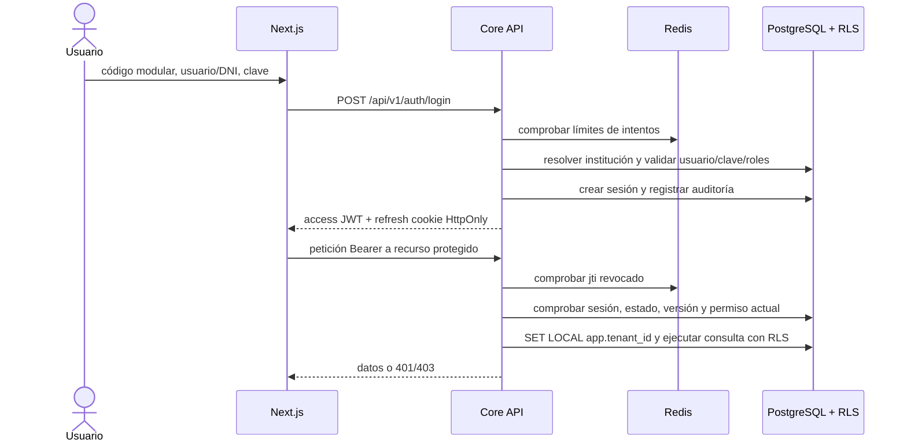

# Plan de implementación integral — Core del Squad 1

**Fecha:** 2026-10-23  
**Alcance:** los 22 RF del Squad 1: RF-01–14, RF-65–68, RF-72, RF-73, RF-75 y RF-76; sus RNF de seguridad, privacidad, calidad y accesibilidad.  
**Estado:** implementación del Core desarrollada y validada con compilación, lint y pruebas locales. La aceptación integrada con PostgreSQL, Redis y SMTP, la aprobación D-16 y el texto oficial de consentimiento siguen pendientes. Las secciones de contexto comprobado describen el estado previo a los cambios; consultar `docs/core/OPERACION_CORE.md` para el arranque actual. La "Fase 1 (2026) / Fase 2 (2027)" describe la puesta en marcha escolar, no las fases documentales del repositorio.

## Resumen

Entregar el Core completo como servicio compartido: identidad y cuentas, autenticación, roles, sedes, año y periodos, escalas, parámetros institucionales, apoderados, notificaciones, privacidad y auditoría. En 2026 se importa el padrón y se activan solo las cuentas necesarias; en 2027 el Squad 2 añade la matrícula anual a las mismas `personas`, sin recrear cuentas ni contraseñas.

## Alcance y fuente de verdad

| Bloque | RF | Resultado verificable |
|---|---|---|
| Acceso y permisos | 01–04 | Login real, refresh/logout/recuperación y autorización efectiva en API |
| Personas y cuentas | 05–09, 72–73 | Alta, importación, directorio, perfil, baja/reactivación y roles con historial |
| Institución y calendario | 07, 10–14 | Sedes, año lectivo, periodos, días no lectivos, niveles/secciones, escalas y membrete |
| Familias y avisos | 75–76 | Vínculo verificado, consentimiento, bandeja, correo y preferencias |
| Protección y auditoría | 65–68 | Bitácora inmutable, historial de cambios, visor/exportación y controles de datos sensibles |

`personas` es la identidad durable; `usuarios` es una cuenta opcional 1:1 con `persona_id`; `usuario_roles` determina privilegios vigentes; `matriculas` vincula una persona a un año y sección. Las migraciones de `database/migrations/` son el esquema ejecutable; `database/init/` y los SQL de cada squad son referencias históricas. El Core no implementa la matrícula RF-15/16/78: expone identidad y configuración para el Squad 2.

## Contexto comprobado

- `frontend/modules/intranet/components/LoginForm.tsx` crea una sesión ficticia con `setTimeout`, acepta el rol elegido por el visitante y no llama a la API. `frontend/app/(intranet)/login/page.tsx` enlaza directamente a `/intranet`; `IntranetHub.tsx` permite cambiar de rol localmente.
- `backend/src/routes/auth.routes.ts` solo ofrece `login`, `me` y `logout`. Falta `refresh-token`, restablecimiento de clave, gestión de permisos y revocación real al salir.
- `AuthService.login` consulta `u.activo`, inexistente en el esquema; la columna vigente es `estado`. `requireTenant` usa un identificador de texto como valor por defecto donde la base espera UUID. El JWT usa `tenantId` y el middleware no comprueba revocación ni estado actual del usuario.
- Las migraciones versionadas en `database/migrations/` son la fuente ejecutable actual. El modelo canónico define `tenant_id UUID`, `personas` separada de `usuarios`, roles globales, asignaciones por tenant, RLS y auditoría mediante `fn_registrar_auditoria()`. El SDD del Squad 1 y algunos contratos Markdown todavía describen variantes anteriores.
- ADR-001, ADR-002, ADR-003 y ADR-005 contienen decisiones propuestas para topología, tenant, RLS y contrato API. Este diseño las toma como base técnica para evitar que el nuevo Core dependa del esquema histórico. Su estado documental sigue siendo “Propuesto”.
- `frontend/app/(intranet)/layout.tsx` no protege rutas; `IntranetHub.tsx` inventa usuario y auditoría y permite cambiar el rol localmente. `CoreModuleView.tsx` solo muestra tarjetas con cifras fijas.
- `backend/src/server.ts` solo monta salud, autenticación y auditoría. `AuditService` usa columnas ausentes y oculta errores de escritura; el backend se conecta como `postgres`, que evita las políticas RLS previstas para `sms_app`.
- Las migraciones ya incluyen `personas`, calendario, sedes, escalas, secciones, matrícula, auditoría y RLS. La migración de identidad es *expand*: aún quedan columnas duplicadas en `usuarios` hasta completar el traslado cifrado y la fase *contract*.
- El SDD del Squad 1 declara 18 RF aunque su alcance actual es 22. RF-05 prescribe contraseña provisional por correo; hay que registrar el cambio a activación de un uso. Los rangos oficiales de RF-13 siguen pendientes de la decisión académica D-16.

## Decisiones de producto y seguridad

Antes de implementar, consolidar en el SDD y en el contrato de API las decisiones de ADR-001 a ADR-005 que todavía figuran como propuestas. No cambiar migraciones ya aplicadas; agregar migraciones nuevas y probarlas sobre una copia. El piloto cubre solo los planteles Guamán Poma de Ayala; `SUPERADMIN` equivale al administrador TI de ese plantel, sin alcance nacional.

1. **Institución:** el login recibe `codigoModular`, `identificador` (usuario o DNI) y contraseña. El servidor resuelve el código modular a un UUID; no acepta un UUID de tenant proporcionado por el navegador. Después del login, cada petición obtiene el tenant exclusivamente del JWT. Una cabecera `X-Tenant-ID` discordante se rechaza.
2. **Roles:** el catálogo institucional de códigos permanece fijo (`roles` global). `SUPERADMIN` representa al administrador TI del plantel, sin alcance nacional. Un administrador puede asignar o retirar roles existentes a usuarios de su propio tenant, con motivo obligatorio, historial y protección del último administrador.
3. **Permisos:** catálogo global de claves `recurso:acción` y matriz de concesiones `tenant_id + rol_id + permiso_id`. La matriz es editable por el administrador del plantel, excepto permisos críticos de administración de seguridad y auditoría. Toda ruta declara el permiso requerido y se deniega por defecto si falta declaración o concesión.
4. **Autoridad vigente:** el JWT identifica la sesión; sus roles son informativos. En cada petición protegida el backend verifica cuenta activa, sesión vigente y permisos actuales en PostgreSQL. Un cambio de roles o de matriz surte efecto en la siguiente petición; se incrementa una versión de autorización para invalidar tokens de acceso previos.
5. **Tokens:** access JWT HS256 de 15 minutos, con `iss`, `aud=sms-core`, `sub`, `tenant_id`, `sid`, `jti` y versión de autorización. Refresh JWT de 7 días en cookie `HttpOnly`, `Secure` en producción, `SameSite=Strict` y `Path=/api/v1/auth`. El access token reside solo en memoria del frontend.
6. **Sesiones:** cada refresh rota `jti` y secreto de forma atómica; la base guarda solo el hash del refresh vigente. Reutilizar un refresh anterior revoca la familia de sesión. Logout revoca la sesión y registra el `jti` del access token en Redis hasta su expiración. Si no se puede verificar revocación o estado, las rutas protegidas fallan cerradas.
7. **Inactividad:** 30 minutos para este piloto, con aviso durante el último minuto. Se corrige el valor inicial de `configuracion_institucional.minutos_inactividad_sesion`, que hoy es 15. La inactividad termina la sesión en el servidor; cerrar la pestaña no equivale a logout.
8. **Clave:** comparación bcrypt con coste mínimo 12; errores de credenciales uniformes. Cinco fallos por IP o identificador en 15 minutos producen 429. Recuperación por enlace de un solo uso válido 30 minutos, con respuesta pública uniforme, hash del token almacenado y revocación de sesiones tras el cambio. El envío requiere un correo institucional configurado; si no existe, el flujo asistido por Administrador TI entrega el enlace solo tras verificación de identidad y deja auditoría.
9. **Auditoría:** login correcto/fallido, bloqueo, logout, recuperación, cambio de roles, edición de matriz y denegación 403 se registran con la función de la base `fn_registrar_auditoria()`. Nunca se escribe directamente en `logs_auditoria` ni se afirma que se auditó si la operación falló.

10. **Alta masiva:** el archivo RF-06 no incluye contraseñas. Hace validación previa, normalización y búsqueda idempotente por documento protegido, código SIAGIE cuando corresponda y correo verificado. Crea o actualiza `personas`; crea `usuarios` solo para quienes deben entrar. Una cuenta pendiente tiene hash aleatorio desconocido y no inicia sesión hasta consumir su invitación de un uso. El usuario fija su propia clave. RF-78 queda a cargo del Squad 2 para padrón académico y matrícula anual.
11. **Datos de menores:** el servidor cifra el documento con AES-256-GCM y busca por índice ciego HMAC, con claves fuera de PostgreSQL. El traslado desde columnas legadas de `usuarios` se valida antes de retirarlas. Lecturas sensibles requieren permiso, motivo y auditoría; listados y exportaciones muestran datos enmascarados salvo autorización.
12. **Configuración temporal:** sedes pertenecen a una institución; años, secciones, periodos, días no lectivos y escalas pertenecen a su año/tenant. El 2027 se configura sin copiar credenciales de 2026. Una escala vigente no se edita: se reemplaza por versión nueva, con aprobación de Coordinación/Dirección. No sembrar fronteras CNEB numéricas hasta resolver D-16.
13. **Apoderados:** el vínculo es entre `personas` y se verifica contra la ficha del estudiante. La cuenta se activa mediante invitación de un uso con consentimiento registrado; el backend aplica acceso de solo lectura a estudiantes vinculados y lo revoca al desvincular.
14. **Notificaciones:** un servicio transversal persiste el aviso, respeta preferencias y entrega bandeja y correo; la difusión en tiempo real se autentica y aísla por tenant. El envío de correo se reintenta desde una cola persistida, sin duplicar avisos.

## Flujo y fuente de verdad

La fuente de verdad de roles, permisos, estado de usuario y sesiones es PostgreSQL. Redis almacena contadores y la lista temporal de `jti` revocados. El frontend deriva su navegación de `GET /auth/me`; ocultar un botón nunca reemplaza la validación del endpoint.

## Contratos de API propuestos

| Endpoint | Acceso | Resultado principal |
|---|---|---|
| `POST /api/v1/auth/login` | Público, con límite de intentos | Access token, vigencia y usuario; refresh en cookie |
| `POST /api/v1/auth/refresh-token` | Cookie de refresh | Access nuevo y refresh rotado |
| `POST /api/v1/auth/logout` | Sesión actual | Revocación y limpieza de cookie, idempotente |
| `GET /api/v1/auth/me` | Autenticado | Identidad, roles y permisos vigentes |
| `POST /api/v1/auth/forgot-password` | Público, con límite | Respuesta uniforme, exista o no la cuenta |
| `POST /api/v1/auth/reset-password` | Token de un uso | Clave cambiada y sesiones revocadas |
| `GET /api/v1/roles` | `roles:read` | Catálogo y matriz del tenant |
| `PUT /api/v1/roles/:id/permissions` | `roles:manage` | Matriz actualizada, motivo y versión |
| `PUT /api/v1/users/:id/roles` | `users:assign-roles` | Roles vigentes; invalida access anterior |

Todas las respuestas usan `{ success, data | error: { code, message }, timestamp }`. `401` significa sesión ausente, vencida o revocada; `403` significa sesión válida sin permiso; `429` significa límite de intentos. El contrato normativo se publicará en `packages/contracts/openapi/paths/auth.yaml` y `users.yaml`, de acuerdo con ADR-005.

| Grupo | Operaciones a especificar antes de codificar | RF |
|---|---|---|
| Personas y usuarios | Alta individual, vista previa y confirmación XLSX/CSV, activación, listado/búsqueda, perfil, edición, baja/reactivación | 05–09, 72 |
| Autorización | Catálogo, consulta y cambio de roles, permisos vigentes; comprobación de acceso por relación estudiante/apoderado | 04, 73, 75 |
| Institución | Instituciones/sedes del piloto, años, periodos, días no lectivos, secciones, escalas y parámetros/membrete | 07, 10–14 |
| Apoderados | Invitación, aceptación y consentimiento, consulta de estudiantes vinculados y desvinculación | 75 |
| Avisos | Bandeja, lectura, preferencias, canal de correo y evento autenticado en tiempo real | 76 |
| Auditoría y privacidad | Búsqueda/exportación, verificación de cadena, lectura enmascarada y desenmascarado auditado | 65–68 |

El contrato debe fijar DTO, errores, paginación, permiso y `tenant_id` derivado del servidor para cada operación. La API de configuración entrega a Squad 2 el año y las secciones; la de escalas entrega a Squad 3 la versión vigente. Ningún endpoint de Core crea una matrícula.

## Permisos iniciales del Core

| Permiso | Administrador TI | Directivo | Otros roles |
|---|---:|---:|---:|
| `profile:read-own`, `profile:update-own` | Sí | Sí | Sí |
| `users:read` | Sí | Sí | Según función documentada |
| `users:assign-roles` | Sí | No | No |
| `roles:read` | Sí | Sí | No |
| `roles:manage` | Sí | No | No |
| `audit:read` | Sí | Sí | No |

La matriz completa por los 89 RF se documentará en `docs/seguridad/matriz_rbac.md` antes de proteger los endpoints de los otros squads. Cada permiso tendrá dueño, rutas consumidoras y trazabilidad RF/CU. El administrador TI no podrá conceder `roles:manage`, `users:assign-roles` ni `audit:read` a roles de menor confianza desde la UI.

## Cambios previstos

- `database/migrations/<fecha>_s1_auth_sesiones_permisos.sql`: agregar sesiones, tokens de recuperación, versión de autorización, catálogo de permisos y concesiones por tenant; RLS, FK compuestas, índices y valor de inactividad 30 minutos. No editar migraciones ya aplicadas.
- `database/migrations/<fecha>_s1_alta_privacidad_notificaciones.sql` y un script controlado en `backend/`: soporte de invitaciones y correo, cifrado/índice ciego de datos existentes, restricciones e índices de importación. La migración *contract* de columnas duplicadas de `usuarios` se ejecuta solo después de que login y demás consumidores lean `personas` y el backfill esté verificado. No insertar datos reales de menores antes de comprobar cifrado y acceso.
- `backend/src/config/database.ts`, `backend/src/middlewares/tenant.middleware.ts` y `backend/src/server.ts`: conexión con rol `sms_app`, contexto tenant/usuario en cada transacción, bootstrap público por código modular, CORS restringido y registro de las rutas nuevas.
- `backend/src/modules/auth/`: concentrar controlador, servicio, repositorio y rutas de login, refresh, logout, recuperación y `me`. Reusar el pool y el contrato de respuesta; corregir consulta de usuario/identidad conforme al modelo canónico.
- `backend/src/core/security/`: validación JWT, contexto tenant desde claims, `requirePermission`, límite de intentos, revocación y comprobación de sesión. Adaptar `audit.routes.ts` para que no acepte el tenant de la cabecera como autoridad.
- `backend/src/modules/authorization/`: consulta de roles/permisos y operaciones de asignación, con transacción, versión y auditoría.
- `backend/src/modules/users/`: personas, cuentas, directorio, perfil, importación RF-06 con vista previa/diferencias, activación, baja/reactivación y aplicación de roles. Reutilizar la misma persona en futuras importaciones.
- `backend/src/modules/school-config/`: sedes, calendario, años, periodos, secciones, escalas y configuración institucional; publicar proveedores tipados para Squads 2, 3 y 5.
- `backend/src/modules/guardians/` y `backend/src/modules/notifications/`: vínculo/consentimiento y entrega de avisos con bandeja, preferencias, correo y eventos en tiempo real.
- `backend/src/services/audit.service.ts` y `backend/src/routes/audit.routes.ts`: integrar `fn_registrar_auditoria()` y `fn_verificar_cadena_auditoria()`, búsqueda autorizada y exportación; no silenciar errores ni devolver éxito falso. Las mutaciones sensibles y su auditoría comparten transacción.
- `packages/contracts/openapi/`: publicar rutas de todos los bloques, esquemas de éxito/error y códigos estables.
- `frontend/modules/squads/squad_1_core/`: `LoginForm`, `SessionProvider`, cliente auth, recuperación/activación, directorio/importación, roles, perfil, configuración, apoderados, notificaciones y visor de auditoría. Reutilizar componentes PrimeReact 10 existentes y aplicar `primereact-guardian` G0–G6 en cada edición UI.
- `frontend/app/(intranet)/`: dejar páginas como puntos de entrada delgados, exigir sesión para intranet y retirar selector de rol simulado, acceso sin clave y datos de usuario inventados.
- `docs/seguridad/matriz_rbac.md`, RF-05/CU-USR-01, SDD del Squad 1 y contratos: mantener trazabilidad de los 22 RF/CU, formalizar activación en lugar de contraseña por correo, separar RF-06 de RF-78 y documentar el comportamiento real.

## Orden de entrega y puertas de salida

| Entrega | Trabajo | Puerta verificable |
|---|---|---|
| **E0. Contratos y datos** | Alinear SDD, RF/CU, ADR propuestos, OpenAPI y matriz RBAC con los 22 RF; delimitar Core RF-06 frente a matrícula RF-78. Inventariar datos existentes y preparar reversión. | Contratos revisados por Squads 1 y 2; cada operación tiene dueño, permiso, RF/CU y errores. |
| **E1. Base segura** | Aplicar y probar migraciones actuales en una copia; configurar `sms_app` sin `BYPASSRLS`, contexto transaccional y RLS; preparar y verificar backfill cifrado hacia `personas`. Corregir auditoría contra funciones SQL. | Test de acceso cruzado falla por API y SQL; hashes/verificación de auditoría coinciden; la identidad nueva se busca sin exponer DNI. |
| **E2. Acceso real** | Reparar login para leer `personas`+`usuarios`, implementar refresh rotado, logout, inactividad, límites de intentos, cambio/recuperación de clave y sesión frontend. Eliminar login y selector de rol simulados. Tras verificar todos los consumidores, ejecutar la migración *contract*. | Credenciales inválidas no abren sesión; recarga, expiración y revocación funcionan de punta a punta; no queda ninguna lectura de columnas legadas. |
| **E3. Usuarios y roles** | Alta individual, directorio, importación XLSX/CSV con vista previa y reporte, invitaciones, perfil, baja/reactivación y reasignación de roles. | Reimportar el mismo lote no duplica personas ni cuentas; baja y cambio de rol afectan la siguiente petición; último administrador protegido. |
| **E4. Configuración escolar** | Sedes, años, periodos, días no lectivos, niveles/secciones, parámetros, membrete y servicio de escalas. Preparar el año 2027. | Un solo año activo por tenant, periodos/secciones válidos para ese año y API consumible por Squads 2/3/5; la escala no pasa a vigente con rangos no aprobados. |
| **E5. Familias, avisos y privacidad** | Vínculo verificado, invitación y consentimiento de apoderados; bandeja, preferencias, correo y tiempo real; permisos de datos sensibles. | El apoderado solo lee estudiantes vinculados; revocar vínculo corta acceso; avisos respetan preferencias y se recuperan tras fallo de envío. |
| **E6. Auditoría y cierre del Core** | Visor filtrable y PDF RF-67; integrar el servicio de auditoría con modificaciones justificadas de notas/asistencia RF-66 de Squads 2/3; revisar cifrado, enmascaramiento y exportaciones RF-68. | La cadena se verifica, los eventos críticos no se pierden, y cambios de notas/asistencia registran autor, antes/después y motivo. |
| **E7. Traspaso 2027** | Entregar a Squad 2 contratos para resolver/reutilizar `persona_id`, consultar año/secciones y registrar matrícula anual RF-15/16/78. | Importación 2027 encuentra personas 2026, crea una matrícula por estudiante/año y conserva cuentas, roles y claves. |

E1–E3 habilitan la Fase 1 de accesos. E4 prepara el año siguiente. E5–E6 completan el Core dentro de sus 22 RF. E7 es una integración con el Squad 2, no una implementación de matrícula por Squad 1. Cada entrega incluye API, UI cuando aplica, migración nueva, pruebas y documentación del contrato; no se considera terminada por una pantalla de demostración.

## Verificación

- Base de datos: `npm test` en `database/`, con casos de migración desde una copia, RLS entre dos tenants, duplicados, restricciones de año/sección y cadena de auditoría. Verificar restauración antes de la migración *contract*.
- Backend: cablear un ejecutor de pruebas real en `backend/package.json` (hoy anuncia `jest` sin dependencia instalada); agregar integración con PostgreSQL y Redis para autenticación, sesiones, permisos, importación, apoderados, configuración y auditoría. Ejecutar `npm run lint`, `npm run build` y `npm test` en `backend/`.
- Frontend: probar los recorridos de login, importación, configuración, guardianes y auditoría con la API real; inspeccionar visualmente estados vacío/carga/error, foco y acceso móvil. Para cada edición UI ejecutar `py -I .claude/skills/primereact-guardian/scripts/audit_primereact.py frontend`, `npm run lint` y `npm run build` en `frontend/`.
- Aceptación conjunta: levantar PostgreSQL, Redis, backend y frontend; probar dos usuarios de roles distintos y dos tenants de prueba, cambio de rol en sesión, invitación expirada, lote parcialmente inválido, exportación no autorizada y promoción al año 2027 sin recrear cuenta.

## Decisiones y dependencias pendientes

- **D-16:** Coordinación Académica debe aprobar los valores de corte CNEB antes de sembrar o publicar una escala vigente. Se puede implementar la estructura y el flujo de aprobación sin inventar rangos.
- **RF-05:** formalizar que la credencial inicial se entrega como enlace de activación de un solo uso y que la cuenta no accede hasta definir su clave; el texto actual prescribe una contraseña provisional por correo.
- **ADR-001–005 y canal en tiempo real:** fijar topología, tenant, RLS, migraciones, contrato y transporte de notificaciones antes de integrar otros squads. Las migraciones actuales ya aplican parte del modelo, pero varios ADR aún están marcados como propuestos.
- **Datos oficiales:** Secretaría aporta la lista de personas y correos autorizados; Dirección valida roles, sedes, calendario y membrete. RF-75 requiere verificar parentesco/tutela y consentimiento antes de conceder acceso familiar.
- **Squads 2/3/5:** acordar el identificador estable `persona_id`, la versión de escalas, el contrato de auditoría de notas/asistencia y el servicio de avisos. Mantener `matriculas` y sus reglas anuales bajo Squad 2.

## Criterios de aceptación

- Nadie entra a `/intranet` ni a una API protegida sin sesión válida; elegir un rol en la UI no otorga privilegios.
- Un usuario del tenant A no puede leer ni modificar datos del tenant B por API ni por SQL usando el rol de aplicación.
- Refresh rota la cookie y rechaza reutilización; logout invalida access y refresh; 30 minutos de inactividad cierran la sesión.
- Los cambios de rol o matriz afectan la siguiente petición y dejan auditoría verificable.
- El restablecimiento expira a los 30 minutos, se usa una sola vez y revoca sesiones existentes.
- Los errores y respuestas cumplen el esquema compartido; las compilaciones y pruebas indicadas terminan sin fallos.
- La importación de 2026 admite personas sin cuenta y crea cuentas solo para quienes acceden; ninguna plantilla contiene contraseñas. La importación repetida informa nuevos, actualizados, sin cambios y rechazados.
- Un apoderado no puede consultar estudiantes no vinculados y la falta de consentimiento impide activar la cuenta; la revocación del vínculo surte efecto en la siguiente petición.
- El año 2027 se configura con sus propias secciones y periodos; ninguna cuenta ni contraseña depende del año. La matrícula anual del Squad 2 referencia la persona existente.
- El directorio, los avisos, el calendario y los datos institucionales muestran información real, sin cifras ni identidades simuladas. La auditoría incluye registros comprobables y exportación autorizada.
