# Catálogo fotográfico y audiovisual — Plataforma Web Institucional PAGPA

**Proyecto:** Plataforma Web Institucional (Proceso de admisión 2027)  
**Institución:** Planteles de Aplicación Guamán Poma de Ayala (PAGPA)  
**Niveles educativos:** Inicial, Primaria y Secundaria  
**Fecha de corte:** 20 de noviembre de 2026  
**Base visual disponible:** carpeta `docs/Archivos_PAGPA` y subcarpeta `docs/Archivos_PAGPA/Videos`  
**Repositorio compartido:** [Google Drive — Imágenes y videos PAGPA](https://drive.google.com/drive/folders/1yq-V7GN4UyBjWTvHMaD1SQ60EgI_7aZa?usp=sharing). Utilizarlo como fuente de descarga y respaldo de los activos originales.

## 1. Cómo utilizar este catálogo

Este documento reúne los registros disponibles y propone el criterio visual para incorporarlos a la plataforma. Cada activo está organizado como una ficha sencilla y reutilizable:

| Campo | Qué debe incluir |
|---|---|
| **Título** | Nombre breve y específico del espacio, actividad o nivel. |
| **Bajada** | Una frase institucional de máximo 120 caracteres. |
| **Nivel educativo** | Inicial, Primaria, Secundaria o Institucional. |
| **Ubicación** | Zona o ambiente reconocido dentro del plantel. |
| **Uso recomendado** | Página o contenido donde puede emplearse el registro. |
| **Descripción** | Contexto institucional, valor formativo y relación con la vida escolar. |
| **Texto alternativo** | Descripción objetiva de lo visible para lectores de pantalla. |
| **Tipo de activo** | Imagen o video. |

Las descripciones actuales son una primera propuesta basada en los nombres y el contenido visible de los archivos. Deben contrastarse con la toma definitiva antes de publicar.

## 2. Criterios generales

- Mantener las rutas relativas desde `docs/Photos.md` hacia `docs/Archivos_PAGPA`.
- Ejemplo de imagen: `Archivos_PAGPA/Vista_general_Panorama1.jpg`.
- Ejemplo de video: `Archivos_PAGPA/Videos/Horizontal_Vista_General_Planteles_GuamanPoma.mp4`.

---

## 3. Identidad, entrada y vista general

### INF-01 — Vista general del plantel

**Nivel:** Institucional (Inicial, Primaria y Secundaria)  
**Uso recomendado:** cabecera institucional, presentación de la sede y galería panorámica.

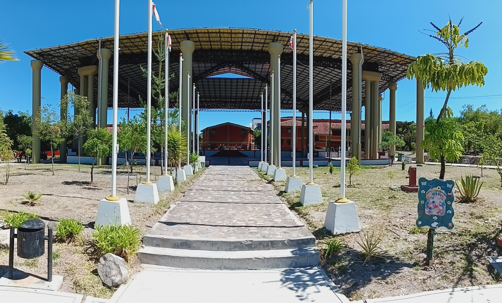

* **Archivo:** `Vista_general_Panorama1.jpg`
* **Subtítulo:** Una infraestructura institucional que ofrece continuidad formativa desde los primeros años hasta la secundaria.
* **Descripción:** Panorama amplio de los Planteles de Aplicación Guamán Poma de Ayala, con visibilidad de sus edificios, áreas verdes y pórticos. Permite presentar la dimensión física de la institución y el entorno compartido por sus tres niveles educativos.
* **Alt text:** Vista panorámica general del campus de los Planteles de Aplicación Guamán Poma de Ayala.

### INF-02 — Entrada principal

**Nivel:** Institucional  
**Uso recomendado:** bienvenida, proceso de admisión, ubicación y recorrido virtual.

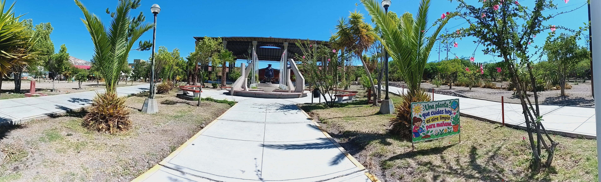

* **Archivo:** `Vista_Principal_Panorama2.jpg`
* **Subtítulo:** Un acceso seguro y ordenado para recibir a estudiantes y familias.
* **Descripción:** Vista frontal del ingreso principal y del frente institucional. Es útil para orientar a las familias postulantes y comunicar los aspectos de seguridad, recepción y organización cotidiana del plantel.
* **Alt text:** Vista frontal de la entrada principal de los Planteles de Aplicación Guamán Poma de Ayala.

### INF-03 — Patio principal

**Nivel:** Institucional  
**Uso recomendado:** vida escolar, ceremonias, recreos y presentación general.

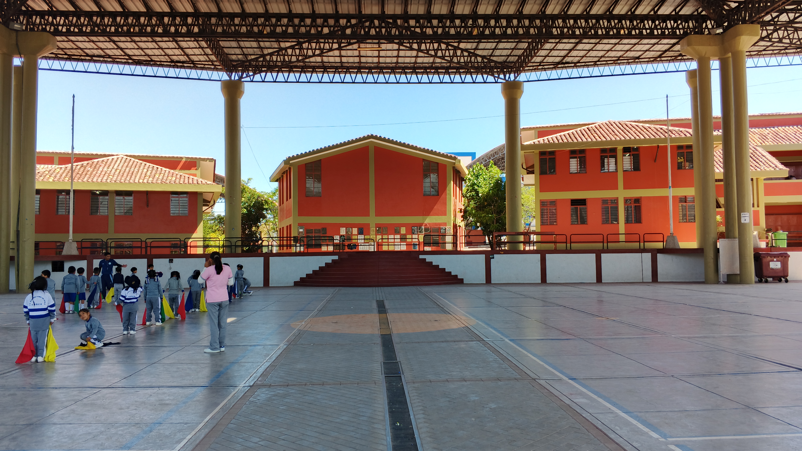

* **Archivo:** `Patio_Principal.jpg`
* **Subtítulo:** Espacio central para la convivencia, el aprendizaje y las actividades escolares.
* **Descripción:** Registro general del patio principal, empleado como punto de encuentro y apoyo a actividades formativas. La composición permite mostrar la arquitectura cubierta y el flujo de circulación dentro del campus.
* **Alt text:** Patio principal institucional rodeado por pasajes y edificios del plantel.

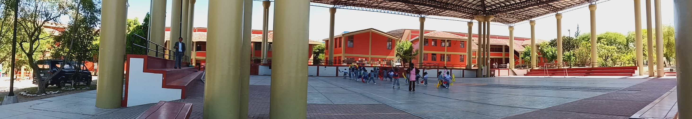

* **Archivo:** `Patio_Principal_Ampliado_Panorama2.jpg`
* **Subtítulo:** Una perspectiva amplia del espacio central de convivencia.
* **Descripción:** Vista panorámica ampliada del patio principal, útil para explicar su escala, conexión con los pabellones y capacidad para distintas reuniones escolares.
* **Alt text:** Vista panorámica ampliada del patio principal y sus áreas de circulación.

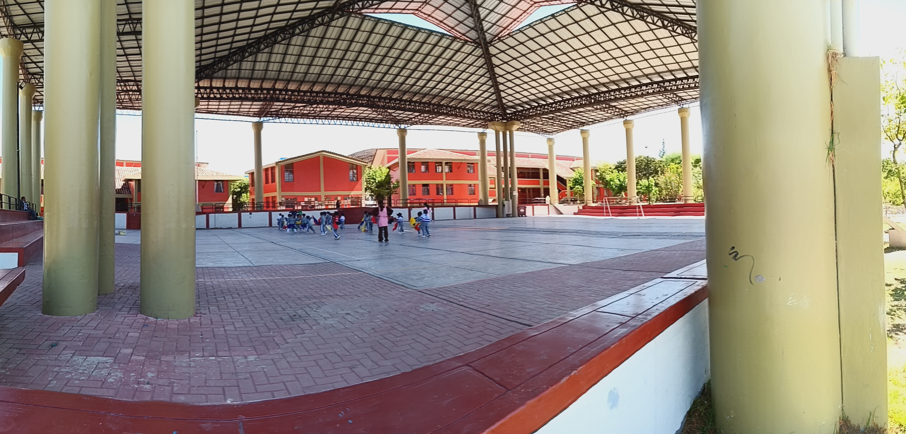

* **Archivo:** `Patio_Principal_Panorama1.jpg`
* **Subtítulo:** El campus visto desde su eje de convivencia.
* **Descripción:** Panorama horizontal del patio principal que destaca su organización arquitectónica y su relación con los espacios educativos cercanos.
* **Alt text:** Panorámica del patio central con columnas, pasajes y edificaciones.

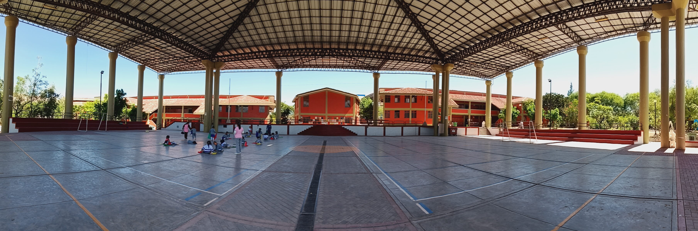

* **Archivo:** `Patio_Principal_Panorama2.jpg`
* **Subtítulo:** Otra perspectiva de la vida cotidiana en el patio institucional.
* **Descripción:** Segunda composición del patio principal; complementa la vista anterior al mostrar diferentes ángulos y conexiones visuales entre el área central y los pabellones.
* **Alt text:** Segunda vista panorámica del patio principal del plantel.

### INF-04 — Patio y pabellón de Secundaria

**Nivel:** Secundaria  
**Ubicación:** Patio principal y pabellón secundario  
**Uso recomendado:** presentación del nivel secundario y espacios compartidos

| Ficha visual 1 | Ficha visual 2 |
|---|---|
| [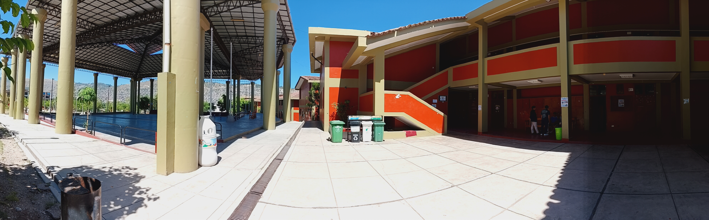](Archivos_PAGPA/Patio_Principal_y_Pabellón_Secundaria_Panorama1.jpg)  **Archivo:** `Patio_Principal_y_Pabellón_Secundaria_Panorama1.jpg` **Bajada:** Patio principal integrado al entorno de Secundaria. **Descripción:** Vista del espacio compartido desde su zona central. **Alt text:** Patio principal junto al pabellón educativo de Secundaria. | [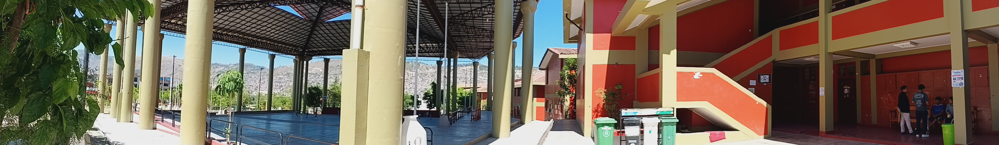](Archivos_PAGPA/Patio_Principal_y_Pabellón_Secundaria_Panorama2.jpg)  **Archivo:** `Patio_Principal_y_Pabellón_Secundaria_Panorama2.jpg` **Bajada:** Otra perspectiva de circulación y recreación. **Descripción:** Presenta el pabellón desde un punto complementario del patio. **Alt text:** Segunda vista del pabellón y el patio principal de Secundaria. |

| Ficha visual 3 | |
|---|---|
| [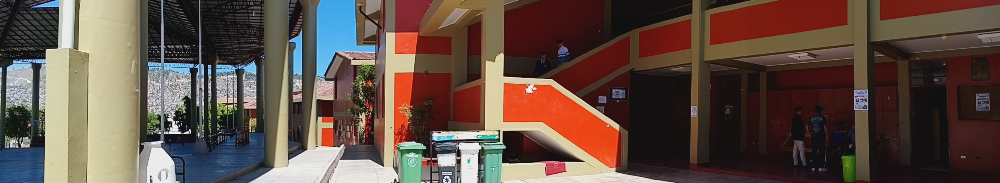](Archivos_PAGPA/Patio_Principal_y_Pabellón_Secundaria_Panorama3.jpg)  **Archivo:** `Patio_Principal_y_Pabellón_Secundaria_Panorama3.jpg` **Bajada:** Accesos y entorno del nivel secundario. **Descripción:** Panorama amplio que relaciona los pabellones con los espacios de convivencia. **Alt text:** Vista panorámica del ingreso y entorno del pabellón de Secundaria. | |

* **Archivos:** `Patio_Principal_y_Pabellón_Secundaria_Panorama1.jpg`, `Panorama2.jpg` y `Panorama3.jpg`
* **Subtítulo:** Espacios de Secundaria integrados a la dinámica cotidiana del plantel.
* **Descripción:** Conjunto de registros que muestran el patio principal desde su relación con el pabellón de Secundaria. Permiten evidenciar circulación, recreación, acceso a aulas y convivencia escolar en el nivel secundario.
* **Alt text:** Diferentes vistas del patio principal y el pabellón educativo de Secundaria.

### INF-05 — Pabellón de Primaria

**Nivel:** Primaria  
**Uso recomendado:** presentación de aulas y espacios pedagógicos de Primaria.

[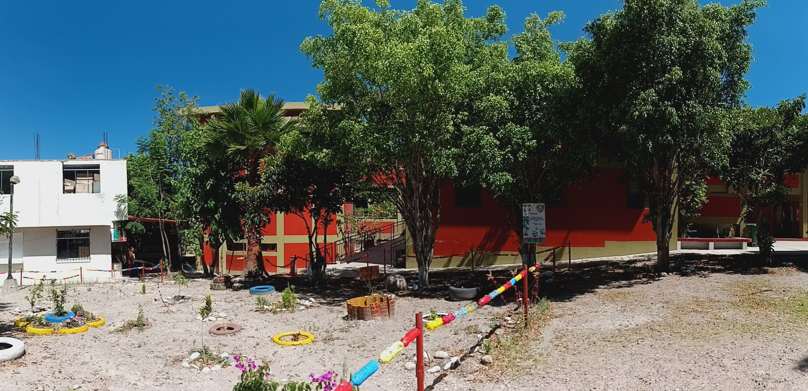](Archivos_PAGPA/Pabellón_Primaria_Panorama1.jpg)

* **Archivo:** `Pabellón_Primaria_Panorama1.jpg`
* **Subtítulo:** Un pabellón organizado para acompañar los aprendizajes de Primaria.
* **Descripción:** Panorama del pabellón correspondiente al nivel de Primaria. La imagen puede apoyar información sobre aulas, circulación protegida y proximidad a patios y áreas educativas.
* **Alt text:** Vista panorámica del pabellón educativo destinado a Primaria.

---

## 4. Deporte y recreación

### DEP-01 — Losa principal

**Nivel:** Inicial, Primaria y Secundaria  
**Uso recomendado:** presentación deportiva, noticias de infraestructura y admisión.

| Imagen | Archivo |
|---|---|
| 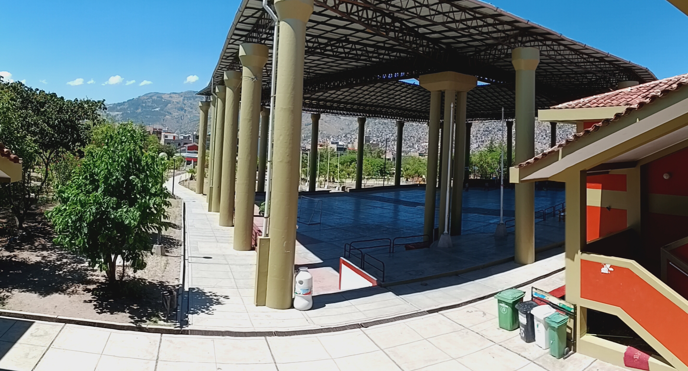 | `Losa_Principal_Panorama.jpg` |

* **Subtítulo:** Cobertura deportiva amplia para practicar, convivir y competir con seguridad.
* **Descripción:** Vistas panorámicas de la losa principal techada. El espacio permite desarrollar educación física, deporte escolar y encuentros institucionales bajo protección frente a la radiación solar.
* **Alt text:** Dos vistas panorámicas de la losa deportiva principal cubierta del plantel.

### DEP-02 — Losa de fútbol

**Nivel:** Primaria y Secundaria  
**Ubicación:** Complejo deportivo cubierto  
**Uso recomendado:** fútbol, educación física, recreos y eventos deportivos

**Bajada:** Una losa reglamentaria para practicar deporte, fortalecer la disciplina y trabajar en equipo.

**Descripción institucional:** La losa de fútbol forma parte de la infraestructura deportiva cubierta del plantel. Permite desarrollar sesiones de educación física y encuentros escolares con protección frente al sol y la lluvia.

| Ficha visual 1 | Ficha visual 2 |
|---|---|
| [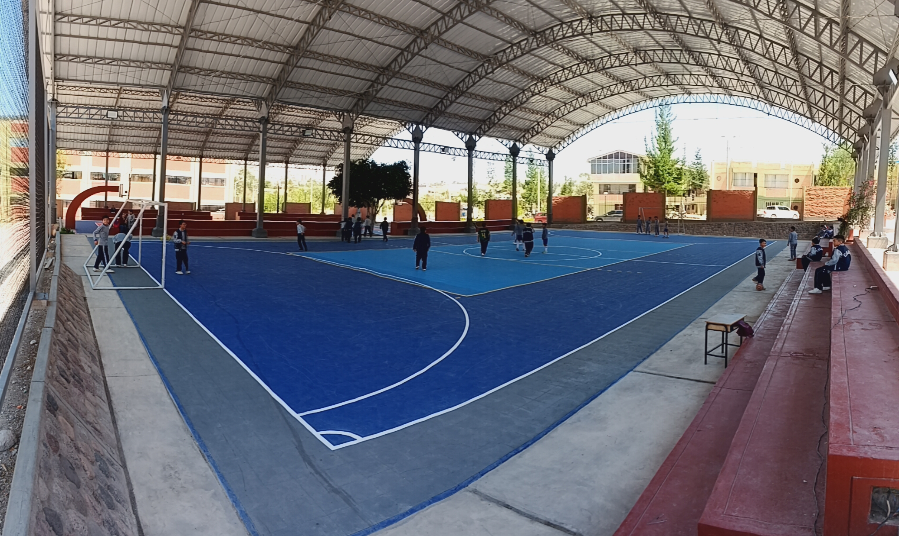](Archivos_PAGPA/Losa_Deportiva_Futbol_Panorama.jpg)  **Archivo:** `Losa_Deportiva_Futbol_Panorama.jpg` **Subtítulo:** Vista general de la losa y su cobertura. **Descripción:** Muestra la superficie deportiva, las demarcaciones y la estructura que protege a los participantes. **Alt text:** Vista panorámica frontal de la losa de fútbol techada del plantel. | [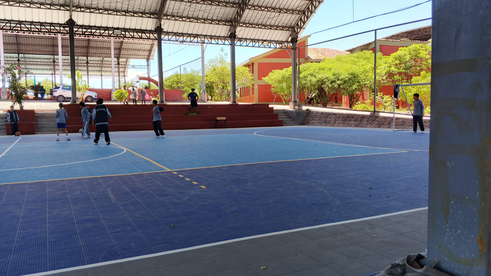](Archivos_PAGPA/Losa_Deportiva_Futbol_Panorama2.jpg)  **Archivo:** `Losa_Deportiva_Futbol_Panorama2.jpg` **Subtítulo:** Perspectiva lateral de la infraestructura deportiva. **Descripción:** Evidencia el alcance de la cancha, el techo y la relación con los pabellones cercanos. **Alt text:** Vista lateral de la losa deportiva de fútbol cubierta y sus graderías. |

| Ficha visual 3 | Ficha visual 4 |
|---|---|
| [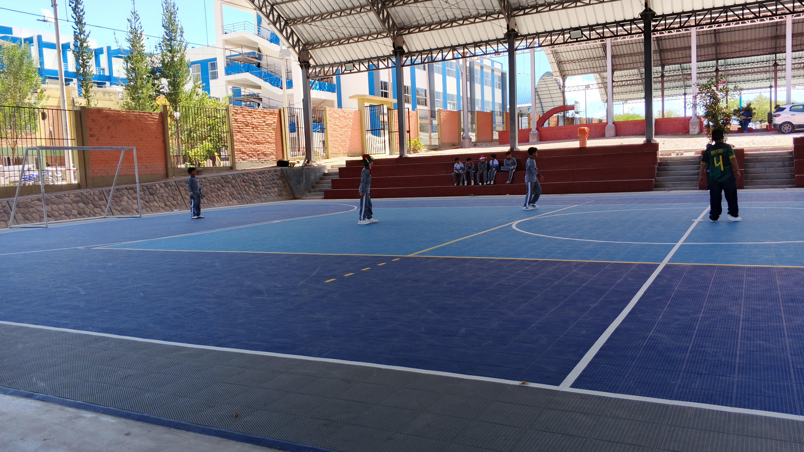](Archivos_PAGPA/Losa_Deportiva_Futbol_Panorama3.jpg)  **Archivo:** `Losa_Deportiva_Futbol_Panorama3.jpg` **Subtítulo:** Espacio amplio para prácticas y encuentros deportivos. **Descripción:** Permite apreciar la cancha desde una posición más amplia y comprender su capacidad de uso. **Alt text:** Vista panorámica completa de la losa de fútbol dentro del plantel. | [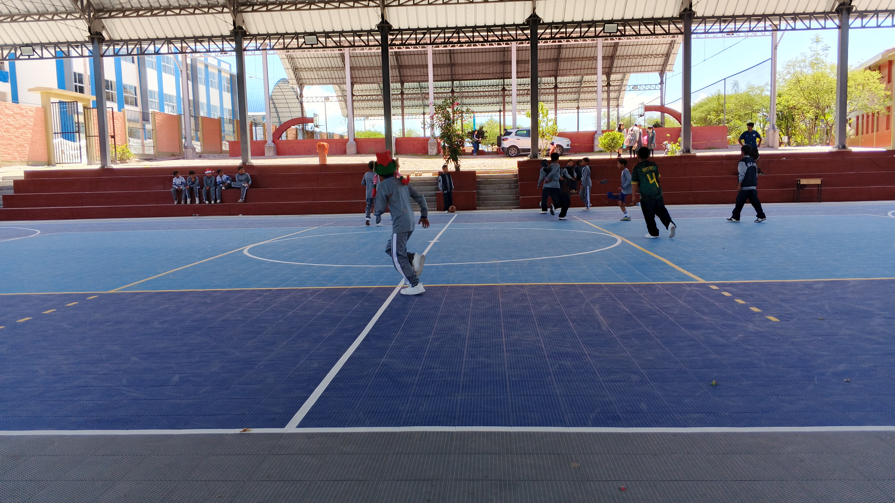](Archivos_PAGPA/Losa_Deportiva_Futbol_Panorama4.jpg)  **Archivo:** `Losa_Deportiva_Futbol_Panorama4.jpg` **Subtítulo:** El fondo de la cancha como parte del entorno deportivo. **Descripción:** Registra las zonas perimetrales, las líneas de juego y la protección superior. **Alt text:** Vista desde el fondo de la losa de fútbol techada del plantel. |

| Ficha visual 5 | Ficha visual 6 |
|---|---|
| [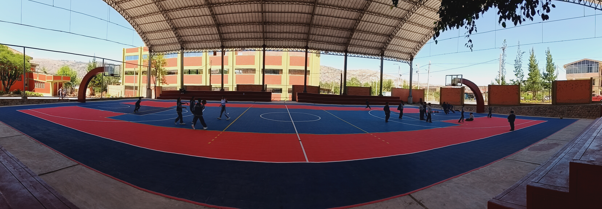](Archivos_PAGPA/Losa_Deportiva_Futbol_Panorama5.jpg)  **Archivo:** `Losa_Deportiva_Futbol_Panorama5.jpg` **Subtítulo:** Sector central de la losa deportiva. **Descripción:** Presenta la distribución central de la cancha y su integración con las zonas de circulación. **Alt text:** Vista central de la losa de fútbol y sus líneas reglamentarias. | [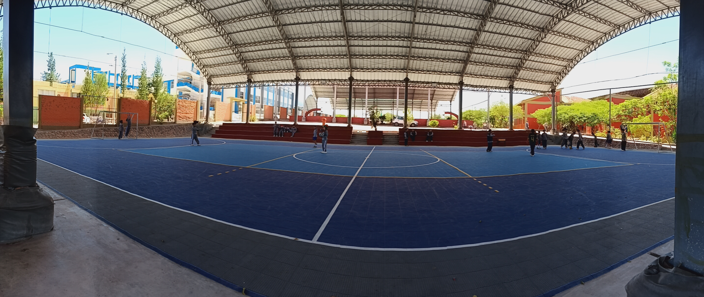](Archivos_PAGPA/Losa_Deportiva_Futbol_Panorama6.jpg)  **Archivo:** `Losa_Deportiva_Futbol_Panorama6.jpg` **Subtítulo:** Una perspectiva complementaria para la galería deportiva. **Descripción:** Cierra la serie panorámica y ofrece un nuevo ángulo del espacio cubierto. **Alt text:** Vista complementaria de la losa de fútbol desde otro sector del plantel. |

### DEP-03 — Losa de básquet

**Nivel:** Primaria y Secundaria  
**Ubicación:** Complejo deportivo cubierto  
**Uso recomendado:** básquet, vóley, recreación deportiva y eventos estudiantiles

**Bajada:** Una losa multifuncional para practicar deporte y promover actividad física diaria.

| Ficha visual 1 | Ficha visual 2 |
|---|---|
| [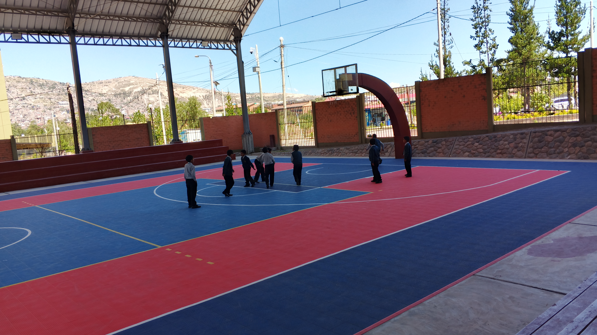](Archivos_PAGPA/Losa_Deportiva_Basquet_Panorama.jpg)  **Archivo:** `Losa_Deportiva_Basquet_Panorama.jpg` **Descripción:** Vista general de la losa y su configuración para diferentes disciplinas. **Alt text:** Vista frontal de la losa deportiva de básquet bajo techo. | [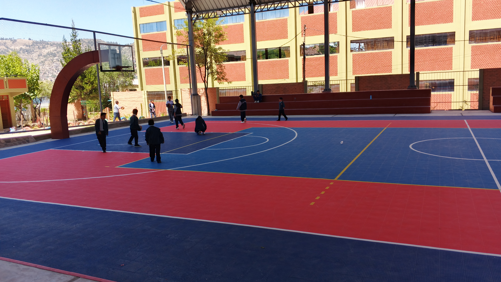](Archivos_PAGPA/Losa_Deportiva_Basquet_Panorama2.jpg)  **Archivo:** `Losa_Deportiva_Basquet_Panorama2.jpg` **Descripción:** Presenta una perspectiva lateral de las demarcaciones y las zonas de juego. **Alt text:** Segunda vista de la losa de básquet techada del plantel. |

| Ficha visual 3 | |
|---|---|
| [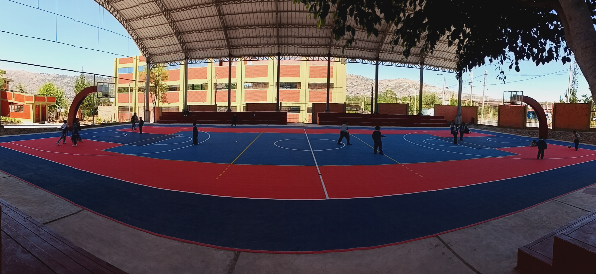](Archivos_PAGPA/Losa_Deportiva_Basquet_Panorama3.jpg)  **Archivo:** `Losa_Deportiva_Basquet_Panorama3.jpg` **Descripción:** Muestra la relación de la losa con la cobertura y los accesos del complejo deportivo. **Alt text:** Vista complementaria de la losa de básquet y su entorno cubierto. | |

**Descripción institucional:** Esta losa permite desarrollar juegos, entrenamientos y encuentros deportivos dentro de una infraestructura cubierta y adaptable a distintas actividades.

### DEP-04 — Actividades recreativas con estudiantes

**Nivel:** Inicial, Primaria y Secundaria  
**Uso recomendado:** evidencia de participación y vida estudiantil.

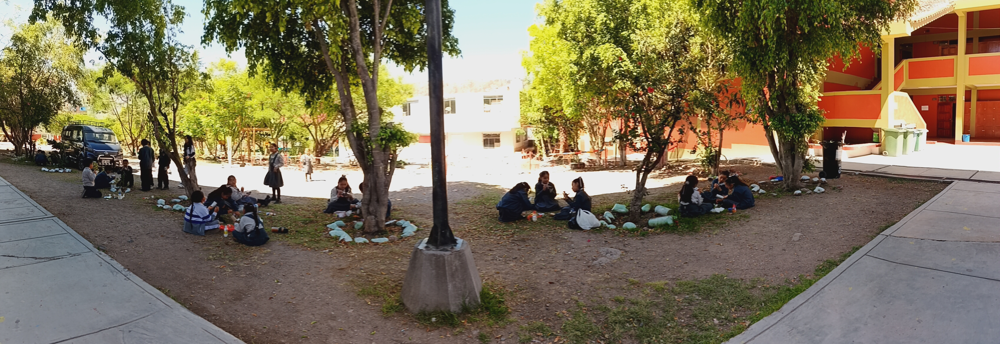

* **Archivo:** `Actividad_Escolar_Primaria_Panorama1.jpg`
* **Subtítulo:** Estudiantes participando activamente en dinámicas escolares supervisadas.
* **Descripción:** Registro panorámico de una actividad desarrollada en el patio. La imagen muestra el acompañamiento pedagógico, la participación estudiantil y la convivencia dentro de un espacio deportivo o recreativo.
* **Alt text:** Estudiantes de Primaria reunidos en una actividad escolar dentro del patio del plantel.

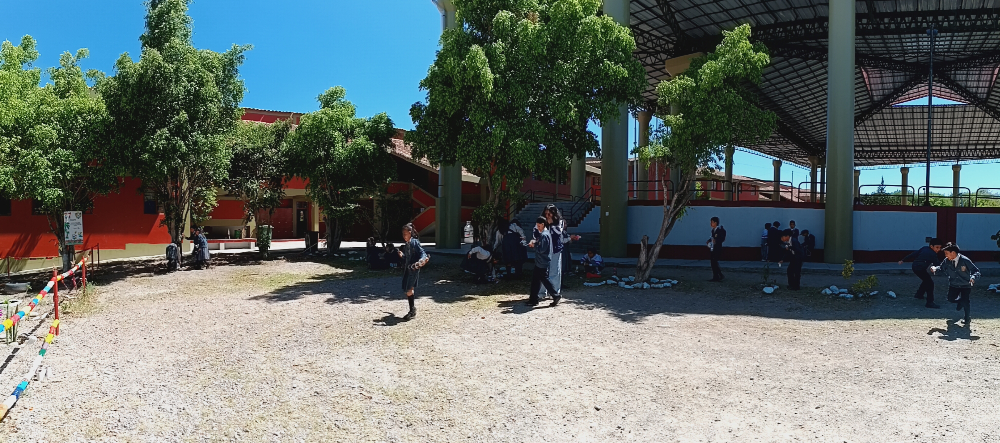

* **Archivo:** `Actividad_Escolar_Primaria_Panorama2.jpg`
* **Subtítulo:** Participación estudiantil y organización en el espacio escolar.
* **Descripción:** Segundo plano de la actividad estudiantil, útil para mostrar dinámica grupal, desplazamiento y trabajo colectivo en un entorno supervisado.
* **Alt text:** Segundo plano panorámico de una actividad formativa realizada por estudiantes de Primaria.

---

## 5. Nivel Inicial y recreación temprana

### INI-01 — Área recreativa del nivel Inicial

**Nivel:** Inicial  
**Ubicación:** Patio recreativo infantil  
**Uso recomendado:** presentación del nivel, psicomotricidad y juego seguro

**Bajada:** Juegos adaptados que estimulan movimiento, autonomía y socialización temprana.

| Ficha visual 1 | Ficha visual 2 |
|---|---|
| [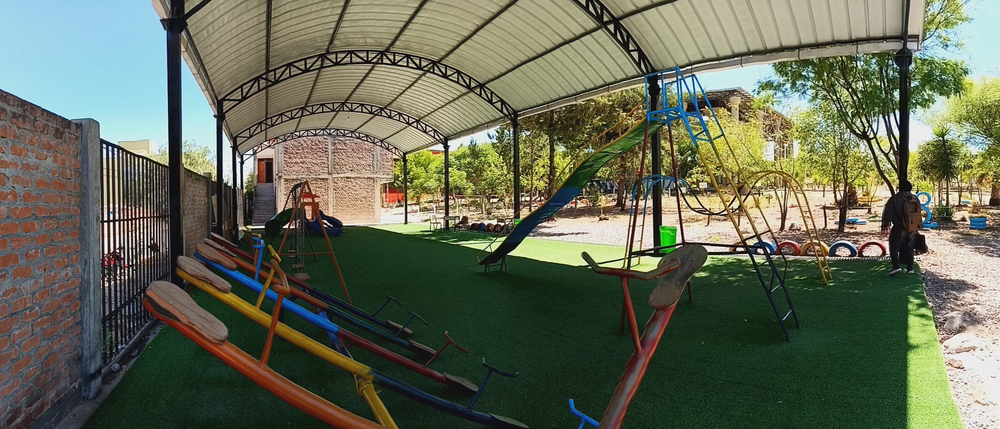](Archivos_PAGPA/Area_Recreativa_Inicial_Panorama2.jpg)  **Archivo:** `Area_Recreativa_Inicial_Panorama2.jpg` **Descripción:** Vista amplia de los juegos infantiles y su entorno protegido. **Alt text:** Área recreativa del nivel Inicial con juegos y superficie segura. | [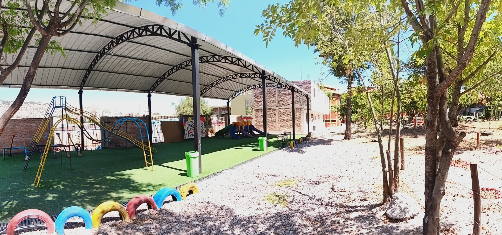](Archivos_PAGPA/Area_Recreativa_Inicial_Panorama3.jpg)  **Archivo:** `Area_Recreativa_Inicial_Panorama3.jpg` **Descripción:** Perspectiva complementaria del patio recreativo infantil. **Alt text:** Segunda vista de los juegos y el patio recreativo de Inicial. |

| Ficha visual 3 | Ficha visual 4 |
|---|---|
| [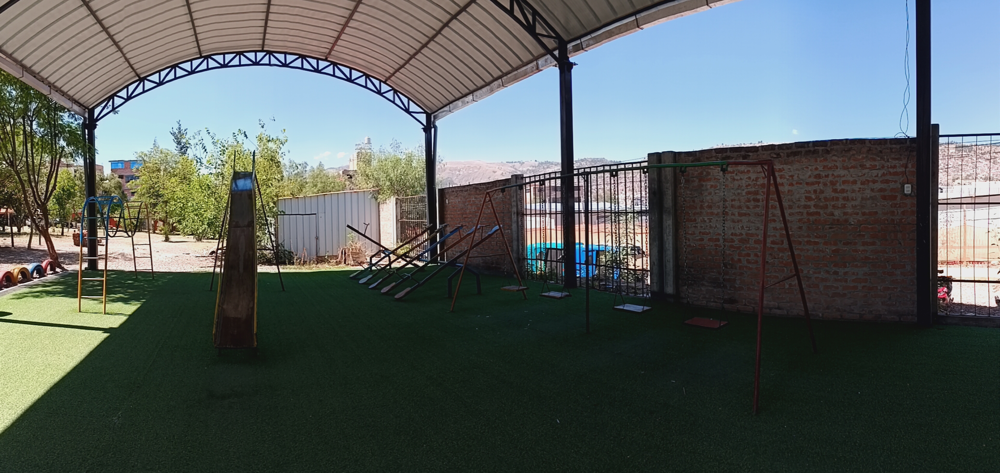](Archivos_PAGPA/Area_Recreativa_Inicial_Panorama4.jpg)  **Archivo:** `Area_Recreativa_Inicial_Panorama4.jpg` **Descripción:** Equipamiento infantil dentro de un espacio techado o protegido. **Alt text:** Juegos infantiles instalados en el área recreativa de Inicial. | [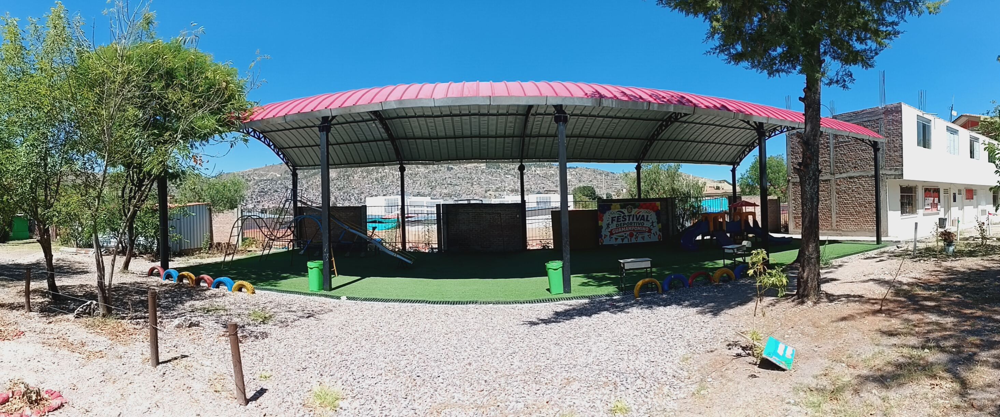](Archivos_PAGPA/Area_Recreativa_Inicial_Panorama5.jpg)  **Archivo:** `Area_Recreativa_Inicial_Panorama5.jpg` **Descripción:** Relación entre los juegos, el piso y las áreas verdes cercanas. **Alt text:** Vista panorámica del área infantil rodeada de zonas verdes. |

**Descripción institucional:** El área recreativa brinda oportunidades de juego dirigido y libre bajo supervisión, favoreciendo el desarrollo psicomotor y la integración social en la primera infancia.

### AMB-01 — Áreas verdes principales

**Nivel:** Institucional  
**Ubicación:** Jardines y zonas verdes del campus  
**Uso recomendado:** cuidado ambiental, descanso, proyectos ecológicos e identidad visual

**Bajada:** Espacios naturales que favorecen el descanso, la observación y la educación ambiental.

| Ficha visual 1 | Ficha visual 2 |
|---|---|
| [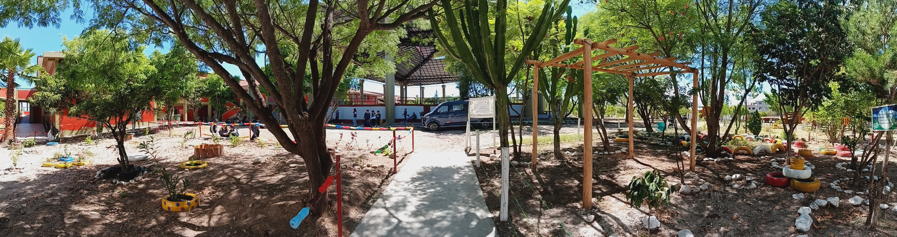](Archivos_PAGPA/Areas_verdes_Dirección_Panorama.jpg)  **Archivo:** `Areas_verdes_Dirección_Panorama.jpg` **Descripción:** Jardines próximos al área de Dirección y las zonas administrativas. **Alt text:** Área verde y senderos cercanos a la Dirección del plantel. | [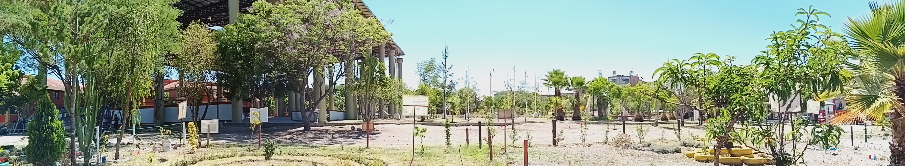](Archivos_PAGPA/Areas_verdes_PAGPA_Panorama.jpg)  **Archivo:** `Areas_verdes_PAGPA_Panorama.jpg` **Descripción:** Panorama de los jardines distribuidos dentro del campus institucional. **Alt text:** Jardines, árboles y áreas verdes dentro de los Planteles PAGPA. |

| Ficha visual 3 | Ficha visual 4 |
|---|---|
| [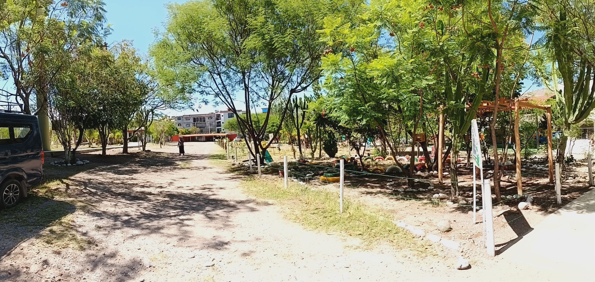](Archivos_PAGPA/Areas_verdes_Primaria_Panorama.jpg)  **Archivo:** `Areas_verdes_Primaria_Panorama.jpg` **Descripción:** Entorno verde vinculado a los espacios del nivel de Primaria. **Alt text:** Jardines y vegetación en el área de Primaria del plantel. | [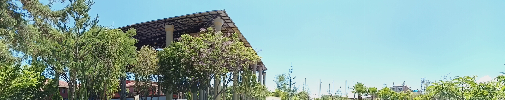](Archivos_PAGPA/Areas_verdes_y_Cielo_PAGPA.jpg)  **Archivo:** `Areas_verdes_y_Cielo_PAGPA.jpg` **Descripción:** Vista abierta de los jardines que relaciona vegetación y paisaje institucional. **Alt text:** Áreas verdes del plantel junto al cielo y los edificios. |

**Descripción institucional:** Las panorámicas muestran jardines y sectores naturales útiles para el descanso, la observación y proyectos de cuidado ambiental dentro de la vida escolar.

### AMB-02 — Patio verde junto a la Dirección

**Nivel:** Institucional  
**Uso recomendado:** espacios de acogida, administración y ambiente natural.

* **Archivo:** `Areas_verdes_Dirección_Panorama.jpg`
* **Subtítulo:** Un entorno verde que humaniza el acceso a los espacios institucionales.
* **Descripción:** Vista del área verde próxima a la Dirección y zonas administrativas. Refuerza una percepción institucional accesible y cuidada.
* **Alt text:** Jardines y senderos ubicados cerca del área de Dirección del plantel.

### AMB-03 — Jardines y huertos estudiantiles

**Nivel:** Inicial, Primaria y Secundaria  
**Uso recomendado:** educación ambiental, proyectos de ciencias y cuidado escolar.

* **Archivos disponibles:** `Areas_verdes_PAGPA_Panorama.jpg`, `Areas_verdes_Primaria_Panorama.jpg` y `Areas_verdes_y_Cielo_PAGPA.jpg`
* **Subtítulo:** Los espacios verdes como laboratorio vivo para aprender a cuidar el entorno.
* **Descripción:** Los registros muestran vegetación, jardines y sectores preparados dentro del campus. Pueden acompañar noticias o proyectos sobre reciclaje, siembra, biodiversidad y responsabilidad ambiental.
* **Alt text:** Jardines, plantas y árboles distribuidos en los espacios verdes del colegio.

---

## 7. Tecnología educativa

### TEC-01 — Sala de cómputo

**Nivel:** Primaria y Secundaria  
**Ubicación:** Laboratorio de cómputo  
**Uso recomendado:** competencias digitales, innovación, investigación y recursos tecnológicos

**Bajada:** Equipos de cómputo al servicio de competencias digitales, investigación y aprendizaje.

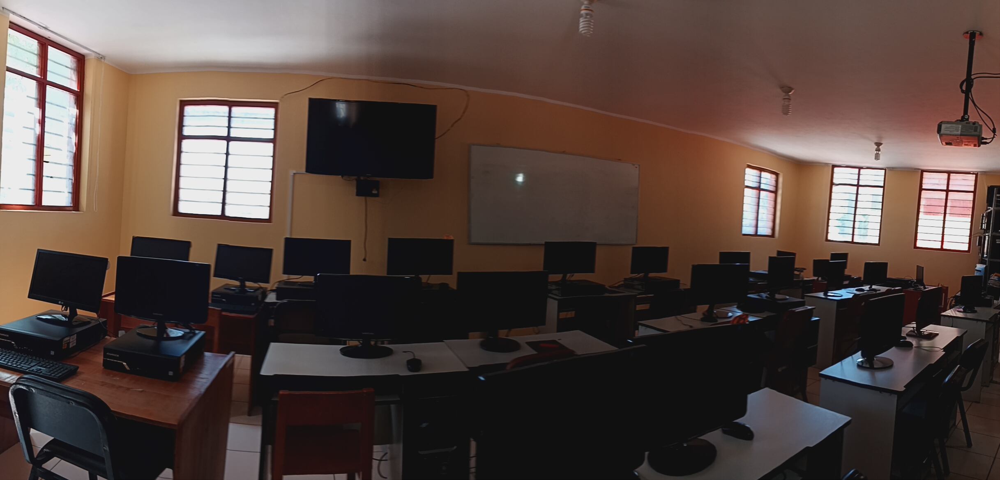

* **Archivo:** `Salón_computo_Panorama1.jpg`
* **Descripción:** Panorama del laboratorio con estaciones de trabajo, escritorios y monitor de uso pedagógico. Evidencia infraestructura disponible para ofimática, programación básica, investigación y acompañamiento docente.
* **Alt text:** Sala de cómputo con computadoras organizadas para sesiones de aprendizaje digital.

---

## 8. Catálogo audiovisual

Los videos pueden abrirse directamente desde el enlace correspondiente. Para la plataforma web, se recomienda configurar una portada, reproducción manual y controles visibles.

### VID-01 — Entrada de los Planteles Guamán Poma

**Nivel:** Institucional

* [Video horizontal — entrada](Archivos_PAGPA/Videos/Horizontal_Entrada_Planteles_GuamanPoma.mp4)

**Subtítulo:** Bienvenida visual al ingreso principal del plantel.  
**Descripción:** Recorridos horizontales que muestran la fachada, el acceso y la recepción institucional.

### VID-02 — Vista general del plantel

**Nivel:** Institucional

* [Video horizontal — vista general](Archivos_PAGPA/Videos/Horizontal_Vista_General_Planteles_GuamanPoma.mp4)

**Subtítulo:** Una mirada panorámica del campus y su infraestructura.  
**Descripción:** Presenta el conjunto escolar, sus pabellones y áreas compartidas.

### VID-03 — Losa principal

**Nivel:** Inicial, Primaria y Secundaria

* [Video horizontal — losa principal](Archivos_PAGPA/Videos/Horizontal_Losa_Principal.mp4)
* [Video horizontal — losa principal 2](Archivos_PAGPA/Videos/Horizontal_Losa_Principal2.mp4)

**Subtítulo:** Recorrido por la infraestructura deportiva principal.

### VID-04 — Losa principal y Secundaria

**Nivel:** Secundaria

* [Video horizontal — losa y Secundaria](Archivos_PAGPA/Videos/Horizontal_Losa_Principal_y_Secundaria.mp4)

**Subtítulo:** Conexión visual entre el patio deportivo y el nivel secundario.

### VID-05 — Losa de fútbol

**Nivel:** Primaria y Secundaria

* [Video horizontal — losa de fútbol](Archivos_PAGPA/Videos/Horizontal_Losa_Deportiva_Futbol.mp4)

**Subtítulo:** Práctica deportiva en una losa reglamentada y techada.

### VID-06 — Áreas verdes y patio principal de Secundaria

**Nivel:** Secundaria e Institucional

* [Video horizontal — áreas verdes y patio](Archivos_PAGPA/Videos/Horizontal_Areas_Verdes_Patio_Principal_Secundaria.mp4)

**Subtítulo:** Áreas verdes y convivencia en el entorno de Secundaria.

### VID-07 — Actividades recreativas con estudiantes

**Nivel:** Inicial, Primaria y Secundaria

* [Video horizontal — actividades recreativas](Archivos_PAGPA/Videos/Horizontal_Actividades_Recreativas.mp4)

**Subtítulo:** Participación estudiantil en actividades recreativas y deportivas.  
**Descripción:** Muestra la interacción de estudiantes en el patio principal durante diversas dinámicas grupales.

### VID-08 — Actividades de Primaria

**Nivel:** Primaria

* [Video horizontal — actividad de Primaria](Archivos_PAGPA/Videos/Horizontal_Actividad_Primaria.mp4)

**Subtítulo:** Vida estudiantil y participación en actividades escolares.

## 9. Mapeo de la infraestructura

| Sección de la plataforma | Activos prioritarios |
|---|---|
| Presentación institucional | Vista general, entrada principal y patio principal |
| Nivel Inicial | Zona de juegos, áreas recreativas, áreas verdes y actividades |
| Nivel Primaria | Pabellón, actividades escolares, patios y losas deportivas |
| Nivel Secundaria | Pabellón, patios, losas principales y prácticas deportivas |
| Instalaciones deportivas | Losa principal, fútbol, básquet y videos deportivos |
| Tecnología educativa | Sala de cómputo |
| Medio ambiente | Áreas verdes del plantel |
| Videos de admisión | Entrada, vista general, losa principal y actividades |

