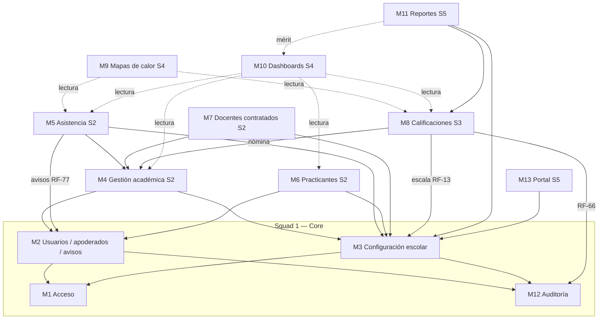
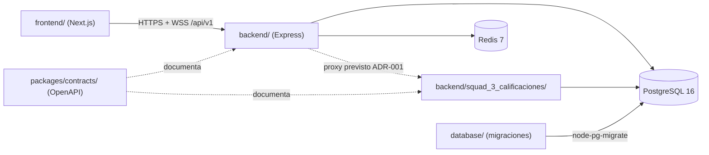

# 02 — Dependencias

## 1. Dependencias entre módulos

Las flechas indican "depende de". El Core (S1) no depende de ningún otro squad.

Las líneas punteadas son **solo lectura** de datos agregados (vistas `vm_*` filtradas por tenant, ADR-003 §3). Ningún módulo escribe datos de otro.

## 2. Reglas de dirección

| Regla | Cómo se comprueba hoy |
|---|---|
| El frontend nunca accede a la base de datos; solo al backend por `/api/v1` | El frontend no tiene dependencia `pg` (revisión de `frontend/package.json`) |
| El frontend usa un solo cliente HTTP | `useCoreSession().request` y `frontend/modules/shared/api/`; revisión de código |
| El tenant sale del JWT, nunca del navegador (ADR-002) | Las rutas protegidas llaman `withTenant(req.user.tenantId, …)`, que `authenticateJwt` carga desde la sesión verificada |
| Ningún módulo usa `pool.query` con datos de tenant fuera de `withTenant()` (ADR-003 §2) | Revisión de código; la regla de lint está pendiente |
| Un módulo no importa archivos internos de otro módulo | Revisión de código; aplica a `backend/src/modules/*` cuando exista |
| Los squads 2–5 no importan desde `squad_1_core` salvo `SessionProvider` (`useCoreSession`) | Revisión de código |
| El dominio no importa Express ni React | Aplica a código nuevo bajo `backend/src/modules/*/domain` |
| M8 solo se alcanza desde el gateway del backend común (ADR-001) | Pendiente: el gateway no existe |

## 3. Dependencias técnicas entre proyectos

`packages/contracts` todavía no genera tipos: `frontend/` y `backend/` no lo importan. Cuando se adopte `openapi-typescript` (ADR-005 §5), ambos dependerán de los tipos generados, nunca al revés.

## 4. Riesgos de acoplamiento

- **Ciclo potencial S2 ↔ S1:** S1 necesita estudiantes para vincular apoderados (RF-75) y S2 necesita personas de S1. Se evita porque ambos referencian `personas` (de S1); S1 no consulta `matriculas`.
- **Analítica sobre tablas de otros squads:** S4 solo lee vistas agregadas; si necesita una columna nueva, la pide al dueño de la tabla.
- **Errores divergentes (P-05):** un consumidor que filtre por `code` se rompe al unificar el catálogo. La unificación debe hacerse antes de que otros squads consuman el Core.
